<div align="center">

<p>
  <a href="https://github.com/SubhransuNayak007/muxaro">
    
  </a>
</p>

# MUXARO

**Your Media. One Powerful Workspace.**

A full-stack, self-hostable media processing workspace for inspecting, converting, compressing, extracting audio from, merging, and packaging permitted media — built with Next.js 14, Fastify 5, Node.js 24, and FFmpeg.

<p>
  <a href="https://muxaro.pages.dev/">
    
  </a>
  <a href="https://github.com/SubhransuNayak007/muxaro/actions/workflows/ci.yml">
    
  </a>
  <a href="https://github.com/SubhransuNayak007/muxaro/actions/workflows/security.yml">
    
  </a>
  <a href="https://github.com/SubhransuNayak007/muxaro/actions/workflows/codeql.yml">
    
  </a>
  <a href="https://github.com/SubhransuNayak007/muxaro/releases">
    
  </a>
  <a href="LICENSE">
    
  </a>
  
  
</p>

<p>
  <a href="https://muxaro.pages.dev/"><strong>Live App</strong></a> ·
  <a href="#overview">Overview</a> ·
  <a href="#features">Features</a> ·
  <a href="#product-screenshots">Screenshots</a> ·
  <a href="#architecture-overview">Architecture</a> ·
  <a href="#getting-started">Getting Started</a> ·
  <a href="#api-reference">API Reference</a> ·
  <a href="#security">Security</a> ·
  <a href="#deployment">Deployment</a>
</p>

<br />

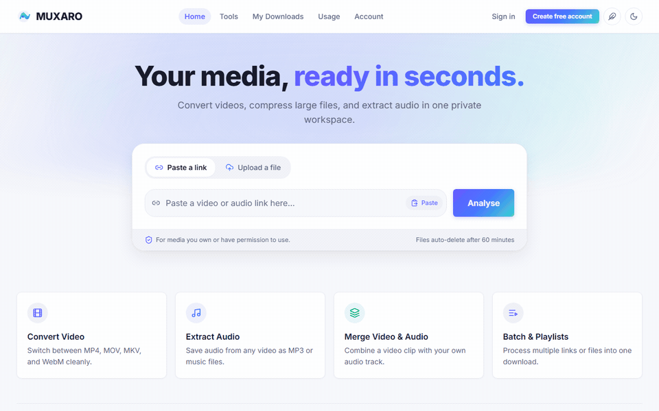

</div>

---

## Overview

**MUXARO** is a modular TypeScript monorepo that combines a consumer-grade web workspace (`apps/web`), a Fastify 5 REST and Server-Sent Events API (`apps/api`), a standalone FFmpeg/FFprobe media worker microservice (`apps/media-worker`), and reusable entitlements, source-adapter, and security packages.

MUXARO is engineered for **permitted and user-owned media workflows**:

- Inspect genuine video and audio stream parameters (resolution, codec, frame rate, HDR/SDR, file size) via `ffprobe` without fake upscaling or bitrate inflation.
- Remux lossless streams when containers are compatible (`-c copy`), or transcode and compress into `MP4`, `MKV`, `WebM`, `MP3`, `M4A`, `Opus`, `WAV`, or `FLAC`.
- Deliver verified artifacts via HMAC-SHA256 signed download tokens with full RFC 9110 HTTP `Range` support and automatic 60-minute retention cleanup.

---

## Features

- **Genuine Stream Inspection:** Probes permitted URLs and local uploads (up to 2 GB via single-stream or resumable 5 MB chunked multipart uploads) to expose real codecs, dimensions, frame rates, and containers.
- **Video Conversion & Compression:** Convert between `MP4`, `MKV`, and `WebM`, prefer lossless stream-copy remuxing when compatible, or compress large recordings to `720p` / `480p`.
- **Audio Extraction:** Extract original audio tracks without re-encoding or transcode to `MP3`, `M4A`, `Opus`, `WAV`, or `FLAC`, with explicit lossy-to-lossless disclosure when source audio is already compressed.
- **Audio/Video Merging:** Combine separate video and audio sources with optional millisecond audio offset synchronization.
- **Batch & Playlist Processing:** Process multi-item batches (`MXB-YYYYMMDD-XXXXXX`) with zero-padded `001`–`050` item numbering, per-item tracking, cancellation, and ZIP archive packaging.
- **TurboFlow 6-Class, 3-Tier Priority Queue:** Isolates workloads across `instant-processing`, `audio-processing`, `merge-processing`, `video-transcoding`, `high-resolution-processing`, and `playlist-packaging` queues with weighted fair scheduling (`PREMIUM=6`, `REGISTERED=3`, `GUEST=1`) and anti-starvation aging.
- **Real-Time Progress & Verification:** Live Server-Sent Events (SSE) progress updates, post-render `ffprobe` playability verification, SHA-256 artifact checksums, and 60-minute automatic artifact deletion.
- **Account Platform, Quotas & Security:** Cookie-based sessions with CSRF protection, Argon2id password hashing, Google OAuth 2.0 (Authorization Code + PKCE + JWKS RS256), RFC 6238 TOTP Admin MFA, rolling 24-hour atomic quota reservations, append-only credit ledger, optional Google Ad Manager ECDSA-SHA256 SSV rewarded credits, SSRF DNS/IP guard, and multi-layer rate limiting.

---

## Product Screenshots

All screenshots below were captured directly from the live MUXARO application running locally using a royalty-free synthetic test video generated with FFmpeg.

| Workspace Home | Media Inspection |
| :---: | :---: |
| 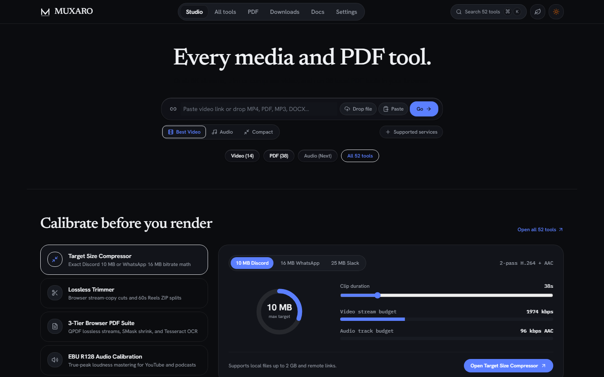 | 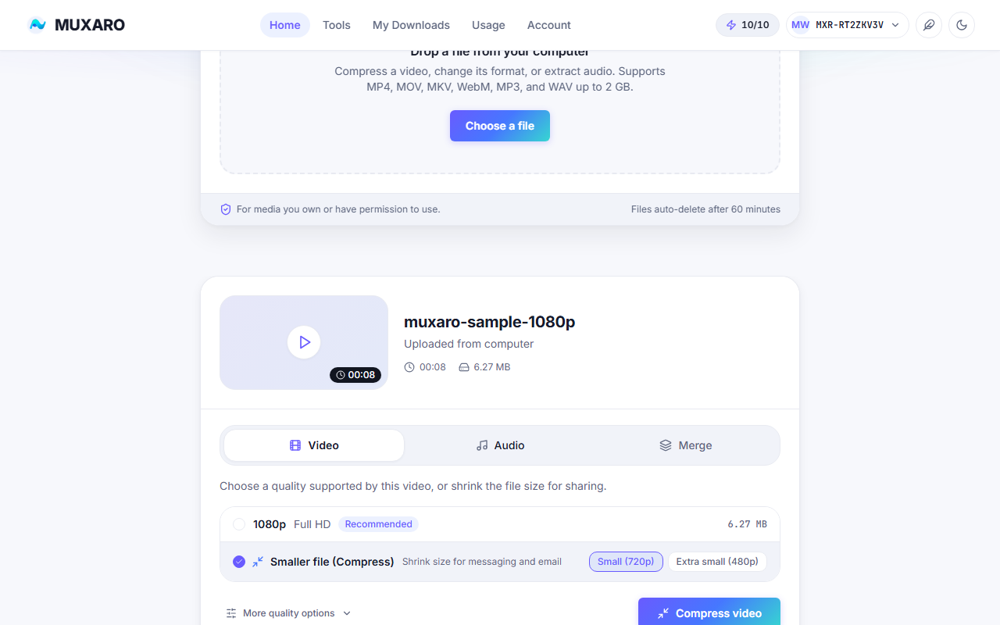 |
| *Landing workspace with URL inspection, local upload tab, and core media tools.* | *Live `ffprobe` metadata readout for an uploaded 1080p sample with video, audio, and merge tabs.* |

| Resolution & Container Selector | Live Processing Progress |
| :---: | :---: |
| 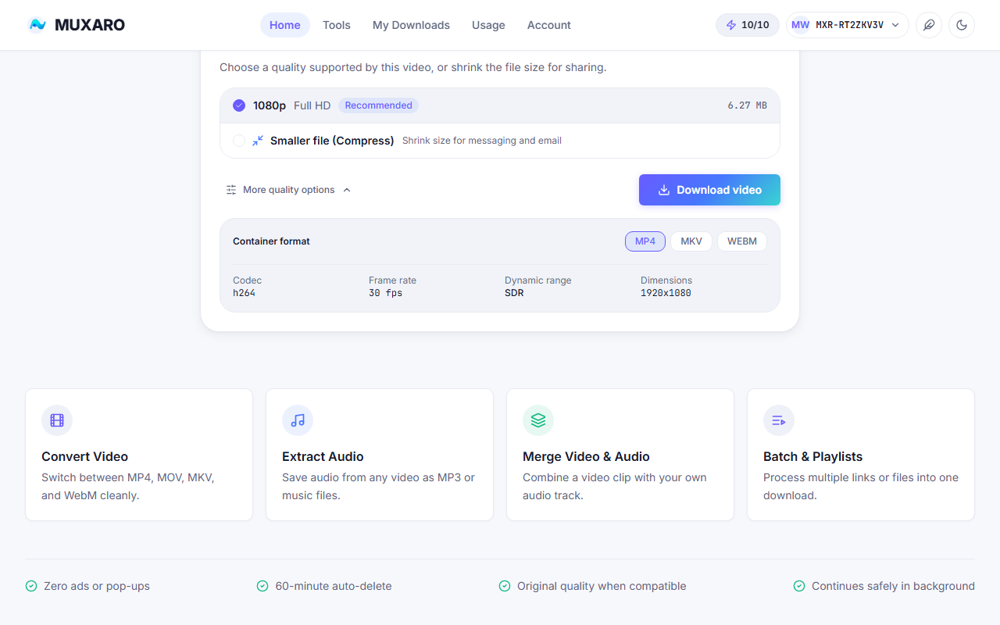 | 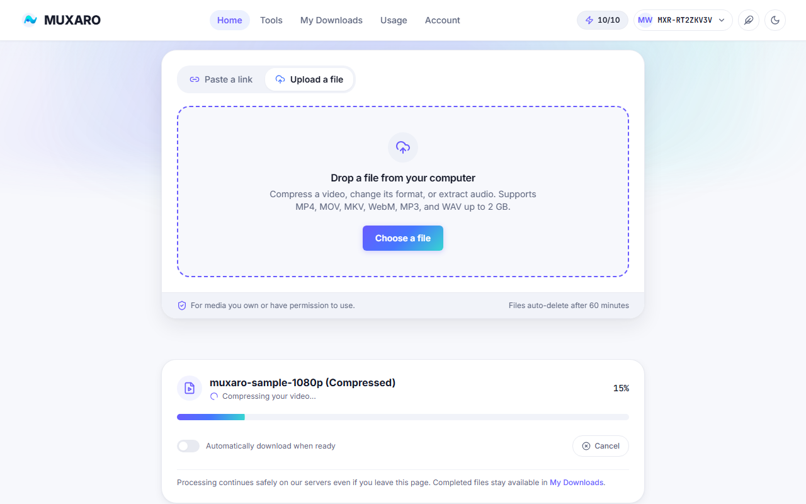 |
| *Expanded stream inspector showing MP4/MKV/WebM selection, H.264 codec, 30 fps, SDR, and 1920x1080 dimensions.* | *Real-time SSE progress bar during FFmpeg compression with cancellation and auto-download toggle.* |

| Completed Download & Verification | My Downloads Dashboard |
| :---: | :---: |
| 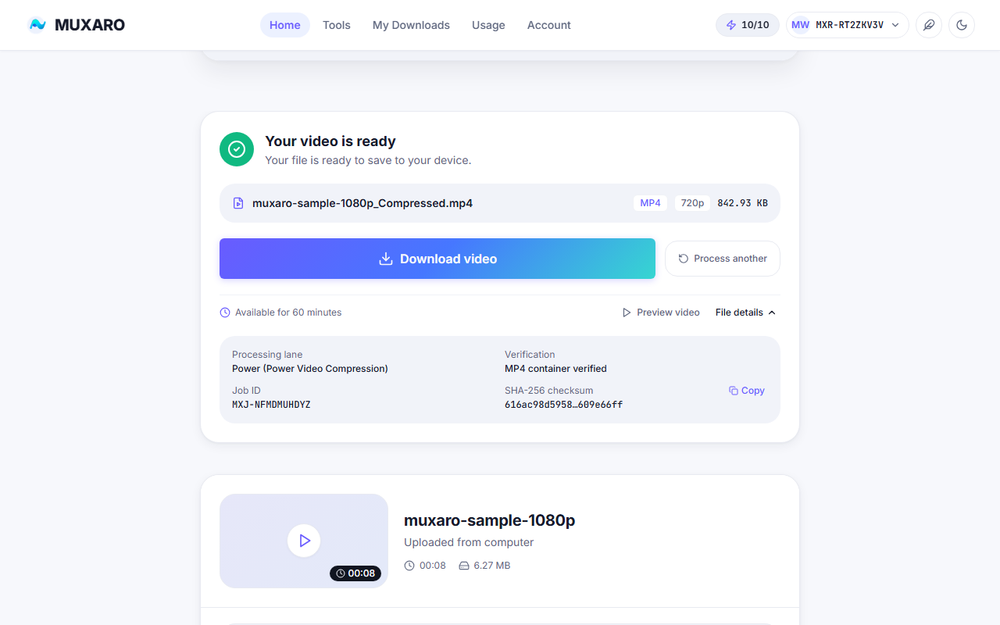 | 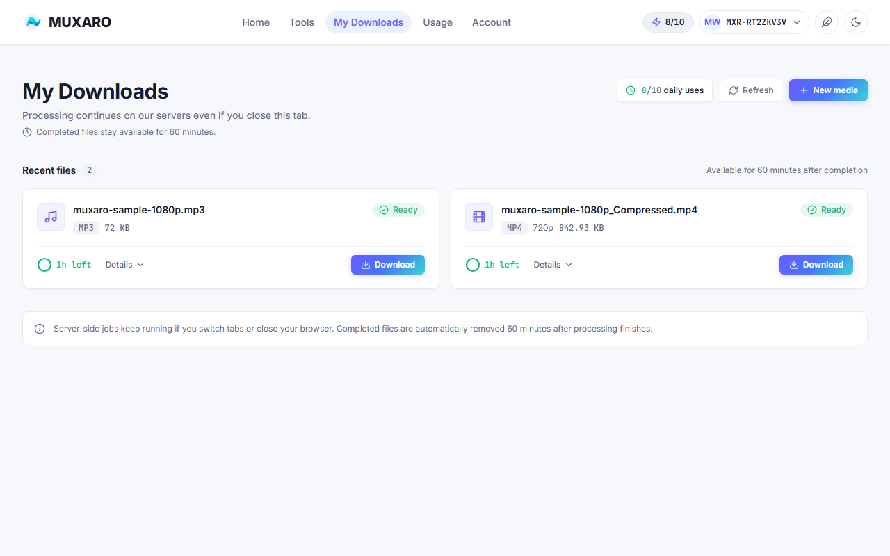 |
| *Verified output artifact with `MXJ-` job ID, SHA-256 digest, container verification, and 60-minute retention window.* | *Unified download history showing completed video and audio outputs, retention timers, and quota status.* |

---

## Live Demonstration

- **Live Deployed Frontend:** [https://muxaro.pages.dev/](https://muxaro.pages.dev/) — hosted on Cloudflare Pages over verified **TLS 1.3** (`TLS_AES_256_GCM_SHA384`, Let's Encrypt certificate, `HTTP 301 -> HTTPS 200`, security headers enabled, zero mixed content; see [docs/deployment/SSL_TLS.md](docs/deployment/SSL_TLS.md)). *(Note: `muxaro.pages.dev` serves the live Next.js static frontend; full API & FFmpeg job execution requires running the local stack below or provisioning the backend API service.)*

### Full End-to-End Workflow
Upload → FFprobe stream inspection → resolution & container selection → live FFmpeg compression → SHA-256 verified download → My Downloads dashboard:

<p align="center">
  
</p>

### Real-Time FFmpeg Processing Transition
Live progress tracking from queued execution through verification to ready download:

<p align="center">
  
</p>

<details>
<summary>Brand Identity Motion Preview</summary>
<p align="center">
  
</p>
</details>

---

## Why MUXARO

1. **Radical Technical Honesty:** MUXARO reports the actual streams detected by `ffprobe`. It never invents 4K options from 720p sources or hides lossy-to-lossless audio conversions.
2. **Stream-Copy First:** When the source codec and target container are compatible, MUXARO remuxes with `-c copy` for near-instant, zero-generation-loss output instead of unnecessary re-encoding.
3. **Defense-in-Depth Media Execution:** Every external URL passes DNS/IP SSRF validation (`security/`), and every media binary invocation executes with `shell: false`, strict argument whitelisting, and sanitized filenames.
4. **Ephemeral Privacy by Default:** Uploaded media and processed artifacts expire automatically after 60 minutes, with server-side analytics strictly free of PII.
5. **Clean-Room Apache-2.0 Licensing:** Application source code contains zero copyleft runtime npm dependencies; external CLI binaries (`ffmpeg`, `ffprobe`, `yt-dlp`) are invoked strictly out-of-process (see [NOTICE](NOTICE) and [THIRD_PARTY_NOTICES.md](THIRD_PARTY_NOTICES.md)).

---

## Architecture Overview

<p align="center">
  
</p>

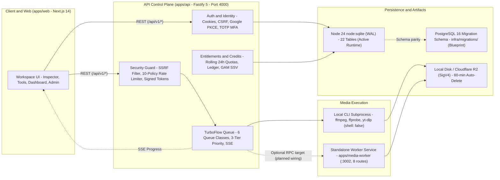

> **Runtime Architecture Note:** In the current implementation, `apps/api` persists state to Node 24's built-in `node:sqlite` (WAL mode, 22 tables) and executes `ffmpeg`/`ffprobe`/`yt-dlp` directly out-of-process from `queue.service.ts`. A standalone `apps/media-worker` microservice, PostgreSQL 16 DDL (`infra/migrations/002_account_rewards_analytics.sql`), Docker Compose stack, Cloud Run manifests, and Terraform modules are included in the repository for distributed production deployment.

For full architectural depth, see:
- [System Architecture](docs/architecture/SYSTEM_ARCHITECTURE.md)
- [Component Architecture](docs/architecture/COMPONENT_ARCHITECTURE.md)
- [Data Flow](docs/architecture/DATA_FLOW.md)
- [Technology Decisions](docs/architecture/TECHNOLOGY_DECISIONS.md)
- [Complete Mermaid Diagrams](docs/diagrams/MERMAID_DIAGRAMS.md)

---

## Technology Stack

| Layer | Technology | Purpose |
| :--- | :--- | :--- |
| **Frontend** | Next.js 14.2 (App Router), React 18.3, Tailwind CSS 3.4, Lucide React | Responsive workspace UI, tools, My Downloads, usage, account, and admin panel |
| **API Server** | Fastify 5, `@fastify/cors`, `@fastify/sensible`, `@fastify/swagger`, TypeScript | 69 `/api/v1` REST/SSE endpoints, OpenAPI `/docs`, auth, quotas, queue, downloads |
| **Media Engine** | FFmpeg, FFprobe, `apps/media-worker` (Fastify 5, Zod, Archiver) | Probing, stream-copy remuxing, transcoding, audio extraction, A/V merge, ZIP packaging |
| **Database** | Node.js 24 `node:sqlite` (WAL, active) · PostgreSQL 16 DDL (migration-ready) | 22 relational tables, 25 secondary indexes, `BEGIN IMMEDIATE` atomic transactions |
| **Object Storage** | Local ephemeral disk (`.muxaro-uploads`, `.muxaro-artifacts`) · Cloudflare R2 (pure-Node SigV4) | Temporary upload staging and 60-minute verified output retention |
| **Security & Auth** | Node `crypto` (Argon2id / Scrypt / AES-256-GCM / HMAC-SHA256), `security/` package | SSRF guard, FFmpeg arg sanitizer, CSRF, Google OAuth 2.0 PKCE, RFC 6238 TOTP MFA |
| **Infrastructure** | Docker, Docker Compose, Cloudflare Pages, Google Cloud Run, Terraform | Containerized staging and multi-service cloud deployment blueprints |

---

## Media Processing Pipeline

<p align="center">
  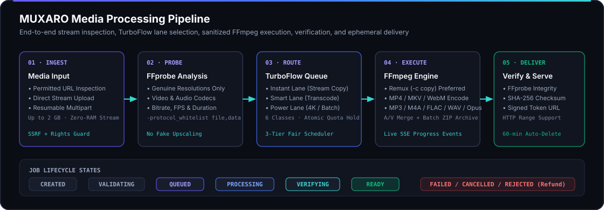
</p>

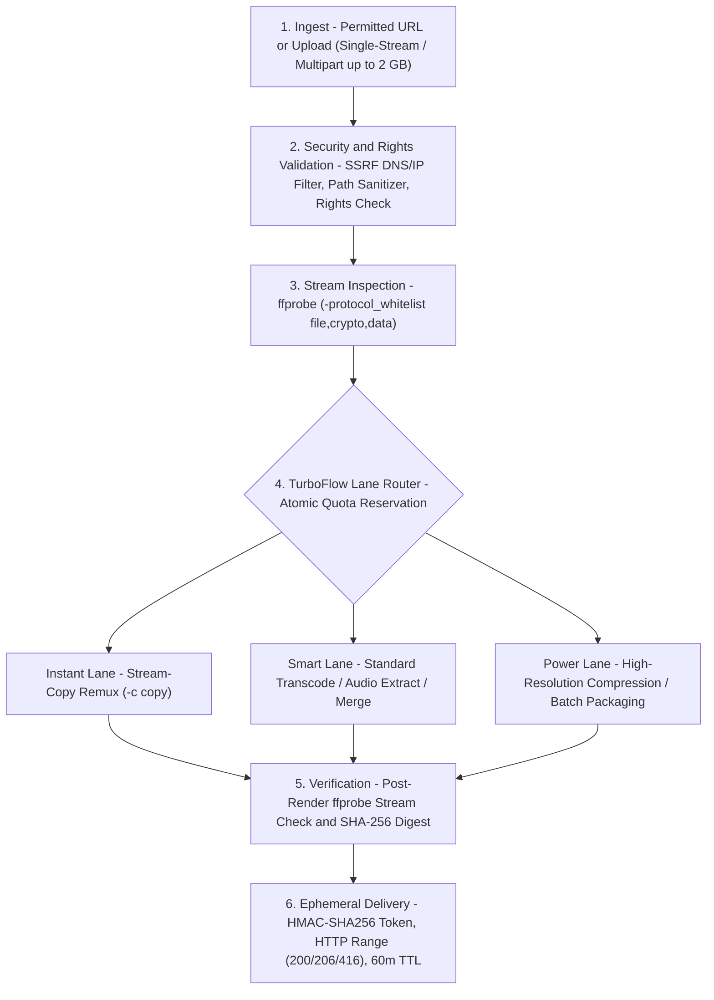

### TurboFlow Queue Classes & Concurrency Caps

| Queue Class | Default Concurrency | Workload |
| :--- | :---: | :--- |
| `instant-processing` | 4 | Stream-copy remuxing (`-c copy`) |
| `audio-processing` | 4 | Audio extraction and audio transcoding |
| `merge-processing` | 2 | Audio/video stream multiplexing |
| `video-transcoding` | 2 | Standard video conversion and compression |
| `high-resolution-processing` | 1 | High-resolution / compute-heavy video transcoding |
| `playlist-packaging` | 1 | Multi-item batch and ZIP archive packaging |

Priority scheduling weighs tiers as `PREMIUM (6) > REGISTERED (3) > GUEST (1)` with anti-starvation aging (`+1` priority weight every 5 seconds waited, capped at `+12`).

---

## Repository Structure

```text
muxaro/
├── apps/
│   ├── api/                  # Fastify 5 REST/SSE API, SQLite WAL store, TurboFlow queue (port 4000)
│   ├── media-worker/         # Standalone Fastify + FFmpeg/FFprobe worker microservice (port 3002)
│   └── web/                  # Next.js 14 App Router web application (port 3000)
├── packages/
│   ├── config/               # Shared brand metadata and constants
│   ├── entitlements/         # Auth crypto, RBAC, sliding-window quotas, atomic reservations, ledger
│   └── source-adapters/      # Direct HTTP & permitted media adapters, SSRF filter, rights validator
├── security/                 # Standalone SSRF guard, FFmpeg arg sanitizer, rate limiter, validators
├── infra/
│   ├── cloudrun/             # Google Cloud Run service manifests (API & Worker)
│   ├── migrations/           # PostgreSQL 16 schema migration (002_account_rewards_analytics.sql)
│   ├── scripts/              # DB init, migration runner, MinIO init, healthcheck, emergency shutdown
│   ├── terraform/            # Modular AWS/Cloudflare Terraform blueprints
│   ├── Dockerfile.{api,media,web,worker}
│   └── docker-compose.yml    # Local full-stack Docker orchestration
├── tests/                    # Unit, concurrency (quota-race), SSRF regression, media, & API integration tests
├── qa/                       # QA harness and load simulation scripts
├── docs/                     # Architecture, backend, database, API, frontend, security, deployment & audit docs
├── assets/                   # Branding SVGs, architecture diagrams, genuine screenshots, & demo GIFs
└── .github/                  # Pinned CI, Security, CodeQL, Staging/Prod Deploy, & Release workflows
```

---

## Getting Started

### Prerequisites

- **Node.js 24 LTS** (pinned in [.nvmrc](.nvmrc); required for built-in `node:sqlite` and native crypto primitives)
- **npm 10+**
- **FFmpeg & FFprobe** available on your system `PATH` (verify with `ffmpeg -version` and `ffprobe -version`)
- Optional: `yt-dlp` on `PATH` for permitted external URL stream inspection, and Docker Desktop for containerized orchestration

### Installation

MUXARO is organized as per-service packages (there is no root `package.json`). Install dependencies for the services you run:

```bash
git clone https://github.com/SubhransuNayak007/muxaro.git
cd muxaro

# Copy the environment template
cp .env.example .env

# Install core app dependencies
npm --prefix apps/api install
npm --prefix apps/web install

# Optional: install standalone media-worker and internal packages for full test coverage
npm --prefix apps/media-worker install
npm --prefix packages/entitlements install
npm --prefix packages/source-adapters install
```

### Local Development

Start the API and Web frontend in two separate terminals:

```bash
# Terminal 1 — Fastify API (http://localhost:4000, Swagger UI at http://localhost:4000/docs)
npm --prefix apps/api run dev

# Terminal 2 — Next.js Web Workspace (http://localhost:3000, proxies /api/v1/* to :4000)
npm --prefix apps/web run dev
```

To also run the standalone FFmpeg media worker microservice locally:

```bash
# Terminal 3 — Standalone Media Worker (http://localhost:3002/health)
npm --prefix apps/media-worker run dev
```

For full local setup troubleshooting, see [docs/deployment/LOCAL_SETUP.md](docs/deployment/LOCAL_SETUP.md).

### Environment Variables

All environment variables are documented with safe placeholders in [.env.example](.env.example). Key variables include:

| Variable | Default / Example | Description |
| :--- | :--- | :--- |
| `PORT` | `4000` | Fastify API listen port |
| `CORS_ORIGIN` | `http://localhost:3000` | Allowed browser origin(s) for credentialed requests |
| `API_INTERNAL_URL` | `http://127.0.0.1:4000` | Upstream API origin used by Next.js `/api/v1/*` rewrites |
| `NEXT_PUBLIC_SITE_URL` | `http://localhost:3000` | Canonical public web origin |
| `NEXT_PUBLIC_API_URL` | *(empty in dev)* | Public API origin (set when deploying static Cloudflare Pages bundle) |
| `MUXARO_DB_PATH` | `.muxaro-data/muxaro.db` | Local Node 24 SQLite WAL database path |
| `SESSION_SECRET` | *(32+ random bytes)* | Required in production for session token security |
| `SIGNED_TOKEN_SECRET` | *(32+ random bytes)* | HMAC-SHA256 secret for signed download URLs |
| `MFA_ENCRYPTION_KEY` | *(32+ random bytes)* | AES-256-GCM key for encrypting Admin TOTP MFA secrets |
| `R2_ACCOUNT_ID`, `R2_ACCESS_KEY_ID`, `R2_SECRET_ACCESS_KEY`, `R2_BUCKET_NAME` | *(empty = local disk)* | Enables Cloudflare R2 SigV4 object storage when all four are set |
| `GOOGLE_CLIENT_ID`, `GOOGLE_CLIENT_SECRET`, `GOOGLE_REDIRECT_URI` | *(empty = disabled)* | Enables Google OAuth 2.0 (Authorization Code + PKCE) |
| `REWARDED_ADS_ENABLED`, `GAM_REWARDED_AD_UNIT_PATH` | `false` | Optional Google Ad Manager rewarded credits with ECDSA SSV verification |

---

## Database Configuration

<p align="center">
  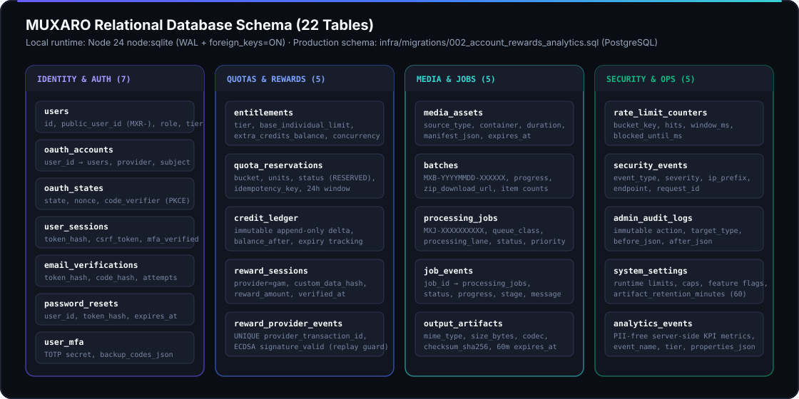
</p>

- **Active Runtime (`apps/api`):** Automatically initializes a persistent SQLite database via Node 24's built-in `node:sqlite` (`PRAGMA journal_mode = WAL`, `PRAGMA foreign_keys = ON`, `PRAGMA busy_timeout = 5000`) containing **22 relational tables**, **25 secondary indexes**, and **16 seeded `system_settings`** defaults.
- **Production PostgreSQL Blueprint:** `infra/migrations/002_account_rewards_analytics.sql` and `infra/scripts/run-migrations.sh` provide PostgreSQL 16 schema parity for future multi-replica PostgreSQL driver cutover.

Documentation: [Schema](docs/database/SCHEMA.md) · [Relationships](docs/database/RELATIONSHIPS.md) · [Indexing](docs/database/INDEXING.md) · [Migrations](docs/database/MIGRATIONS.md) · [Database Setup](docs/deployment/DATABASE_SETUP.md)

---

## Authentication

MUXARO implements defense-in-depth session and identity management across `apps/api/src/routes/auth.ts` and `apps/api/src/services/auth.service.ts`:

- **Email & Password Accounts:** Password hashing with Argon2id/scrypt, single-use hashed email verification and password reset tokens (written to local `dev-outbox.jsonl` in development; outbound SMTP client integration is tracked on the roadmap).
- **HttpOnly Sessions & CSRF:** Opaque session tokens stored as SHA-256 hashes in `user_sessions`, paired with `muxaro_csrf` and `x-muxaro-csrf` verification on state-changing requests.
- **Google OAuth 2.0 + PKCE:** Server-side `state`, `nonce`, and `code_verifier` (S256) stored in `oauth_states`, with Google ID token JWKS RS256 verification. Stays cleanly disabled when `GOOGLE_CLIENT_ID` is unset.
- **Admin TOTP MFA:** Privileged `/api/v1/admin/*` management endpoints enforce authenticated `admin` role plus verified RFC 6238 TOTP MFA (`user_mfa`, encrypted with AES-256-GCM) and write immutable records to `admin_audit_logs`.

Documentation: [Authentication](docs/security/AUTHENTICATION.md) · [Authorization](docs/security/AUTHORIZATION.md)

---

## API Reference

The Fastify 5 API exposes **69 live endpoints** under `/api/v1` across 13 route plugins, plus interactive Swagger UI at `http://localhost:4000/docs`.

| Route Group | Key Endpoints | Purpose |
| :--- | :--- | :--- |
| **Health** | `GET /api/v1/health`, `GET /api/v1/ready` | Liveness, storage mode, and worker pool readiness |
| **Auth & MFA** | `POST /api/v1/auth/{register,login,logout,verify-email,reset-password}`, `GET /api/v1/auth/google/{start,callback}`, `POST /api/v1/auth/mfa/{setup,verify,disable}` | Account lifecycle, OAuth 2.0 PKCE, and TOTP MFA |
| **Media** | `POST /api/v1/media/inspect`, `POST /api/v1/media/upload`, `POST /api/v1/media/upload/{init,:uploadId/complete}`, `PUT /api/v1/media/upload/:uploadId/part/:partNumber` | URL stream inspection and single-stream / resumable multipart uploads |
| **Jobs & SSE** | `POST /api/v1/jobs`, `GET /api/v1/jobs/:id`, `GET /api/v1/jobs/:id/events`, `POST /api/v1/jobs/:id/{cancel,retry}`, `GET /api/v1/jobs/:id/download` | Job submission, live SSE progress, retries, and download resolution |
| **Tools & Batches** | `POST /api/v1/tools/merge`, `POST /api/v1/playlists/inspect`, `POST /api/v1/playlists/jobs`, `GET /api/v1/playlists/jobs/:id`, `POST /api/v1/batches`, `GET /api/v1/batches/:id` | A/V merge, playlist inspection/jobs, and numbered batch orchestration |
| **Entitlements** | `GET /api/v1/entitlements`, `GET /api/v1/credits/ledger`, `GET /api/v1/account/{credits,history}`, `POST /api/v1/rewards/sessions` | Rolling 24h quotas, immutable credit ledger, and GAM SSV rewards |
| **Downloads** | `GET /api/v1/download/:token` | Signed artifact streaming with RFC 9110 HTTP `Range` (`200`/`206`/`416`) |
| **Admin & SRE** | `GET /api/v1/admin/metrics` *(public redacted)*, `/api/v1/admin/{users,settings,analytics,audit-logs,security-events}` *(MFA-gated)* | Operational telemetry and MFA-protected control centre |

Full API documentation:
- [API Reference](docs/api/API_REFERENCE.md)
- [OpenAPI Specification Guide](docs/api/OPENAPI.md)
- [Error Codes Reference](docs/api/ERROR_CODES.md)

---

## Media-Processing Documentation

- [Media Pipeline Design](docs/backend/MEDIA_PIPELINE.md)
- [Job Processing & Lifecycle](docs/backend/JOB_PROCESSING.md)
- [TurboFlow Queue Architecture](docs/backend/QUEUE_DESIGN.md)
- [Upload & Range Download Delivery](docs/backend/UPLOAD_DELIVERY.md)
- [Backend Architecture](docs/backend/BACKEND_ARCHITECTURE.md)
- [Frontend Architecture](docs/frontend/FRONTEND_ARCHITECTURE.md) & [Design System](docs/frontend/DESIGN_SYSTEM.md)

---

## Security

Implemented security controls include:

- **SSRF Protection:** Blocks private RFC 1918, loopback, link-local, cloud metadata (`169.254.169.254`), and IPv6 internal ranges on both URL validation and DNS resolution (`security/`, `packages/source-adapters`).
- **Command-Injection Prevention:** All `ffmpeg`, `ffprobe`, and `yt-dlp` invocations use direct `execFile`/`spawn` with `shell: false`, strict option sanitization, and safe path containment.
- **Abuse & Flood Guard:** 10 per-endpoint rate-limit policies backed by `rate_limit_counters`, a 10-second duplicate mutation flood guard, and explicit exemptions for read-only job/SSE polling.
- **Signed Ephemeral Downloads:** Short-lived HMAC-SHA256 download tokens bound to artifact ownership, paired with automatic 60-minute expiration.
- **Automated Scanning:** GitHub Actions workflows run Gitleaks secret scanning, Trivy vulnerability scanning, `npm audit`, and CodeQL static analysis.

> **Security Disclosure Note:** MUXARO implements engineering security controls documented in our threat model, but has not undergone third-party SOC 2, ISO 27001, or external penetration-test certification. Please report vulnerabilities privately via GitHub Security Advisories as described in [SECURITY.md](SECURITY.md).

Security documentation: [SECURITY.md](SECURITY.md) · [Threat Model](docs/security/THREAT_MODEL.md) · [SSRF Prevention](docs/security/SSRF_PREVENTION.md) · [Upload Security](docs/security/UPLOAD_SECURITY.md) · [Abuse Prevention](docs/security/ABUSE_PREVENTION.md) · [Secrets Management](docs/security/SECRETS_MANAGEMENT.md)

---

## Testing

MUXARO includes unit, security regression, concurrency, real-FFmpeg media engine, and API integration test suites. All commands below run on Node 24 with FFmpeg/FFprobe installed:

```bash
# Security module tests (SSRF, FFmpeg sanitizer, rate limiter, request validation)
node --experimental-strip-types security/tests/ssrf.test.ts
node --experimental-strip-types security/tests/ffmpeg-sanitizer.test.ts
node --experimental-strip-types security/tests/rate-limiter.test.ts
node --experimental-strip-types security/tests/validation.test.ts

# Entitlements & source-adapter package suites
npm --prefix packages/entitlements test
npm --prefix packages/source-adapters test

# Media worker tests (real FFmpeg & FFprobe execution)
npm --prefix apps/media-worker test

# Cross-system unit, concurrency, SSRF regression, media, and API integration suites
node --experimental-strip-types tests/security/ssrf-regression.test.ts
npx --prefix apps/api tsx --test tests/unit/adapters.test.ts
npx --prefix apps/api tsx --test tests/unit/entitlements.test.ts
npx --prefix apps/api tsx --test tests/concurrency/quota-race.test.ts
npx --prefix apps/api tsx --test tests/media/media-engine.test.ts
npx --prefix apps/api tsx --test tests/integration/api-integration.test.ts

# Frontend typecheck & production build verification
(cd apps/web && npx tsc --noEmit)
npm --prefix apps/web run build
```

---

## Deployment

- **Live Cloudflare Pages Frontend:** Deployed at **[https://muxaro.pages.dev/](https://muxaro.pages.dev/)** with verified **TLS 1.3** (`Let's Encrypt`), automatic `HTTP -> HTTPS` `301` redirect, security response headers (`X-Content-Type-Options`, `X-Frame-Options`, `Referrer-Policy`, `Permissions-Policy`), and zero mixed content (verified in [docs/deployment/SSL_TLS.md](docs/deployment/SSL_TLS.md)). Build the static frontend export locally with:
  ```bash
  CLOUDFLARE_PAGES=1 NEXT_PUBLIC_SITE_URL=https://muxaro.pages.dev NEXT_PUBLIC_API_URL=https://api.your-domain.example npm --prefix apps/web run build
  ```
- **Docker Compose (Local / Staging):** `docker compose -f infra/docker-compose.yml up --build` (orchestrates Next.js Web, Fastify API, FFmpeg Media Worker, PostgreSQL 16, Redis 7, and MinIO).
- **Google Cloud Run & Terraform (Ready for Provisioning):** Service manifests in `infra/cloudrun/` (`api-service.yaml`, `worker-service.yaml`) and modular IaC in `infra/terraform/` for provisioning the backend API, Media Worker, PostgreSQL, Cloudflare R2, and custom domains (`muxaro.app` / `api.muxaro.app`).

Deployment guides: [Production Deployment](docs/deployment/PRODUCTION_DEPLOYMENT.md) · [Cloudflare Setup](docs/deployment/CLOUDFLARE_SETUP.md) · [Worker Setup](docs/deployment/WORKER_SETUP.md) · [Storage Setup](docs/deployment/STORAGE_SETUP.md) · [SSL/TLS](docs/deployment/SSL_TLS.md) · [Rollback](docs/deployment/ROLLBACK.md) · [Troubleshooting](docs/deployment/TROUBLESHOOTING.md)

---

## Performance

- **Zero-Reencode Fast Path:** Stream-copy remuxing bypasses video decode/encode cycles whenever input codecs match the target container.
- **Workload Isolation:** Six bounded queue classes prevent long 4K transcodes or playlist ZIP packaging from blocking fast audio extractions or remux jobs.
- **Zero-RAM Streaming I/O:** Single-stream uploads, 5 MB resumable multipart reassembly, and RFC 9110 `Range` downloads stream directly between sockets and storage without buffering entire media files in memory.
- **Lightweight Frontend Mode:** Code-split interactive islands (`MediaInspector`, `JobProgress`), pre-allocated aspect ratios, `prefers-reduced-motion` compliance, and a manual/automatic lightweight mode that disables decorative aurora blurs on constrained devices.

Performance docs: [Frontend Performance](docs/frontend/PERFORMANCE.md) · [Processing Benchmarks](docs/turboflow/PROCESSING_BENCHMARKS.md)

---

## Roadmap

Engineering progress is tracked transparently across 124 concrete work items in [docs/repository/124_ENGINEERING_WORK_ITEMS.md](docs/repository/124_ENGINEERING_WORK_ITEMS.md) (111 Implemented, 9 Partial, 4 Planned). Key upcoming milestones:

- **PostgreSQL Runtime Driver Cutover:** Wire `DATABASE_URL` in `apps/api` to a live PostgreSQL driver (`pg`) alongside existing SQLite local mode.
- **Distributed Media Worker RPC:** Connect `apps/api` `queue.service.ts` to external `apps/media-worker` instances over `MEDIA_WORKER_URL` for horizontal worker autoscaling.
- **Outbound Transactional Email:** Add SMTP/API email transport for verification and password-reset messages (replacing local `dev-outbox.jsonl` in production).
- **Distributed Rate Limiting & Queue Broker:** Integrate `REDIS_URL` for multi-replica shared rate-limit counters and job coordination.
- **Production Backend & Custom Domain Provisioning:** Attach custom domains (`muxaro.app` / `api.muxaro.app`) alongside the live Cloudflare Pages frontend (`https://muxaro.pages.dev/`) and provision Cloud Run API/worker services, managed PostgreSQL, and Cloudflare R2 buckets using the existing `infra/` blueprints.

---

## Contributing

Contributions, bug reports, and documentation improvements are welcome. Please review our community standards before opening an issue or pull request:

- [Contributing Guide](CONTRIBUTING.md)
- [Code of Conduct](CODE_OF_CONDUCT.md)
- [Support Guide](SUPPORT.md)
- [Changelog](CHANGELOG.md)
- [Repository Audit](docs/repository/REPOSITORY_AUDIT.md)

---

## Acknowledgements

Built with a combination of human engineering direction, testing and AI-assisted development using Google Antigravity.

- [AUTHORS.md](AUTHORS.md) — Project authorship and maintenance credits
- [AI-Assisted Development Disclosure](docs/repository/AI_ASSISTED_DEVELOPMENT.md) — Transparent overview of human engineering oversight and AI-assisted tooling
- [THIRD_PARTY_NOTICES.md](THIRD_PARTY_NOTICES.md) — Complete third-party dependency, font, icon, and out-of-process binary attributions

---

## License

MUXARO is licensed under the **Apache License, Version 2.0**. See [LICENSE](LICENSE), [NOTICE](NOTICE), and [THIRD_PARTY_NOTICES.md](THIRD_PARTY_NOTICES.md) for full terms and third-party notices.
