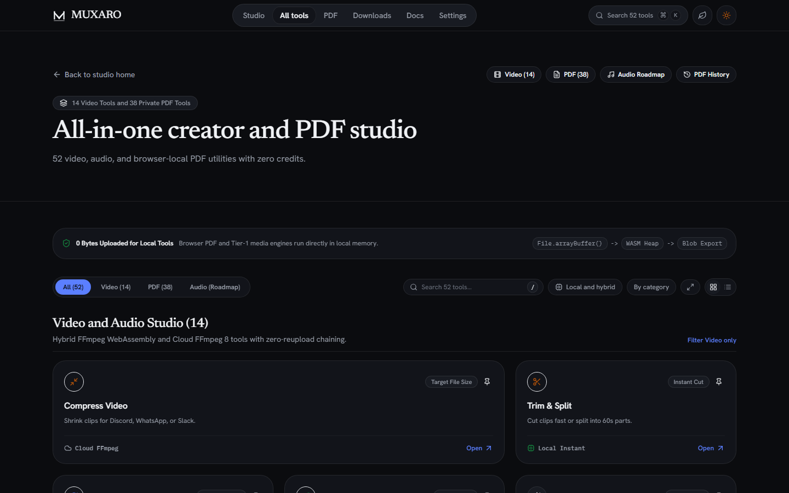
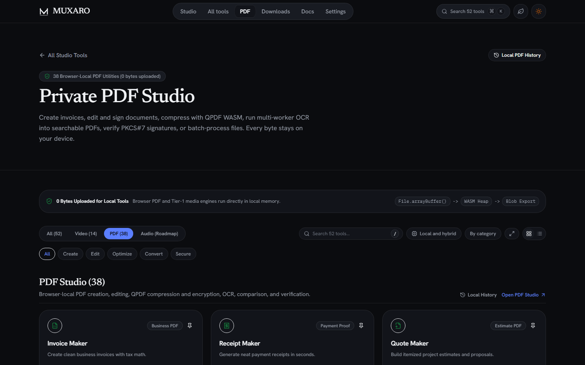
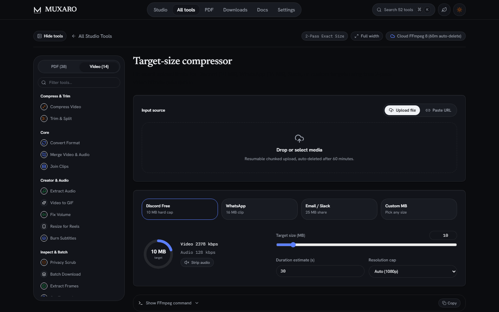
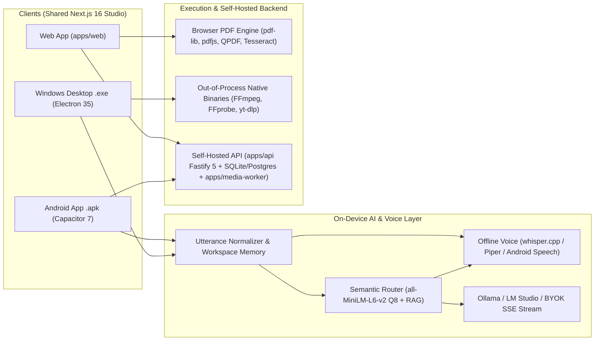

<div align="center">

<p>
  <a href="https://github.com/SubhransuNayak007/muxaro">
    
  </a>
</p>

<h3>Private Offline AI, PDF &amp; 12K Media Workstation</h3>

<p>
  Chat, speak, redact personal info, run OCR, trim lossless 4K–12K video, and extract media locally on
  <strong>Windows Desktop (.exe)</strong>, <strong>Android (.apk)</strong>, and <strong>Web</strong> — with zero mandatory cloud uploads.
</p>

<p>
  <a href="https://github.com/SubhransuNayak007/muxaro/actions/workflows/ci.yml">
    
  </a>
  <a href="https://github.com/SubhransuNayak007/muxaro/actions/workflows/security.yml">
    
  </a>
  <a href="LICENSE">
    
  </a>
  
  
</p>

<p>
  <a href="#preview">Demo</a> ·
  <a href="#features">Features</a> ·
  <a href="#screenshots">Screenshots</a> ·
  <a href="#architecture">Architecture</a> ·
  <a href="#tech-stack">Tech Stack</a> ·
  <a href="#quick-start">Quick Start</a> ·
  <a href="#license">License</a>
</p>

</div>

---

## Preview

<p align="center">
  
</p>

<p align="center">
  <a href="assets/animations/muxaro-showcase.mp4">Watch full 1280×800 MP4 product showcase</a>
</p>

---

## Why MUXARO

- **Private & Offline-First:** PDF processing, OCR, personal-info redaction, semantic intent routing, and local voice capture run directly on your hardware. External cloud keys (Gemini / OpenAI / Anthropic / OpenRouter) remain opt-in and automatically mask sensitive entities before leaving your device.
- **Natural Conversational Control:** Instead of hunting across 52 disconnected buttons, drop files or speak naturally (*"trim 0:10 to 0:45 and shrink for WhatsApp"* or *"remove blank pages, redact my phone number, and compress"*). Ambiguous inputs trigger 1-tap preset chips rather than blind guesses.
- **Cross-Platform Native Runtimes:** Ships a unified Next.js 16 UI packaged as a standalone **Windows portable `.exe`** (`Electron 35` + native `FFmpeg`/`yt-dlp`/`whisper.cpp`/`Piper`), an **Android `.apk`** (`Capacitor 7` + native Java media & on-device speech plugins), and an optional self-hostable **Fastify 5 REST/SSE API**.
- **Clean-Room Apache-2.0 Boundary:** First-party TypeScript, React, Electron, and Android Java sources carry no copyleft dependencies; CLI engines (`FFmpeg`, `yt-dlp`, `whisper.cpp`, `Piper`) run strictly out-of-process.

---

## Features

### Conversational AI & 100% Offline Voice
- **Hybrid Intent & Dictation Engine:** Cleans spoken fillers, resolves mid-sentence self-corrections (*"make it 16 MB no wait 10 MB"*), handles Hinglish phrases, and maps requests across all 52 tools using exact rules + quantized on-device embeddings (`all-MiniLM-L6-v2`, `q8` WebGPU/WASM).
- **Thread Workspace Memory:** Tracks multiple attached files and outputs so follow-ups like *"compress the second PDF"* or *"make it smaller"* adjust parameters cleanly without re-attaching files.
- **Offline Speech-to-Text & Neural TTS:**
  - **Windows Desktop:** 16 kHz mono PCM + energy VAD into local `whisper.cpp` (`tiny`/`base` `q5_1`), with `Piper` neural speech synthesis and Windows SAPI fallback.
  - **Android Mobile:** Native `SpeechRecognizer.createOnDeviceSpeechRecognizer` (API 31+) with RMS amplitude telemetry and queued `TextToSpeech` playback.
- **Voice Orb Mode:** Full-screen amplitude-reactive listening overlay with instant `<20 ms` speech **barge-in** interruption and confirmation handshakes before destructive edits.
- **Local LLM Streaming:** Auto-discovers local `Ollama` (`:11434`), `LM Studio` (`:1234`), or `llama-server` (`:8080`) with live Server-Sent Events (SSE) streaming and tokens/sec telemetry, plus encrypted home LAN Wi-Fi sharing (`PIN` paired) for mobile phones.

### Private PDF Studio (38 Tools)
- **Create & Scan:** Invoice/Quote/Receipt maker, prompt-to-PDF generator, validated camera/multi-image batch scanner (`lib/pdf/image-pipeline.ts`), and native Electron Screen-to-PDF capture.
- **Edit & Convert:** Merge, split, compress (QPDF WASM lossless, balanced, grayscale), rotate, reorder, watermark, Bates/page numbering, form fill, flatten, digital e-sign, and PDF-to-Word/JPG export.
- **Intelligent Extraction & Redaction:** Multi-worker Tesseract WASM OCR (auto-inserted when redacting or summarizing scanned PDFs), X/Y table-to-CSV/JSON extraction, permanent burn-in PII redaction (cards, IBAN, SSN, Aadhaar/PAN, phone, email, optional secrets), and page-cited local RAG answers.

### 12K Media & Audio Studio (14 Tools)
- **Stream-Copy First Engine:** Inspects real container/codec metadata via `ffprobe` and uses lossless `-c copy` remuxing whenever containers permit.
- **Creator Workflows:** Exact target-size compression (`10 MB Discord`, `16 MB WhatsApp`, `25 MB Email`), lossless timestamp cutting, 60-second Reels splitting, `9:16` / `16:9` / `1:1` reframing, `EBU R128` loudness normalization, `MP3`/`FLAC`/`WAV`/`Opus` audio extraction, metadata scrubbing, and cross-domain video/audio transcription to structured PDF notes.
- **Native Multi-Platform URL Resolver:** Inspects highest-quality streams on Desktop (`yt-dlp`) and Android (`MuxaroMediaPlugin`) with safe fallback cards in offline browsers.

---

## Screenshots

| Assistant Workspace (`/app`) | Unified 52-Tool Suite (`/tools`) |
| :---: | :---: |
|  |  |
| *Clean conversational entry with on-device privacy toggle and Voice Orb trigger.* | *All 38 PDF and 14 Media utilities searchable in one place.* |

| PDF Studio (`/tools/pdf`) | Target-Size Video Compressor |
| :---: | :---: |
|  |  |
| *Zero-upload local PDF tools powered by QPDF, pdf-lib, pdfjs-dist, and Tesseract.* | *Exact bitrate/size calculator for Discord, WhatsApp, Email, and custom MB targets.* |

<p align="center">
  
  <br />
  <em>Android Mobile Studio (<code>/m</code>) packaged inside <code>MUXARO-Studio.apk</code>.</em>
</p>

---

## Architecture

<p align="center">
  
</p>



---

## Tech Stack

| Layer | Technologies | Notes |
| :--- | :--- | :--- |
| **Web Workspace (`apps/web`)** | Next.js `16.4`, React `18`, TypeScript, Tailwind CSS `3.4` | Prerendered static export (`apps/web/out`) shared across Web, Electron, and Capacitor |
| **Local AI & RAG** | `@huggingface/transformers`, `Xenova/all-MiniLM-L6-v2` (`q8`), Ollama/llama-server SSE | Hybrid BM25 + vector RAG, typed intent routing, automatic PII masking on cloud fallback |
| **Offline Speech** | Web Audio `16 kHz` PCM + VAD, `whisper.cpp` (`tiny`/`base` `q5_1`), `Piper` ONNX, Android `SpeechRecognizer` & `TextToSpeech` | Zero cloud `webkitSpeechRecognition` lock-in; instant `<20 ms` TTS barge-in |
| **PDF Engine** | `pdf-lib`, `pdfjs-dist`, `tesseract.js`, `qpdf-run`, `jspdf`, `jsqr`, `jszip` | 100% browser/on-device execution (`0` bytes uploaded) |
| **Desktop (`apps/desktop`)** | Electron `35`, Node.js `24`, native `ffmpeg.exe`, `yt-dlp.exe` | Portable Windows x64 executable with local HTTP IPC and LAN Wi-Fi mesh sharing |
| **Mobile (`apps/mobile`)** | Capacitor `7.4`, Android Java SDK (`MuxaroAiPlugin`, `MuxaroMediaPlugin`) | Native Android voice recognition, TTS queueing, hardware camera scanner, and media downloader |
| **Self-Hosted Backend (`apps/api`, `apps/media-worker`)** | Fastify `5`, Zod, `node:sqlite` / PostgreSQL (`drizzle-orm`), Redis / BullMQ, S3 / R2 | Optional multi-user API control plane and isolated transcoding microservice |

---

## Quick Start

### 1. Web Workspace (`apps/web`)

```bash
git clone https://github.com/SubhransuNayak007/muxaro.git
cd muxaro

npm --prefix apps/web ci
npm --prefix apps/web run dev
```

Open `http://localhost:3000` (or `/app` for the full-screen Assistant workspace).

### 2. Windows Desktop App (`apps/desktop`)

```bash
STATIC_EXPORT=1 npm --prefix apps/web run build
npm --prefix apps/desktop ci
npm --prefix apps/desktop run build
```

Outputs portable `MUXARO-Studio-Windows-x64.exe` under `apps/desktop/release/`. Place `ffmpeg.exe` and `yt-dlp.exe` in `apps/desktop/bin/` prior to packaging (`copy-web.mjs` automatically bundles `ffmpeg-static`).

### 3. Android APK (`apps/mobile`)

> Requires JDK 21 (e.g. Android Studio JBR) and Android SDK configured.

```bash
STATIC_EXPORT=1 npm --prefix apps/web run build
npm --prefix apps/mobile ci
npm --prefix apps/mobile run build:apk
```

Outputs `app-debug.apk` under `apps/mobile/android/app/build/outputs/apk/debug/`.

### 4. Verification Checks

```bash
npm --prefix apps/web run lint
node --test apps/web/lib/ai/__tests__/intent-engine.test.mjs
npm --prefix apps/desktop run build:ts
```

---

## Repository Layout

<details>
<summary>Expand monorepo structure</summary>

```text
muxaro/
├── apps/
│   ├── web/                # Next.js 16 UI, 52 PDF + Media tools, semantic AI & Voice Orb
│   ├── desktop/            # Electron 35 Windows workstation, local Whisper/Piper/Ollama bridge
│   ├── mobile/             # Capacitor 7 Android app + MuxaroAiPlugin / MuxaroMediaPlugin
│   ├── api/                # Optional Fastify 5 REST/SSE API server
│   └── media-worker/       # Optional standalone FFmpeg/FFprobe microservice
├── packages/
│   ├── chrome-extension/   # Browser companion helper extension
│   ├── config/             # Shared brand constants
│   ├── contracts/          # Shared TypeScript API/job contracts
│   ├── db/                 # Drizzle schema & database definitions
│   ├── entitlements/       # Quota & credit ledger engine
│   ├── network/            # Networking helpers
│   ├── shared/             # Common types & utilities
│   └── source-adapters/    # Permitted media inspection adapters
├── security/               # SSRF guard, FFmpeg arg sanitizer, token signer, rate limiter
├── assets/                 # Branding SVGs, architecture diagram, screenshots, demo MP4/GIF
├── scripts/                # Build and release helper scripts
├── LICENSE                 # Apache License 2.0
├── NOTICE                  # Copyright & out-of-process boundary notices
└── THIRD_PARTY_NOTICES.md  # Verified dependency & binary attributions
```

</details>

---

## License

First-party MUXARO source code across the repository is licensed under the **[Apache License 2.0](LICENSE)** — chosen specifically for its explicit **patent grant & retaliation clause**, **contributor IP protections**, and **trademark reservation** (`NOTICE` §3).

External command-line binaries and WebAssembly codecs (`FFmpeg`, `yt-dlp`, `@ffmpeg/core`, optional user-downloaded `whisper.cpp` and `Piper`) operate strictly out-of-process or inside sandboxed browser Web Workers with full attribution in [`NOTICE`](NOTICE) and [`THIRD_PARTY_NOTICES.md`](THIRD_PARTY_NOTICES.md).
