# MUXARO — Enterprise SEO Strategy & Technical Growth Blueprint

> **Document Version:** 1.0.0  
> **Status:** Approved / Active Production Standard  
> **Author:** AGENT 09 (SEO & Documentation Engineer)  
> **Audience:** Engineering, Product, Frontend (@frontend), Principal Architect (@architect), Project Leadership (@coordinator)  
> **Target Properties:** `Muxaro.media`, `app.Muxaro.media`, documentation subpaths, and integrated developer tools

---

## Table of Contents
1. [Executive Summary & Strategic Brand Positioning](#1-executive-summary--strategic-brand-positioning)
2. [Market Landscape, Competitive Intelligence & White-Space Analysis](#2-market-landscape-competitive-intelligence--white-space-analysis)
3. [Keyword Taxonomy & Multi-Tier Search Intent Architecture](#3-keyword-taxonomy--multi-tier-search-intent-architecture)
4. [Technical SEO & Next.js Architecture](#4-technical-seo--next-js-architecture)
5. [Crawl Budget Optimization & Indexation Hygiene](#5-crawl-budget-optimization--indexation-hygiene)
6. [Schema.org Structured Data Strategy (JSON-LD)](#6-schema-org-structured-data-strategy-json-ld)
7. [Pillar-and-Cluster Content Strategy (Hallmark Anti-Slop)](#7-pillar-and-cluster-content-strategy-hallmark-anti-slop)
8. [Internationalization & Multi-Locale Architecture (hreflang)](#8-internationalization--multi-locale-architecture-hreflang)
9. [Authority Engineering, Digital PR & Link Acquisition](#9-authority-engineering-digital-pr--link-acquisition)
10. [Core Web Vitals & Real User Monitoring (RUM) SLA](#10-core-web-vitals--real-user-monitoring-rum-sla)
11. [KPIs, Continuous Telemetry & Maintenance Governance](#11-kpis-continuous-telemetry--maintenance-governance)

---

## 1. Executive Summary & Strategic Brand Positioning

### 1.1 The Market Paradox
The online media conversion, stream inspection, and audio-video manipulation category has historically suffered from severe trust deficits. Dominant legacy utilities (e.g., ad-bloated web converters, scammy "YouTube to MP3" portals, and sketchy downloaders) are riddled with intrusive popups, malware redirects, misleading audio upsampling claims, and copyright vulnerabilities. Search engines (especially Google and Bing) have systematically de-indexed, penalized, or demoted sites that rely on abusive interstitial advertising, copyright evasion, or dubious domain-hopping networks.

Conversely, developer-focused desktop utilities (like command-line FFmpeg) offer pristine fidelity and complete flexibility, but present an insurmountable barrier of entry to casual creators, educators, journalists, and media engineers needing rapid, browser-based media diagnostics and manipulation.

### 1.2 The MUXARO Positioning
**MUXARO** bridges this chasm as a modern, high-integrity, cloud-native media utility platform. Built on clean-room architecture with strict legal compliance, verified audio/video streams, transparent rolling allowances, and zero ad-slop, Muxaro positions itself not as a generic pirate utility, but as:
- **The Modern Browser-Based Digital Audio/Video Workstation (DAW/NLE Companion)**
- **An Authoritative Media Engineering Reference and Diagnostic Tool**
- **A Transparent, Ethical Utility** respecting copyright holders, providing crystal-clear DMCA procedures, and strictly disallowing unauthorized DRM bypassing or predatory scraping.

### 1.3 Strategic SEO Pillars
1. **Unassailable Technical Authority**: Establish the undisputed high ground for media format explanations (Container vs Codec, DASH demuxing, AAC vs Opus, psychoacoustic limits).
2. **Programmatic & Intent-Specific Landing Pages**: High-speed, Hallmark-compliant interactive tools (`/tools/audio-extractor`, `/tools/audio-video-merger`, `/tools/media-converter`).
3. **Core Web Vitals Dominance**: 100/100 Mobile & Desktop Lighthouse scores, sub-second LCP, zero layout shifts, zero tracking bloat.
4. **Structured Semantic Footprint**: Comprehensive JSON-LD schema layers (`SoftwareApplication`, `HowTo`, `FAQPage`, `TechArticle`, `BreadcrumbList`) maximizing rich-snippet real estate in Search Engine Results Pages (SERPs).

---

## 2. Market Landscape, Competitive Intelligence & White-Space Analysis

| Dimension | Legacy Web Converters (Y2Mate, CloudConvert, Convertio) | Desktop CLIs (FFmpeg, yt-dlp) | MUXARO (Target Position) |
| :--- | :--- | :--- | :--- |
| **Trust & Safety** | Terrible; spam ads, deceptive download buttons, malware threats | High; local open-source software | **Flawless; clean UI, no ads, strict privacy guarantees** |
| **Technical Honesty** | Misleading (claims 320kbps MP3 from 128kbps Opus streams) | Honest (displays raw stream info) | **100% Honest (stream-copy, true bitrates, no fake upsampling)** |
| **Search Engine Health** | Volatile; frequent DMCA de-indexing & algorithmic penalties | N/A (GitHub repos, documentation) | **Resilient, clean-domain whitehat SEO, compliant with DMCA § 512** |
| **User Experience (UX)** | Cluttered, high cognitive load, intrusive layout shifts | CLI only; requires terminal expertise | **Minimalist, instant feedback, Hallmark Anti-AI-Slop compliance** |
| **Mobile Friendliness** | Impaired by full-page modal ads and mobile redirects | None | **Progressive Web App, fully responsive, touch-optimized** |

### Strategic White-Space
Major search queries like *"how to extract audio without losing quality"*, *"mp4 vs webm for youtube"*, and *"why is audio and video out of sync after merging"* have an immense volume of search queries where existing search results are either thin automated scrapers or forum threads from 2014. By pairing **deep, authoritative engineering guides** with **instant in-browser or API-driven utility tools**, Muxaro captures high-intent traffic and converts searchers into habitual daily utility users.

---

## 3. Keyword Taxonomy & Multi-Tier Search Intent Architecture

Our keyword acquisition funnel is organized into three distinct tiers:

```
               ▲
              / \     Top-of-Funnel (TOFU) - Informational
             /   \    "container vs codec", "opus vs aac bitrate"
            /-----\
           /  MOFU \  Middle-of-Funnel (MOFU) - Evaluative / Diagnostic
          /         \ "audio video sync fix", "how to inspect stream bitrate"
         /-----------\
        /    BOFU     \ Bottom-of-Funnel (BOFU) - High-Intent Transactional
       /_______________\ "online audio extractor", "lossless video merger"
```

### 3.1 Bottom-of-Funnel (BOFU): High-Intent Transactional & Utility Tools

These queries represent users actively seeking to perform a specific media task immediately. Landing pages must load instantly, present the dropzone/input without scrolling at 1280x800, and immediately deliver utility.

| Primary Keyword Target | Secondary / Long-Tail Keyword Clusters | Target Route | Search Intent | Est. Monthly Global Vol | Target Schema |
| :--- | :--- | :--- | :--- | :--- | :--- |
| `online audio extractor` | `extract audio from video online`, `lossless aac extractor`, `rip opus from webm` | `/tools/audio-extractor` | Transactional | 165,000 | `SoftwareApplication`, `HowTo` |
| `video audio merger` | `merge audio and video online free`, `combine video and audio track`, `mux mkv mp4 online` | `/tools/audio-video-merger` | Transactional | 110,000 | `SoftwareApplication`, `HowTo` |
| `media stream inspector` | `inspect video codecs online`, `probe mp4 moov atom`, `check video bitrate online` | `/tools/media-inspector` | Utility / Tech | 42,000 | `SoftwareApplication` |
| `batch media converter` | `convert multiple videos online`, `browser batch transcode`, `lossless stream copy batch` | `/tools/batch-processing` | Transactional | 68,000 | `SoftwareApplication`, `HowTo` |
| `video format converter` | `mp4 to webm online`, `webm to mp4 lossless`, `opus to mp3 320kbps honesty` | `/tools/media-converter` | Transactional | 290,000 | `SoftwareApplication` |

### 3.2 Middle-of-Funnel (MOFU): Problem-Solving & Diagnostic Guides

These queries represent users encountering friction in video editing, media playback, or web delivery.

| Primary Keyword Target | Secondary / Long-Tail Keyword Clusters | Target Route | Search Intent | Target Schema |
| :--- | :--- | :--- | :--- | :--- |
| `audio video sync fix` | `why is video out of sync after download`, `pts dts drift fix`, `variable frame rate audio desync` | `/docs/troubleshooting#sync` | Diagnostic | `TechArticle`, `FAQPage` |
| `unsupported container format` | `moov atom not found fix`, `mp4 play error in browser`, `faststart ffmpeg web` | `/docs/troubleshooting#containers`| Diagnostic | `TechArticle`, `FAQPage` |
| `dash stream merging guide` | `combine separate youtube audio video streams`, `fmp4 chunk muxing`, `1080p separate video audio` | `/docs/resolutions#dash-reality`| Diagnostic | `TechArticle`, `HowTo` |
| `lossless stream copy vs transcode`| `ffmpeg c copy vs reencode`, `zero loss video extraction`, `smart remuxing explained` | `/docs/formats#stream-copy` | Technical | `TechArticle` |

### 3.3 Top-of-Funnel (TOFU): Educational & Foundational Engineering Docs

These queries target researchers, developers, students, and prosumers searching for definitive explanations.

| Primary Keyword Target | Secondary / Long-Tail Keyword Clusters | Target Route | Search Intent | Target Schema |
| :--- | :--- | :--- | :--- | :--- |
| `mp4 vs webm` | `difference between mp4 and webm`, `h264 vs vp9 vs av1`, `container vs codec explained` | `/docs/formats` | Informational | `TechArticle` |
| `opus vs aac` | `is opus better than aac`, `best audio codec for web`, `lossy vs lossless audio myths` | `/docs/audio-quality` | Informational | `TechArticle` |
| `4k vs 1080p bitrate` | `youtube 4k bitrate reality`, `is 1080p high bitrate better than 4k low`, `8k video bandwidth` | `/docs/resolutions` | Informational | `TechArticle` |
| `audio upsampling myth` | `can you convert 128kbps to 320kbps`, `fake flac upscaling`, `audio masking threshold` | `/docs/audio-quality#mythbusting`| Informational | `TechArticle`, `FAQPage` |

---

## 4. Technical SEO & Next.js Architecture

Our frontend architecture (Next.js App Router) must enforce strict Technical SEO hygiene out of the box.

```
                    ┌────────────────────────────┐
                    │      Next.js Request       │
                    └─────────────┬──────────────┘
                                  │
                  ┌───────────────┴───────────────┐
                  ▼                               ▼
       ┌──────────────────────┐       ┌──────────────────────┐
       │   Static SSG Pages   │       │   Dynamic Tool Pages │
       │  (/docs/*, /legal/*) │       │  (/, /tools/*)       │
       └──────────┬───────────┘       └──────────┬───────────┘
                  │                              │
                  ▼                              ▼
       ┌──────────────────────┐       ┌──────────────────────┐
       │ Edge CDN Cache: 24h  │       │ Edge CDN SWR Cache   │
       │ Static HTML + JSON-LD│       │ Hydrated UI + Tokens │
       └──────────────────────┘       └──────────────────────┘
```

### 4.1 URL Hierarchy & Canonicals
- **Domain Root:** Clean, lowercase, trailing-slash stripped (`https://Muxaro.media`).
- **Hierarchy:**
  - Homepage: `https://Muxaro.media/`
  - Tool Hub: `https://Muxaro.media/tools`
  - Individual Tools: `https://Muxaro.media/tools/:slug`
  - Documentation Hub: `https://Muxaro.media/docs`
  - Documentation Guides: `https://Muxaro.media/docs/:slug`
  - Legal Hub: `https://Muxaro.media/legal/:slug`
- **Canonical Self-Referencing:** Every single route renders an explicit `<link rel="canonical" href="https://Muxaro.media/path" />` with protocol, domain, and exact casing to prevent duplicate content consolidation penalties.

### 4.2 Dynamic Metadata Generation Pattern (`apps/web/`)
In Next.js App Router, every `layout.tsx` or `page.tsx` must export an unambiguous `metadata` object or `generateMetadata()` function:

```typescript
// Pattern for app/docs/[slug]/page.tsx
export async function generateMetadata({ params }): Promise<Metadata> {
  const doc = getDocBySlug(params.slug);
  return {
    title: `${doc.title} | Muxaro Media Engineering Guide`,
    description: doc.excerpt,
    alternates: {
      canonical: `https://Muxaro.media/docs/${params.slug}`,
    },
    openGraph: {
      title: `${doc.title} | Muxaro Media Docs`,
      description: doc.excerpt,
      url: `https://Muxaro.media/docs/${params.slug}`,
      siteName: 'Muxaro Media',
      images: [
        {
          url: `https://Muxaro.media/og/docs/${params.slug}.png`,
          width: 1200,
          height: 630,
          alt: doc.title,
        },
      ],
      type: 'article',
      publishedTime: doc.publishedAt,
      modifiedTime: doc.updatedAt,
    },
    twitter: {
      card: 'summary_large_image',
      title: doc.title,
      description: doc.excerpt,
      images: [`https://Muxaro.media/og/docs/${params.slug}.png`],
    },
  };
}
```

### 4.3 Rendering Modes
- **Documentation & Legal (`/docs/*`, `/legal/*`):** `output: 'export'` or SSG with incremental revalidation (ISR). Rendered to static pre-computed HTML. Instant TTFB (<50ms from edge CDN). Zero hydration shifts.
- **Tools (`/tools/*`):** Static shell with client-side reactive components. Initial DOM contains full semantic `<noscript>` explanation and structured data to ensure non-JS web crawlers parse tool capabilities completely.

---

## 5. Crawl Budget Optimization & Indexation Hygiene

### 5.1 Robots Directives (`robots.txt`)
Search engine spiders (Googlebot, Bingbot, DuckDuckGoBot, Applebot) must spend 100% of their crawl budget on high-value public pages (`/`, `/tools/*`, `/docs/*`, `/legal/*`) and be strictly prohibited from wasting requests on stateful user sessions, dynamic job IDs, or backend API endpoints.

```txt
# robots.txt for MUXARO
User-agent: *
Allow: /
Allow: /tools/
Allow: /docs/
Allow: /legal/
Allow: /status

# Disallow private user states, dynamic job instances, internal APIs, and auth
Disallow: /api/
Disallow: /dashboard/
Disallow: /admin/
Disallow: /jobs/
Disallow: /account/
Disallow: /credits
Disallow: /*?*token=*
Disallow: /*?*jobId=*
Disallow: /*?*download=*

# Disallow aggressive scraping AI training bots if instructed by security
User-agent: CCBot
Disallow: /

Sitemap: https://Muxaro.media/sitemap.xml
Host: https://Muxaro.media
```

### 5.2 Dynamic XML Sitemap Specification (`sitemap.xml`)
The sitemap adheres to the Sitemaps.org standard v0.9:
- `<loc>`: Absolute HTTPS URL.
- `<lastmod>`: ISO 8601 timestamp dynamically updated via git commit hash or file modification time.
- `<changefreq>`:
  - `weekly` for homepage and core tools.
  - `monthly` for deep technical docs.
  - `yearly` for legal policies.
- `<priority>`:
  - `1.0`: Homepage (`/`)
  - `0.9`: Primary interactive tools (`/tools/audio-extractor`, `/tools/audio-video-merger`, `/tools/media-converter`)
  - `0.8`: Secondary tools (`/tools/media-inspector`, `/tools/batch-processing`)
  - `0.7`: Core educational documentation (`/docs/formats`, `/docs/resolutions`, `/docs/audio-quality`)
  - `0.5`: Troubleshooting, FAQs (`/docs/troubleshooting`, `/docs/faq`, `/status`)
  - `0.3`: Legal & compliance terms (`/legal/terms`, `/legal/privacy`, `/legal/dmca`)

---

## 6. Schema.org Structured Data Strategy (JSON-LD)

To dominate SERP visibility with rich features (software badges, step-by-step HowTo carousels, expandable FAQ accordions, and breadcrumb trails), structured data is injected as strict `<script type="application/ld+json">` elements on every page.

```
                    ┌─────────────────────────────────┐
                    │      Structured Data Hub        │
                    └────────────────┬────────────────┘
                                     │
         ┌───────────────────────────┼───────────────────────────┐
         ▼                           ▼                           ▼
┌──────────────────┐       ┌──────────────────┐       ┌──────────────────┐
│ SoftwareApp /    │       │ HowTo Schema     │       │ FAQPage Schema   │
│ WebApplication   │       │ Step-by-Step     │       │ Direct Answers   │
│ (Tools & Home)   │       │ (Tools & Guides) │       │ (FAQ & Troublesh)│
└──────────────────┘       └──────────────────┘       └──────────────────┘
```

### 6.1 `SoftwareApplication` / `WebApplication`
Placed on `/` and all `/tools/*` pages:
- Declares the software category (`MultimediaApplication`).
- Specifies operating systems (`All - Web Browser`).
- Outlines free tier allowance (`Freemium - 10 jobs/24h free`).
- Links to screenshot assets, developer identity, and operating requirements.

### 6.2 `HowTo` Schemas
Placed on practical utility pages (e.g., `/tools/audio-extractor`, `/tools/audio-video-merger`, and matching docs):
- Defines prerequisites (e.g., modern web browser, audio file link or upload).
- Breaks process down into sequential, digestible steps (`HowToStep`).
- Grants eligibility for Google SERP expandable How-To cards.

### 6.3 `FAQPage` Schemas
Placed on `/docs/faq` and `/docs/troubleshooting`:
- Contains authentic, precise Q&A pairs (e.g., daily allowance reset timers, lossy vs lossless audio truths, A/V desync fixes).
- Guarantees immediate SERP answer real-estate, reducing bounce rates and capturing high-intent clicks.

### 6.4 `BreadcrumbList` Schemas
Placed globally across all sub-levels (`Home > Tools > Audio Extractor` or `Home > Docs > Formats`):
- Supplies clear hierarchical navigation trails in mobile and desktop search snippets.

---

## 7. Pillar-and-Cluster Content Strategy (Hallmark Anti-Slop)

### 7.1 The Anti-AI-Slop Content Standard
Search engines have evolved to detect and punish superficial, generic AI-generated content that regurgitates clichés without technical substance. In compliance with the **Hallmark standard**, all documentation in Muxaro adheres to:
1. **Verifiable Engineering Truth**: Provide actual FFmpeg commands (`ffmpeg -i input.mp4 -vn -c:a copy output.m4a`), bitstream specs, and container atom diagrams.
2. **Zero False Claims**: Explicitly educate users that converting 128kbps AAC into 320kbps MP3 or 1411kbps FLAC *cannot restore lost acoustic harmonics* and merely inflates file size.
3. **No Fluff & No Fictional Testimonials**: Zero filler prose ("In today's fast-paced digital world..."), zero fake trust badges, zero invented user quotes.
4. **Actionable Utility**: Every document must solve an actual user problem and link seamlessly to the appropriate interactive tool without high-pressure sales hooks.

### 7.2 Topic Clusters

```mermaid
flowchart TD
    P1[Pillar: Formats & Containers /docs/formats]
    C1A[MP4 ISOBMFF Faststart]
    C1B[WebM & Matroska Subsets]
    C1C[Stream Copy vs Transcode]
    P1 --> C1A
    P1 --> C1B
    P1 --> C1C

    P2[Pillar: Resolutions & Streams /docs/resolutions]
    C2A[DASH Disjoint Video/Audio]
    C2B[Bitrate vs Resolution Curves]
    C2C[8K AV1 Hardware Demands]
    P2 --> C2A
    P2 --> C2B
    P2 --> C2C

    P3[Pillar: Audio Engineering /docs/audio-quality]
    C3A[AAC vs Opus vs MP3 Benchmarks]
    C3B[Lossy vs Lossless Mythbusting]
    C3C[Psychoacoustic Masking Thresholds]
    P3 --> C3A
    P3 --> C3B
    P3 --> C3C

    P4[Pillar: Diagnostics & Fixing /docs/troubleshooting]
    C4A[A/V Desync & PTS Timestamp Drift]
    C4B[Unsupported Containers & Moov Atoms]
    C4C[Rate Limits & 429 Strategies]
    P4 --> C4A
    P4 --> C4B
    P4 --> C4C
```



### 7.3 Strategic Internal Linking Matrix
Every content document maintains contextual bidirectional links:
- From `/docs/formats` $\longleftrightarrow$ To `/tools/media-converter` & `/tools/media-inspector`.
- From `/docs/resolutions` $\longleftrightarrow$ To `/tools/audio-video-merger` (explaining why YouTube 1080p+ requires remuxing disjoint streams).
- From `/docs/audio-quality` $\longleftrightarrow$ To `/tools/audio-extractor` (demonstrating why `-c:a copy` preserves original bitstream quality).
- From `/docs/troubleshooting` $\longleftrightarrow$ To `/status` & `/docs/faq`.

---

## 8. Internationalization & Multi-Locale Architecture (hreflang)

Video manipulation is an intensely global search phenomenon (over 65% of global searches for format conversion and video merging originate outside the US/UK).

### 8.1 Target Locales (Phase 1 & Phase 2 Roadmap)
- **Phase 1 (Core):**
  - `en` (Global English - Default `x-default`)
- **Phase 2 (High-Growth Search Volumes):**
  - `es` (Spanish - Latin America & Spain: ~28M monthly queries across category)
  - `pt-BR` (Brazilian Portuguese: ~18M monthly queries)
  - `de` (German: High prosumer/developer affinity)
  - `ja` (Japanese: Strong high-fidelity audio community)
  - `fr` (French)

### 8.2 Technical Implementation Rules
1. **URL Subpaths:** Clean path prefixes: `https://Muxaro.media/es/tools/audio-extractor`.
2. **Reciprocal Link Tags:** Every localized page must declare hreflang links pointing to all variants including itself and `x-default`.
3. **No Automatic Redirects by IP:** Spiders must not be redirected based on GeoIP; all language variants must be directly crawlable via static URLs.

---

## 9. Authority Engineering, Digital PR & Link Acquisition

Unlike scam sites that purchase spam backlinks or construct PBNs (Private Blog Networks), MUXARO builds durable domain authority (DA/DR 60+) through authentic utility and developer-first assets:

1. **Open-Source Tooling & Repositories:** Release lightweight client adapters and FFmpeg helper snippets under permissive open-source licenses on GitHub, linking back to `https://Muxaro.media/docs`.
2. **Audio/Video Engineering Communities:** Curate answers on Stack Overflow, Reddit (`r/ffmpeg`, `r/videoediting`, `r/audiophile`), and SuperUser, providing objective, mathematically sound FFmpeg solutions that cite Muxaro's format documentation.
3. **Interactive Media Diagnostic Embeds:** Provide a lightweight, embeddable `<iframe />` or widget for inspecting container atoms, generating organic educational backlinks from university journalism labs and coding bootcamps.
4. **Clean DMCA & Transparency Index:** Host a transparent monthly copyright compliance and DMCA log, establishing high institutional trust with tech policy journalists and digital rights researchers.

---

## 10. Core Web Vitals & Real User Monitoring (RUM) SLA

Search engines prioritize user experience through Core Web Vitals. Our technical implementation targets the 95th percentile (p95) of real users:

| Metric | Target SLA (p95) | Mechanism / Optimization |
| :--- | :--- | :--- |
| **Largest Contentful Paint (LCP)** | `< 1.2s` | Server-rendered static HTML, self-hosted system fonts, zero render-blocking third-party scripts. |
| **Interaction to Next Paint (INP)** | `< 80ms` | Zero heavy main-thread JS on page load, worker-offloaded stream parsing, instant CSS `:active` / `:focus-visible` states. |
| **Cumulative Layout Shift (CLS)** | `0.00` | Rigid CSS aspect-ratio placeholders for video inspection previews, Hallmark-mandated strict container caps. |
| **First Input Delay (FID)** | `< 30ms` | Lightweight framework bundle (<65kb initial JS payload). |
| **Time to First Byte (TTFB)** | `< 150ms` | Global Edge CDN caching on Cloudflare/Vercel Edge Network. |

---

## 11. KPIs, Continuous Telemetry & Maintenance Governance

### 11.1 Key Performance Indicators
- **Organic Clicks & Impressions (GSC):** Target 100k monthly organic visits within 6 months of indexation.
- **SERP Feature Coverage:** Target rich snippet capture for >70% of target `HowTo` and `FAQ` keywords.
- **Average Position for High-Intent Queries:** Top 3 rankings for `lossless audio extractor`, `stream copy mp4`, `dash video audio muxing`.
- **Indexation Ratio:** >98% of submitted URLs in `sitemap.xml` actively indexed and healthy.

### 11.2 SEO Governance & Automated CI/CD Gates
- **Pre-Commit / Pre-Deploy Linting:** Automated checks verifying every page exports canonicals, OG tags, description (<160 chars), title (<60 chars), and valid JSON-LD schemas.
- **Sitemap Freshness Check:** Automated CI build step that updates `<lastmod>` based on git history.
- **Broken Link Detection:** Weekly automated crawl preventing 404 dead-ends and redirection loops across internal documentation links.

---

*Authored by AGENT 09 (SEO and Documentation Engineer) for MUXARO.*
