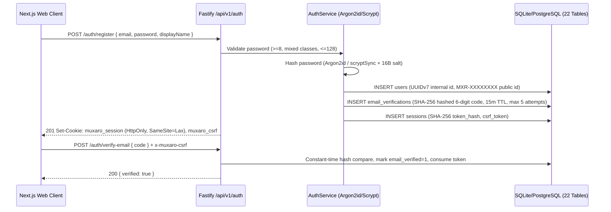
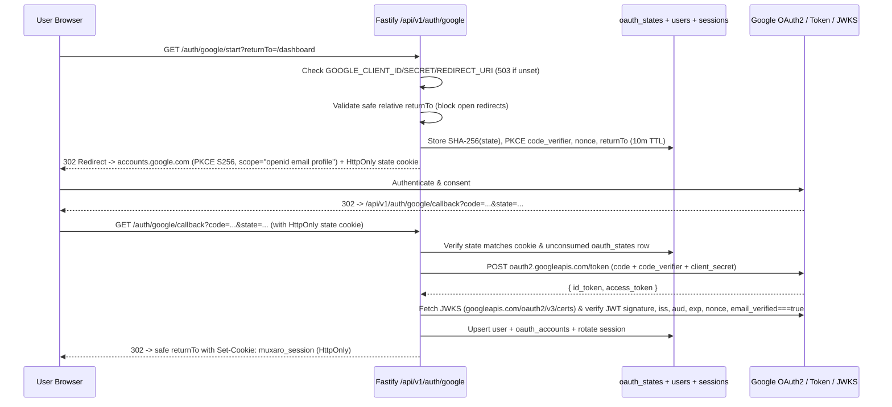
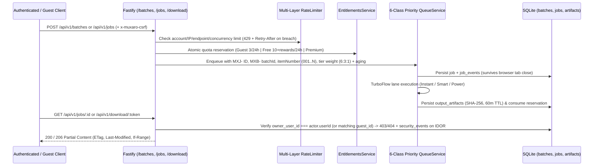
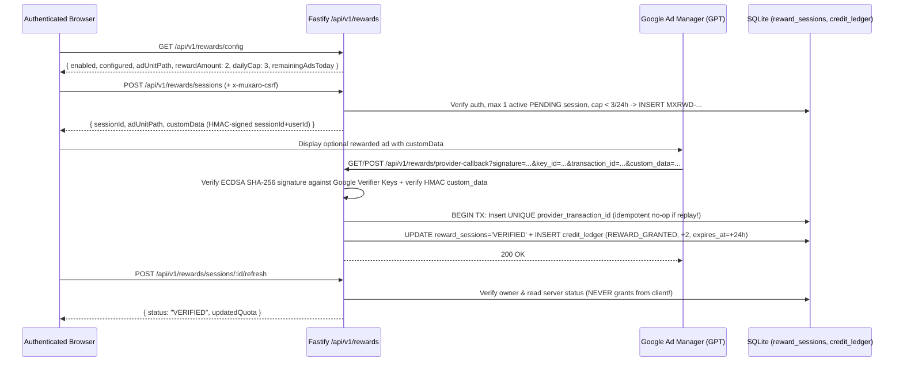
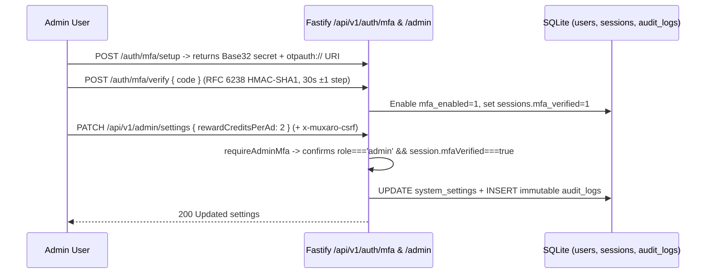
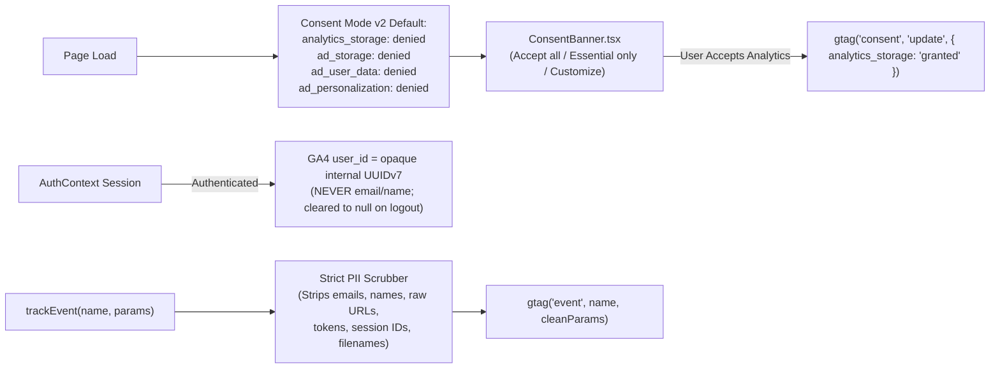

# MUXARO Account Platform — End-to-End Data & Security Flows
**Product:** MUXARO — *Your Media. One Powerful Workspace.*  
**Author:** AGENT 01 — Principal Architect & System Designer  
**Date:** 18 November 2026  

---

## 1. Email Registration, Verification & Cookie Session Flow

---

## 2. Google OAuth 2.0 Authorization Code + PKCE (S256) Flow

---

## 3. Three-Tier Priority Queue, Batch Execution & IDOR Isolation Flow

---

## 4. Google Ad Manager Rewarded Ad SSV (Server-Side Verification) Flow

---

## 5. Admin TOTP MFA & Privileged Control Centre Flow

---

## 6. Privacy-First Analytics (GA4 + Consent Mode v2 + PII Scrubber)

