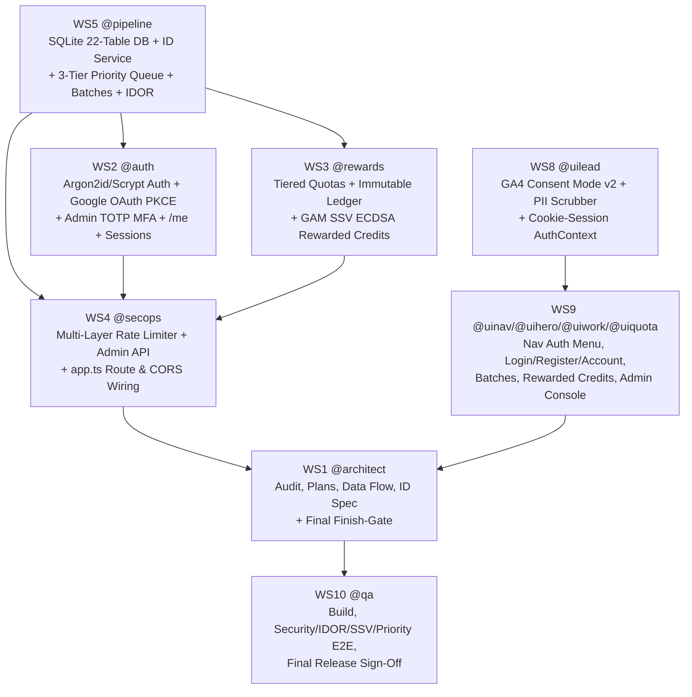

# MUXARO Account Platform — Master Implementation Plan
**Product:** MUXARO — *Your Media. One Powerful Workspace.*  
**Author:** AGENT 01 — Principal Architect & System Designer  
**Date:** 18 November 2026  
**Scope:** End-to-end architecture and rollout plan for Accounts, Authentication, Admin MFA, 22-Table Relational Persistence, 3-Tier Priority Scheduling, Google Ad Manager SSV Rewarded Credits, Multi-Layer Rate Limiting, Admin Control Centre, and GA4 Consent Mode v2.

---

## 1. Workstream Topology & Execution DAG

---

## 2. Core Architectural Contracts

### 2.1 Relational Persistence Contract (`apps/api/src/db/database.ts`)
- Runtime engine: Node 24 built-in `node:sqlite` (`DatabaseSync`) at `.muxaro-data/muxaro.db` with `PRAGMA journal_mode = WAL` and `PRAGMA foreign_keys = ON`.
- Mirrors the production PostgreSQL 16 schema across **22 core tables**:
  1. `users` (`id` UUIDv7 PK, `public_user_id` UNIQUE `MXR-XXXXXXXX`, `email` UNIQUE, `password_hash`, `email_verified`, `display_name`, `avatar_url`, `role`, `tier`, `status`, `mfa_enabled`, `mfa_secret_encrypted`, `preferences_json`, `deleted_at`, timestamps)
  2. `oauth_accounts` (`provider`, `provider_subject`, `user_id`, `email`, timestamps)
  3. `oauth_states` (`state_hash`, `code_verifier`, `nonce`, `return_to`, `expires_at`, `consumed_at`)
  4. `sessions` (`id`, `user_id`, `token_hash` UNIQUE SHA-256, `csrf_token`, `mfa_verified`, `user_agent`, `ip_prefix`, `expires_at`, `revoked_at`, `last_seen_at`, `created_at`)
  5. `email_verifications` (`id`, `user_id`, `code_hash`, `attempts`, `max_attempts`, `expires_at`, `consumed_at`)
  6. `password_resets` (`id`, `user_id`, `token_hash`, `expires_at`, `consumed_at`)
  7. `guest_identities` (`guest_id`, `ip_prefix`, `created_at`, `last_seen_at`)
  8. `media_assets` (`id`, `owner_user_id`, `guest_id`, `source_type`, `title`, `container`, `duration_seconds`, `file_size_bytes`, `expires_at`, `metadata_json`)
  9. `batches` (`id` `MXB-YYYYMMDD-XXXXXX`, `owner_user_id`, `guest_id`, `title`, `total_items`, `completed_items`, `failed_items`, `status`, `created_at`, `updated_at`)
  10. `jobs` (`id` `MXJ-XXXXXXXXXX`, `owner_user_id`, `guest_id`, `batch_id`, `item_number`, `tier`, `processing_lane`, `queue_class`, `strategy_label`, `lossless_preserved`, `retention_minutes`, `status`, `progress`, `queued_at`, `started_at`, `completed_at`, `error_code`, `user_message`, `payload_json`)
  11. `job_events` (`id`, `job_id`, `status`, `progress`, `stage_message`, `created_at`)
  12. `output_artifacts` (`id`, `job_id`, `filename`, `mime_type`, `size_bytes`, `sha256`, `file_path`, `expires_at`, `created_at`)
  13. `quota_reservations` (`id`, `subject_key`, `user_id`, `guest_id`, `bucket`, `job_id`, `units`, `source`, `status`, `reserved_at`, `consumed_at`, `released_at`)
  14. `credit_ledger` (immutable append-only: `id`, `user_id`, `guest_id`, `entry_type`, `delta`, `remaining_units`, `bucket`, `reference_id`, `reason`, `expires_at`, `created_at`)
  15. `reward_sessions` (`id` `MXRWD-...`, `user_id`, `ad_unit_path`, `custom_data_sig`, `reward_amount`, `status`, `expires_at`, `verified_at`, `created_at`)
  16. `reward_provider_events` (`id`, `reward_session_id`, `provider_transaction_id` UNIQUE, `key_id`, `verified`, `payload_redacted`, `created_at`)
  17. `system_settings` (`key` PK, `value_json`, `updated_by`, `updated_at`)
  18. `rate_limit_buckets` (`bucket_key` PK, `count`, `window_start`, `expires_at`)
  19. `security_events` (`id`, `event_type`, `severity`, `actor_id`, `ip_prefix`, `endpoint`, `details_redacted`, `created_at`)
  20. `audit_logs` (`id`, `actor_user_id`, `action`, `target_type`, `target_id`, `request_id`, `details_json`, `created_at`)
  21. `analytics_events` (`id`, `event_name`, `user_id`, `guest_id`, `tier`, `metadata_json`, `created_at`)
  22. `schema_migrations` (`version` PK, `applied_at`)

### 2.2 Non-Negotiable Security & Integrity Invariants
1. **Zero Client-Side Auth Tokens:** Session tokens live exclusively in `HttpOnly; SameSite=Lax; Path=/` (`Secure` in production) cookies (`muxaro_session`). `localStorage` MUST NEVER store bearer/session tokens.
2. **Zero Client-Triggered Credit Grants:** Rewarded ad credits (+2 individual jobs, 24h rolling expiry, cap 3/24h -> max 16 individual jobs, playlist unaffected) are granted **only** after server-side ECDSA SHA-256 signature verification and unique `provider_transaction_id` deduplication.
3. **Zero Fabricated Speed Claims or Mock Secrets:** Priority scheduling (`PREMIUM` weight 6 > `REGISTERED` weight 3 > `GUEST` weight 1 + anti-starvation aging) must report real measured queue wait / p50 / p95 benchmarks — never invent marketing multipliers (e.g., `"3.5x faster"`). Google OAuth & GA4 & GAM env vars must come strictly from `process.env`.
4. **Zero IDOR Cross-Tenant Leakage:** Every `GET`/`POST`/`DELETE` on jobs, batches, downloads, reward sessions, and user sessions validates strict actor ownership (`owner_user_id === user.id` or matching `guest_id`).
5. **Zero PII in Analytics or Logs:** GA4 `user_id` uses strictly the opaque internal `UUIDv7`; `trackEvent` scrubs email addresses, names, raw URLs, tokens, session IDs, and filenames; `Consent Mode v2` defaults all storage signals to `'denied'` until explicit user choice.

---

## 3. Finish-Gate Verification Criteria (Gate for `@qa`)
1. `tsc --noEmit` exits `0` in `apps/web` and across all modified/new `apps/api/src/` files.
2. `sloplint.mjs apps/web/app apps/web/components` reports **0 FAIL, 0 WARN**.
3. Static & live audit confirms zero hardcoded secrets, zero client-side credit granting, zero tokens in `localStorage`, zero PII in analytics payloads, zero demo/mock data in production, and full IDOR protection.
4. All required architecture, security, authentication, reward, analytics, and benchmark reports exist under `docs/account-platform/`, `docs/security/`, and `docs/performance/`.
