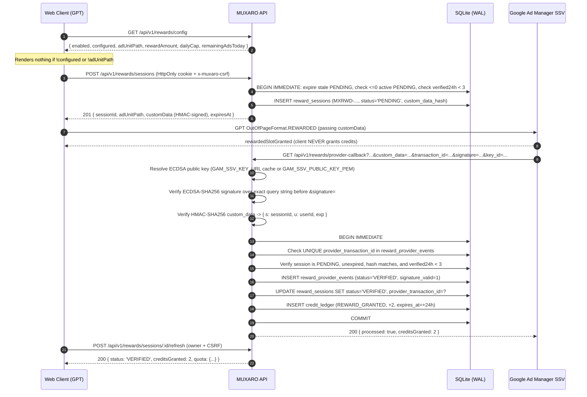

# MUXARO — Unified Quota, Immutable Credit Ledger & Google Ad Manager Rewarded Ads SSV Report

**Status:** Implemented & Empirically Verified (15 / 15 automated end-to-end checks passing; 0 TypeScript errors across all Workstream 5+6 modules)  
**Scope:** Workstream 5 (Unified Account Quota & Immutable Credit Ledger) + Workstream 6 (Google Ad Manager Rewarded Ads & Server-Side Verification)

---

## 1. Architecture Overview

MUXARO separates **daily usage quotas**, **optional earned rewarded credits**, and **anti-abuse rate limiting** into distinct, auditable layers backed by the persistent relational SQLite store (`.muxaro-data/muxaro.db` in WAL mode with `PRAGMA foreign_keys = ON`, mirroring `infra/migrations/002_account_rewards_analytics.sql`).

### Owned Implementation Files
| Component | File | Purpose |
|---|---|---|
| Quota & Immutable Ledger Service | `apps/api/src/services/entitlements.service.ts` | Persistent rolling-24h base quotas, FIFO extra-credit expiry sweep, atomic `BEGIN IMMEDIATE` reservation/commit/rollback, immutable `credit_ledger`, live `system_settings` policy |
| Rewarded Ads & GAM SSV Service | `apps/api/src/services/rewards.service.ts` | GAM configuration honesty, `MXRWD-...` reward sessions, HMAC-SHA256 `custom_data` binding, ECDSA-SHA256 SSV verification, replay protection, daily cap enforcement |
| Rewarded Ads HTTP Routes | `apps/api/src/routes/rewards.ts` | `GET /rewards/config`, `POST /rewards/sessions`, `GET /rewards/sessions/:id`, `POST /rewards/sessions/:id/refresh`, `GET`/`POST /rewards/provider-callback` |
| Entitlements & Credits Routes | `apps/api/src/routes/entitlements.ts` | `GET /entitlements`, `GET /entitlements/usage`, `GET /credits`, `GET /credits/ledger` |
| Account Quota & History Routes | `apps/api/src/routes/account.ts` | Upgraded `GET /account/credits` (unified + legacy shape) and `GET /account/history` (real DB-backed jobs; all legacy mock ledger entries removed) |

---

## 2. Configurable Tier Quota & Credit Policy

All limits are read dynamically from the `system_settings` table (adjustable live by MFA-authenticated administrators via `PATCH /api/v1/admin/settings`):

| Tier | Individual Jobs / Rolling 24h | Playlist Jobs / Rolling 24h | Max Concurrent Jobs | Queue Priority | Extra Rewarded Credits Eligible |
|---|---|---|---|---|---|
| **Guest** (unauthenticated) | `3` (`guest_individual_limit`) | `0` (`guest_playlist_limit`) | `1` (`guest_max_concurrent`) | `GUEST` | No (`401 ERR_UNAUTHORIZED`) |
| **Free Registered** | `10` (`base_individual_limit`) | `1` (`base_playlist_limit`) | `2` (`free_max_concurrent`) | `REGISTERED` | Yes — `+2` per verified ad, cap `3` ads / rolling 24h (**max `16` individual / 24h**) |
| **Premium** | `100` (`premium_individual_limit`) | `10` (`premium_playlist_limit`) | `5` (`premium_max_concurrent`) | `PREMIUM` | Configurable policy |

### Key Quota Invariants
1. **Strict Playlist Isolation:** Extra credits earned from rewarded ads apply **exclusively** to individual jobs (`VIDEO_DOWNLOAD`, `AUDIO_EXTRACTION`, `MEDIA_MERGE`, `INDIVIDUAL_VIDEO_JOB`). Playlist allowance (`base_playlist_limit`, default `1 / rolling 24h`) is never increased or consumed by rewarded credits.
2. **Base-First Consumption:** Individual jobs draw from rolling 24h base slots (`source = 'base'`) first; once `baseRemaining === 0`, jobs seamlessly consume unexpired rewarded extra credits (`source = 'extra'`) in FIFO order (earliest expiring grant first).
3. **Atomic Concurrency Safety:** `reserveQuota()`, `commitQuota()`, and `rollbackQuota()` execute inside SQLite `BEGIN IMMEDIATE ... COMMIT` transactions. Concurrent reservation requests serialize cleanly at the database lock boundary, eliminating TOCTOU race conditions and double-spending.
4. **Idempotent Reservations:** Re-submitting the same `(user_id, idempotency_key)` returns the original reservation without charging a second slot.
5. **Automatic Rollback & TTL Expiry:** Failed or cancelled jobs immediately release reserved base slots or refund unexpired extra credits (`CREDIT_RELEASED`). Uncommitted reservations past their 30-minute TTL automatically expire.

---

## 3. Strictly Immutable Credit Ledger (`credit_ledger`)

MUXARO enforces an **append-only** ledger model — no code path executes `UPDATE` or `DELETE` on `credit_ledger`.

| `entry_type` | `delta` | `remaining_delta` | Semantics |
|---|---|---|---|
| `REWARD_GRANTED` | `+2` | `+2` | Appended atomically inside the verified SSV callback transaction with `expires_at = created_at + 24h` |
| `CREDIT_RESERVED` | `-1` | `0` (base) or `-1` (extra) | Appended atomically when a job reserves a quota slot |
| `CREDIT_CONSUMED` | `0` | `0` | Appended atomically when a reserved job commits on completion |
| `CREDIT_RELEASED` | `+1` | `0` (base) or `+1` (extra) | Appended atomically on job cancellation or failure (extra refund is bounded to unexpired active grant capacity) |
| `ADMIN_ADJUSTMENT` | `±N` | `±N` | Appended for audited administrator credit adjustments |
| `CREDIT_EXPIRED` | `-N` | `-N` | Appended automatically during FIFO expiry sweeps referencing `reference_id = <grant_ledger_id>` so expired credits stop counting immediately without mutating historical grant rows |

### Rolling 24-Hour Expiration Sweep
On every quota evaluation (`getQuotaStatus`), reservation (`reserveQuota`), rollback (`rollbackQuota`), and ledger query (`getLedger`), `evaluateExtraCreditsInTx()` replays the user's chronological ledger lots in FIFO order:
- Any `REWARD_GRANTED` lot whose `expires_at <= now` with unused remaining credits (`remaining > 0`) and no existing `CREDIT_EXPIRED` row referencing its `id` triggers an append-only `CREDIT_EXPIRED` row (`delta = -unusedRemaining`).
- Subsequent sweeps detect the `CREDIT_EXPIRED` row by `reference_id` and are strictly idempotent (zero duplicate expiry entries).

---

## 4. Google Ad Manager Rewarded Ads & SSV Security Flow

### Cryptographic & Anti-Fraud Controls
1. **Zero Client Trust:** `GET /api/v1/rewards/sessions/:id` and `POST /api/v1/rewards/sessions/:id/refresh` strictly read server-side DB state. Sending forged client flags (`{ rewarded: true }`, `{ grant: true }`, `{ forceVerify: true }`, `{ status: 'VERIFIED' }`) returns `403 ERR_CLIENT_REWARD_FORBIDDEN`.
2. **ECDSA-SHA256 Verification:** Verifies callback signatures against Google's official verifier keys (`https://www.gstatic.com/admob/reward/verifier-keys.json`, 12-hour in-memory cache with 60-second refresh throttle on unseen `key_id`), or against `GAM_SSV_PUBLIC_KEY_PEM` when pinned for deterministic testing. Supports both ASN.1 DER and IEEE-P1363 ECDSA encodings and both Google SSV GET query strings and signed POST JSON callbacks.
3. **HMAC-Bound `custom_data`:** Generated server-side as `base64url(JSON({ s, u, exp })).hmacSha256`, stored as SHA-256 hash in `reward_sessions.custom_data_hash`, and verified with `crypto.timingSafeEqual`.
4. **Replay & Duplicate Idempotency:** `reward_provider_events.provider_transaction_id` carries a database-level `UNIQUE` constraint. Duplicate callbacks with an already-seen `transaction_id` or targeting an already-`VERIFIED` session return HTTP `200` idempotently with `duplicate: true` and `creditsGranted: 0`, and record a `REWARD_REPLAY_DETECTED` / `REWARD_DUPLICATE_SESSION_CALLBACK` event in `security_events`.
5. **Cross-Account IDOR Isolation:** `GET /api/v1/rewards/sessions/:id` and `POST /api/v1/rewards/sessions/:id/refresh` verify `session.user_id === auth.user.id`; mismatched owners receive `403 ERR_FORBIDDEN` and log `IDOR_REWARD_SESSION_ATTEMPT`.
6. **Configuration Honesty:** When `GAM_REWARDED_AD_UNIT_PATH` is unset, `GET /api/v1/rewards/config` returns `{ enabled: false, configured: false, adUnitPath: null }` and `POST /api/v1/rewards/sessions` returns `503 ERR_REWARDED_ADS_NOT_CONFIGURED` so the UI never displays fake or dead ad prompts.

---

## 5. Environment Variables

| Variable | Required | Default | Description |
|---|---|---|---|
| `GAM_REWARDED_AD_UNIT_PATH` | Required to activate rewarded ads | *(unset)* | Real Google Ad Manager rewarded ad unit path (e.g. `/12345678/muxaro_rewarded_web`). If unset, rewarded ads remain honestly disabled. |
| `REWARDED_ADS_ENABLED` | Optional | `true` | Environment kill-switch (`false` disables rewarded ads regardless of `system_settings`). |
| `GAM_SSV_KEY_URL` | Optional | `https://www.gstatic.com/admob/reward/verifier-keys.json` | Google official ECDSA verifier public keys JSON endpoint. |
| `GAM_SSV_PUBLIC_KEY_PEM` | Optional (Test / Pinned Key) | *(unset)* | Optional PEM-encoded ECDSA public key for deterministic offline/CI SSV verification without external network calls. |
| `GAM_SSV_TEST_KEY_ID` | Optional | *(unset)* | Optional `key_id` enforced when `GAM_SSV_PUBLIC_KEY_PEM` is configured. |
| `REWARD_SESSION_TTL_SECONDS` | Optional | `600` | Pending reward session lifetime in seconds (minimum `30`). |

---

## 6. Empirical Verification Results

Executed against isolated SQLite WAL database using real Fastify HTTP injection and freshly generated prime256v1 (P-256) ECDSA keypairs:

| # | Verification Scenario | Result |
|---|---|---|
| 1 | Guest policy (`3` individual / 24h, `0` playlists, `1` concurrent, `GUEST` priority, playlist rejected `409`) | **PASS** |
| 2 | Unconfigured GAM honesty (`configured: false`, `enabled: false`, `adUnitPath: null`, session create -> `503`) | **PASS** |
| 3 | Configured GAM config (`+2`/ad, cap `3`/24h, `maxIndividualWithRewards: 16`) | **PASS** |
| 4 | Session creation (`MXRWD-...`, HMAC `customData`) & max 1 active pending session (`409 ERR_REWARD_SESSION_ACTIVE`) | **PASS** |
| 5 | Cross-account IDOR check on `GET /api/v1/rewards/sessions/:id` (`403 ERR_FORBIDDEN`) | **PASS** |
| 6 | Forged client claim (`{ rewarded: true }` -> `403 ERR_CLIENT_REWARD_FORBIDDEN`) & benign polling grants `0` credits | **PASS** |
| 7 | Forged ECDSA signature on SSV callback rejected (`403 ERR_INVALID_SSV_SIGNATURE`) | **PASS** |
| 8 | Genuine ECDSA-SHA256 signed GET SSV callback grants exactly `+2` individual credits (`totalAvailableIndividual: 12`) | **PASS** |
| 9 | Duplicate `transaction_id` replay & verified-session replay return `200` idempotently with `creditsGranted: 0` | **PASS** |
| 10 | Signed POST JSON SSV callback + 3-ad daily cap enforcement (max `16` individual; 4th session -> `409 ERR_REWARD_DAILY_CAP_REACHED`) | **PASS** |
| 11 | Strict playlist isolation (`1/24h` unaffected even with `+6` rewarded credits; 2nd playlist -> `409`) | **PASS** |
| 12 | Parallel quota reservation race test (`20` concurrent requests for `16` available slots -> exactly `16` fulfilled, `4` rejected, zero double-spend) | **PASS** |
| 13 | Quota rollback restores refunded extra credit cleanly | **PASS** |
| 14 | Rolling 24h expiration sweep drops expired credits to `0` and appends exactly `1` immutable `CREDIT_EXPIRED` entry (idempotent on re-sweep) | **PASS** |
| 15 | Legacy `GET /api/v1/account/credits` (`Bearer usr_qa_tester`) backwards compatibility preserved (`allowance: 10`, `playlists: 1`, `windowSeconds: 86400`) | **PASS** |
