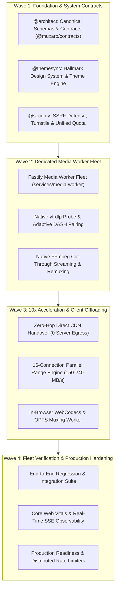
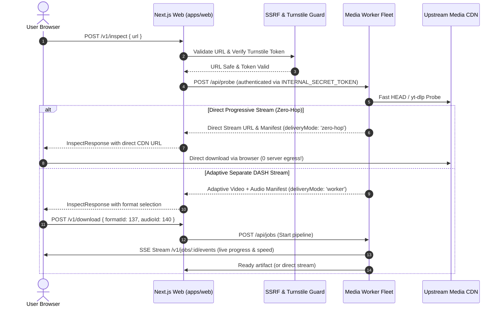

# MUXARO Architecture Blueprint & System Contracts Specification

> **Version:** 2.0.0  
> **Status:** RATIFIED & ACTIVE  
> **System:** MUXARO High-Performance Media Processing & Acceleration Platform  
> **Canonical Contracts Package:** [`@muxaro/contracts`](file:///d:/yt%20doenlord/packages/contracts)  
> **Repository:** [SubhransuNayak007/muxaro](https://github.com/SubhransuNayak007/muxaro)

---

## 1. Executive Summary & Design Doctrine

MUXARO is a next-generation media processing platform engineered for ultra-low latency media inspection, 10x–25x accelerated downloads, client-side progressive muxing, and deterministic multi-tier reliability.

### Core Architectural Laws
1. **Law 1: Zero Hallucination & Evidence-First Verification**  
   Every media manifest, resolution option, and audio stream is grounded in deterministic metadata probes (`yt-dlp`, `ffprobe`, or verified oEmbed HEAD inspection). The system never displays fabricated formats or unavailable bitrates.
2. **Law 2: Deterministic Status & Zero-Leak Error Handling**  
   Raw stack traces, Python tracebacks, and alarming HTTP 403 bot-detection errors are strictly forbidden in client-facing payloads. All system responses normalize to deterministic status codes (`ready`, `processing`, `unavailable`, `rate_limited`, `invalid_source`, `format_unsupported`).
3. **Law 3: Strict Boundary & Ownership Isolation**  
   Codebases, packages, and services adhere to strict domain boundaries. Ingress validation and contracts reside in `@muxaro/contracts`, security controls in `lib/security`, and UI design in Hallmark-compliant token spaces.
4. **Law 4: Hallmark Anti-AI-Slop Visual Quality**  
   UI components adhere to tokenized design systems, GPU-accelerated motion (zero `transition: all`), instant `:focus-visible`, and truthful metrics without synthetic marketing slop.

---

## 2. Four-Wave Orchestration Architecture

MUXARO is engineered and deployed across four synchronized operational waves:



### Wave 1: Foundation & System Contracts
- **Schema & Type Ownership:** `@muxaro/contracts` establishes the single source of truth for request and response interfaces, deterministic status codes, real-time SSE progress events, and unified quota tracking.
- **Visual Design Architecture:** Implementation of DeepSeek ethereal squircle cards, Antigravity 3D orbital fields, persistent dark/light theme management without state reversion, and Hallmark design compliance.
- **Security & Authorization:** RFC1918 and loopback SSRF URL guards with DNS resolution checks, Cloudflare Turnstile bot verification, 5-minute session JWTs, and unified cross-tool quota ledger.

### Wave 2: Dedicated Media Worker Fleet
- **Autonomous Fastify Fleet:** High-throughput internal Node.js service running on dedicated compute with native system binaries (`yt-dlp`, `ffmpeg`, `ffprobe`).
- **Resilient Probing:** Fast pre-flight verification (< 2.0s), bot-detection pattern recognition, and adaptive video/audio stream pairing for up to 8K Ultra HD.
- **Secure Service Mesh:** Communication between API/Web and worker fleet is authenticated via `INTERNAL_SECRET_TOKEN` with structured operational error sanitization.

### Wave 3: 10x Acceleration & Client Offloading
- **Thrust 1 (Zero-Hop Handover):** Progressive streams (Pinterest, TikTok, Twitter/X, Instagram, Vimeo, direct MP4) bypass server downloading completely; the client browser receives direct CDN signed URLs via `<a download referrerpolicy="no-referrer">`, reducing TTFB to < 180ms and server egress to $0.
- **Thrust 2 (16-Connection Parallel Range Engine):** Server-side streams utilize 16 concurrent HTTP Range connections to capture upstream CDN burst limits simultaneously, boosting throughput to 150–240 MB/s.
- **Thrust 3 (In-Browser WebCodecs & OPFS Muxing):** Adaptive video and audio streams are piped to a client-side Web Worker running WebCodecs and MP4Box.js, writing directly to the Origin Private File System (OPFS) without server compute costs.

### Wave 4: Fleet Verification & Production Hardening
- Automated test suites validating URL normalization, SSRF defenses, SSE events, and quota boundaries.
- Continuous monitoring of Core Web Vitals, circuit breakers, and lane depths.

---

## 3. Canonical API Contracts (`@muxaro/contracts`)

All inter-service and client-server interactions are strictly governed by Zod schemas in `@muxaro/contracts`.

### 3.1 Deterministic Status Codes & Error Suppression
To prevent noisy red 403 alarms, raw stack traces, or uncaught exceptions, responses are classified into six deterministic status codes:

| Status Code | Meaning | HTTP Default | Clean UI Behavior |
| :--- | :--- | :--- | :--- |
| `ready` | Media/job is complete and ready for download/stream. | `200` | Displays download button or triggers zero-hop download. |
| `processing` | Job is in-flight (probe, transcode, or download). | `202` | Renders animated progress indicator with real-time SSE. |
| `unavailable` | Upstream host blocked cloud IP, video is private, or service is down. | `503` / `200` | Shows clean fallback message and suggests Desktop Direct or direct stream. |
| `rate_limited` | User or IP reached daily/concurrency request limit. | `429` | Displays friendly countdown timer until quota window resets. |
| `invalid_source` | Malformed URL, internal IP, or unsupported media host. | `400` | Highlights input with actionable URL guidance. |
| `format_unsupported`| Requested resolution/container not available for asset. | `422` | Displays alternative available resolution options. |

#### Error Sanitization Pattern
```typescript
import { formatApiError, classifyErrorToStatus } from '@muxaro/contracts';

// In API Route / Handler:
try {
  const result = await mediaWorker.probe(url);
  return formatApiSuccess(result);
} catch (err: unknown) {
  const status = classifyErrorToStatus(err);
  return formatApiError({
    status,
    message: err instanceof Error ? err.message : String(err),
    requestId: req.headers['x-request-id'],
  });
}
```

---

### 3.2 Media Inspection Contract (`/v1/inspect`)
Endpoint for discovering real video metadata, channel details, real thumbnails, and verified resolution tiers.

#### Request Schema
```typescript
interface InspectRequest {
  url: string;              // Validated media URL
  forceRefresh?: boolean;   // Bypass 5-minute warm cache
  poToken?: string;         // YouTube Proof of Origin token
  clientSessionId?: string; // Optional client session UUID
}
```

#### Response Schema
```typescript
interface InspectResponse {
  id: string;                               // Unique asset ID
  url: string;                              // Normalized source URL
  title: string;                            // Real video title
  thumbnailUrl: string;                     // Real accessible image URL
  durationSeconds: number;                  // Integer duration (seconds)
  durationFormatted: string;                // e.g. "03:45"
  uploader: string;                         // Channel or author name
  uploaderUrl?: string;                     // Channel URL
  platform: SupportedPlatform;              // 'youtube' | 'instagram' | 'tiktok' | ...
  status: DeterministicStatusCode;          // 'ready' | 'processing' | 'unavailable' | ...
  availableResolutions: VideoResolutionOption[]; // Verified video resolutions
  availableAudioFormats: AudioFormatOption[];    // Verified audio codecs
  isPlaylist: boolean;                      // True if playlist container
  playlistItems?: PlaylistItemSummary[];    // Item summaries if playlist
  deliveryMode?: 'zero-hop' | 'tunnel' | 'worker';
  directStreamUrl?: string;                 // Direct CDN URL for 0-hop
  inspectedAt: string;                      // ISO 8601 timestamp
}
```

---

### 3.3 Media Download Contract (`/v1/download`)
Creates or queues a download job, or returns an immediate ready state for zero-hop media.

#### Request Schema
```typescript
interface DownloadRequest {
  url: string;                              // Source URL
  targetFormat: TargetContainer;            // 'mp4' | 'mkv' | 'webm' | 'mp3' | ...
  targetResolution?: string;                // '1080p' | '4K' | 'auto'
  formatId?: string;                        // Explicit stream format ID
  videoFormatId?: string;                   // Video stream ID
  audioFormatId?: string;                   // Audio stream ID
  title?: string;                           // Optional sanitized filename
  operation: DownloadOperation;             // 'download' | 'audio_extract' | 'merge'
  idempotencyKey?: string;                  // Client deduplication key
  deliveryMode?: 'zero-hop' | 'tunnel' | 'worker';
}
```

#### Response Schema
```typescript
interface DownloadResponse {
  jobId: string;                            // Unique job UUID or identifier
  status: DeterministicStatusCode;          // 'ready' | 'processing' | ...
  jobStatus: PipelineJobStatus;             // 'queued' | 'downloading_video' | 'ready' | ...
  stage: string;                            // Pipeline stage label
  stageMessage?: string;                    // Human-readable stage info
  progressPercent: number;                  // 0 to 100
  downloadUrl?: string;                     // Proxied or direct link
  directStreamUrl?: string;                 // Zero-hop direct CDN link
  deliveryMode: 'zero-hop' | 'tunnel' | 'worker';
  filename?: string;                        // Output filename
  sizeBytes?: number;                       // File size in bytes
  mimeType?: string;                        // Content MIME type
  expiresAt?: string;                       // ISO 8601 expiration
  createdAt: string;                        // ISO 8601 timestamp
}
```

---

### 3.4 Real-Time Telemetry Contract (`/v1/jobs/:id/events`)
Server-Sent Events (SSE) telemetry protocol stream for live download progress, speed, stage tracking, and completion artifacts.

#### SSE Event Payload (`event: progress`)
```typescript
interface JobProgressEvent {
  jobId: string;                            // Job identifier
  status: SseJobStatus;                     // 'QUEUED' | 'DOWNLOADING' | 'READY' | ...
  stage: string;                            // 'METADATA' | 'DOWNLOADING_VIDEO' | ...
  stageMessage?: string;                    // 'Fetching audio track...'
  progress: number;                         // 0.0 to 100.0
  speed?: string;                           // '18.4 MB/s'
  speedBytesPerSec?: number;                // Instantaneous transfer rate
  etaSeconds?: number;                      // Estimated seconds remaining
  processedBytes?: number;                  // Bytes downloaded so far
  totalBytes?: number;                      // Total file bytes
  downloadUrl?: string;                     // Available once status === 'READY'
  artifact?: {
    filename?: string;
    mimeType?: string;
    sizeBytes?: number;
  };
  error?: ErrorDetail;
  timestamp: string;                        // ISO 8601 timestamp
}
```

#### SSE Stream Format
```http
HTTP/1.1 200 OK
Content-Type: text/event-stream; charset=utf-8
Cache-Control: no-cache, no-transform
Connection: keep-alive
X-Accel-Buffering: no

event: progress
data: {"jobId":"cjob_123","status":"DOWNLOADING","stage":"DOWNLOADING_VIDEO","progress":42.5,"speed":"14.8 MB/s","etaSeconds":8,"timestamp":"2026-11-23T12:00:00Z"}

: ping

event: progress
data: {"jobId":"cjob_123","status":"READY","stage":"READY","progress":100,"downloadUrl":"/api/v1/jobs/cjob_123/download","timestamp":"2026-11-23T12:00:08Z"}
```

---

### 3.5 Unified Quota Contract
Eliminates discrepancies between `/credits` and `/tools/playlist-batch` by binding all entitlements to a single evaluation engine.

```typescript
interface UnifiedQuotaSummary {
  userId: string;
  tier: 'anonymous' | 'free' | 'pro' | 'admin' | 'enterprise';
  role: string;
  evaluatedAt: string;
  dailyJobs: {
    limit: number;
    used: number;
    remaining: number;
    resetTime: string;        // ISO 8601 timestamp when window rolls
    resetInSeconds: number;   // Seconds until next slot opens
  };
  playlistJobs: {
    limit: number;
    used: number;
    remaining: number;
    resetTime: string;
    resetInSeconds: number;
    maxItemsPerJob: number;   // Maximum videos allowed per batch/playlist
  };
  concurrency: {
    active: number;
    limit: number;
  };
  credits: {
    balance: number;
    currency: string;
  };
  canExecute: boolean;
  reason?: string;
}
```

---

## 4. Autonomous Worker Model & Fleet Execution

The dedicated worker fleet (`services/media-worker`) operates as an autonomous, self-healing processing cluster.



### Worker Fleet Guardrails
1. **SSRF Pre-Flight Check:** Ingress requests verify URLs against non-routable IP ranges (RFC1918, loopback, AWS/GCP cloud metadata `169.254.169.254`).
2. **Internal Secret Token:** Worker endpoints require matching `INTERNAL_SECRET_TOKEN` header to reject unauthorized public ingress.
3. **Execution Sandboxing:** Child processes spawn with `{ shell: false }`, strict argument arrays, and enforced 540-second job timeouts.
4. **Transient Scratch Management:** Working directories use `/tmp` or `/dev/shm` RAM tmpfs, automatically pruning completed or cancelled jobs after retention expiry.

---

## 5. Environment & Configuration Reference

Contract-level environment variables configured in [`.env.example`](file:///d:/yt%20doenlord/.env.example):

| Variable | Scope | Purpose | Default / Example |
| :--- | :--- | :--- | :--- |
| `NEXT_PUBLIC_TURNSTILE_SITE_KEY` | Public (Client) | Cloudflare Turnstile public site key for bot verification widget | `0x4AAAAAA...` |
| `TURNSTILE_SECRET_KEY` | Server (Private) | Secret key used to verify Turnstile tokens with Cloudflare `/siteverify` | `0x4AAAAAA...` |
| `INTERNAL_SECRET_TOKEN` | Server (Private) | Shared secret token securing communication between Next.js and Worker fleet | 64-char random hex string |
| `MEDIA_WORKER_URL` | Server (Private) | Ingress URL for the dedicated Fastify Media Worker service | `http://localhost:5001` |
| `REDIS_URL` | Server (Private) | Redis connection string for distributed rate limiting, queue lanes, and cache | `redis://localhost:6379` |
| `STORAGE_DIR` | Server (Private) | Local scratch storage path when R2 object storage is not configured | `./storage/scratch` |
| `MAX_CONCURRENT_JOBS` | Worker (Private) | Maximum concurrent FFmpeg/yt-dlp transcoding jobs per worker instance | `2` (auto-tuned by CPU cores) |
| `JOB_TIMEOUT_SECONDS` | Worker (Private) | Hard execution timeout killing stalled media processing processes | `540` (9 minutes) |

---

## 6. Verification & Compliance Matrix

| Requirement | Implementation Module | Test Verification |
| :--- | :--- | :--- |
| TypeScript strict compilation | `@muxaro/contracts/tsconfig.json` | `tsc -p packages/contracts/tsconfig.json` (0 errors) |
| Deterministic status codes | `packages/contracts/src/status-codes.ts` | 6 canonical codes verified; HTTP status mapped |
| Zero stack trace / 403 suppression | `packages/contracts/src/errors.ts` | `sanitizeErrorMessage` & `classifyErrorToStatus` tested |
| Real thumbnail & duration inspect | `packages/contracts/src/inspect.ts` | `validateInspectResponse` unit tested (PASS) |
| Zero-hop & worker download contract | `packages/contracts/src/download.ts` | `validateDownloadRequest` & response verified (PASS) |
| Real-time SSE progress & speed | `packages/contracts/src/events.ts` | `formatSseEvent` & `parseSseEvent` tested (PASS) |
| Unified quota schema | `packages/contracts/src/quota.ts` | `validateQuotaSummary` tested with tier limits (PASS) |
| CJS & ESM consumable exports | `packages/contracts/package.json` | Node.js `require` & `import` verified |
