# MUXARO 10X SPEED & ARCHITECTURAL ACCELERATION EXECUTION PLAN
## Operationalizing the Cobalt & aria2c Blueprint into Production Reality

> **Status:** READY FOR EXECUTION  
> **Target System:** MUXARO Media Acceleration Core (`http://localhost:3000` & `muxaro.vercel.app`)  
> **Source Blueprint:** [`ARCHITECTURAL_INVESTIGATION_AND_10X_SPEED_BLUEPRINT.md`](file:///d:/yt%20doenlord/docs/architecture/ARCHITECTURAL_INVESTIGATION_AND_10X_SPEED_BLUEPRINT.md)  
> **Coordination Model:** The Agency NEXUS Protocol (Multi-Agent Swarm Orchestration)  
> **Speed Target:** 10x–25x Throughput Acceleration across YouTube, Pinterest, TikTok, Twitter/X, Reddit, Vimeo & Instagram

---

## 1. Executive Strategy & Physics of 10x Acceleration

To achieve a true **10x speedup**, MUXARO must systematically dismantle the four physical bottlenecks identified in the comparative architecture audit:

```mermaid
flowchart TD
    subgraph B1["Bottleneck 1: Server Transit"]
        A1["Platform CDN"] -->|Download to Server| S1["Vercel / VPS Server"]
        S1 -->|Re-upload to Client| C1["User Browser"]
        style S1 fill:#f87171,color:#000
    end

    subgraph S1_Sol["10x Solution: Zero-Hop Handover"]
        A2["Platform CDN"] ===>|Direct 0-Hop Download 100% Line-Rate| C2["User Browser"]
        style C2 fill:#4ade80,color:#000
    end

    subgraph B2["Bottleneck 2: CDN Playback Pacing"]
        A3["Google CDN"] -->|Single TCP Stream Paced to 1.5 MB/s| C3["User Browser"]
        style A3 fill:#f87171,color:#000
    end

    subgraph S2_Sol["10x Solution: 16-Conn Range Engine"]
        A4["Google CDN"] ===>|16 Parallel 10MB Range Chunks| R4["Ring Buffer (240 MB/s)"]
        R4 ===>|Line-Rate Stream| C4["User Browser"]
        style R4 fill:#4ade80,color:#000
    end
```



### The 4 Execution Thrusts
1. **Thrust 1 (Zero-Hop Client Handover):** For progressive streams (Pinterest, TikTok, Twitter/X, Instagram, Vimeo, YouTube 720p/360p), the server does **0 bytes of data transfer**. The server only resolves the stream URL; the client browser downloads directly from the origin CDN via `<a href="..." download referrerpolicy="no-referrer">`. **TTFB drops to < 180ms; server egress drops to $0.00; speed is 100% of user line rate.**
2. **Thrust 2 (16-Connection Parallel Range Engine):** For server-handled streams, upgrade `range-fetcher.ts` from 6 to 16 concurrent HTTP Range connections (matching aria2c `-x 16 -k 1M -s 16`). Each connection captures Google CDN's initial 15 MB unthrottled burst simultaneously, multiplying throughput from ~5 MB/s to **150–240 MB/s**.
3. **Thrust 3 (Client-Side In-Browser Muxing via WebCodecs & OPFS):** For 1080p/4K/8K media with separate video and audio tracks (Cobalt v11 model), offload track remuxing to a background Web Worker using MP4Box.js / WebCodecs in the browser's Origin Private File System (OPFS). Zero server CPU, zero cloud storage wear.
4. **Thrust 4 (Split Edge Architecture & Infrastructure Hardening):** Retain Vercel for the ultra-fast Next.js UI, marketing pages, and singleflight manifest cache. Route heavy 4K/8K media conversion requests via short-lived HMAC-signed bearer tokens to dedicated, unmetered edge streaming nodes (Fly.io / Hetzner / Bare-Metal) with `/dev/shm` RAM tmpfs.

---

## 2. Phase-by-Phase Implementation Roadmap

```mermaid
gantt
    title MUXARO 10x Speed Implementation Phases
    dateFormat  X
    axisFormat  Day %d
    section Phase 1: Zero-Hop Client Handover
    Wire platform-extractors to zero-hop flag       :p1_1, 0, 1
    Update UI for direct browser-to-CDN download  :p1_2, 1, 2
    section Phase 2: 16-Conn Range Engine
    Upgrade range-fetcher to 16 connections        :p2_1, 1, 3
    Dynamic buffer pooling & socket reuse         :p2_2, 2, 4
    section Phase 3: Client-Side Web Worker
    Scaffold in-browser muxer worker with OPFS    :p3_1, 3, 5
    Implement stream-copy MP4Box.js packaging     :p3_2, 4, 6
    section Phase 4: Verification & Benchmarking
    Live before-vs-after empirical speed testing  :p4_1, 5, 7
    ffprobe validation & production deployment    :p4_2, 6, 8
```



---

### Phase 1: Zero-Hop Client Handover (Immediate 10x–50x for Progressive Media)
*Target: Pinterest, TikTok, Twitter/X, Instagram, Vimeo, and progressive YouTube.*

- [ ] **1.1 Platform Extractor Zero-Hop Contract Enhancement**
  - **File:** `apps/web/lib/platform-extractors.ts`
  - **Action:** Ensure every progressive media result specifies `deliveryMode: 'zero-hop'` and provides a validated direct CDN URL.
  - **Mechanisms:**
    - Pinterest: Extracts direct `v.pinimg.com/videos/mc/...mp4` from `__PWS_DATA__` or OpenGraph tags.
    - Twitter/X: Extracts direct `video.twimg.com/...mp4` with bitrate variants.
    - TikTok: Extracts direct `playAddr` from TikWM / Douyin CDN.
    - Vimeo: Extracts direct `player.vimeo.com` progressive CDN files.
- [ ] **1.2 Job Manager Instant Ready Response**
  - **File:** `apps/web/lib/job-manager.ts`
  - **Action:** When `spec.directProgressiveUrl` or `streamInfo.mediaUrl` is detected and CORS/referrer policy permits direct download, bypass server downloading completely:
    ```typescript
    job.status = 'ready';
    job.stage = 'READY';
    job.deliveryMode = 'zero-hop';
    job.directStreamUrl = directUrl;
    job.downloadUrl = directUrl; // Points directly to CDN!
    ```
- [ ] **1.3 UI Client Handover Execution**
  - **Files:** `apps/web/components/JobProgress.tsx`, `apps/web/components/AdaptiveMediaCard.tsx`
  - **Action:** If `job.deliveryMode === 'zero-hop'`, trigger client download directly via an invisible anchor:
    ```html
    <a href={job.directStreamUrl} download={job.filename} rel="noreferrer" referrerpolicy="no-referrer" />
    ```
  - **Fallback:** If client direct fetch is blocked by browser CORS, automatically fall back to Tier 0 loopback proxy (`/api/v1/jobs/[id]/download`).

---

### Phase 2: 16-Connection Parallel Range Engine (10x for Adaptive YouTube & Reddit)
*Target: 1080p, 1440p, 4K, 8K DASH streams.*

- [ ] **2.1 Concurrency & Chunk Sizing Calibration**
  - **File:** `apps/web/lib/pipeline/range-fetcher.ts`
  - **Action:**
    - Scale `MAX_CONCURRENT` from 6 to **16 connections** for files > 50 MB (matching aria2c).
    - Maintain chunk size at **9.5 MB** to maximize the Google CDN 15 MB initial burst without triggering TCP rate-shaping.
- [ ] **2.2 Connection Pooling & Agent Keep-Alive**
  - **File:** `apps/web/lib/pipeline/range-fetcher.ts`
  - **Action:** Use a dedicated `http.Agent` / `https.Agent` with `keepAlive: true`, `maxSockets: 32`, and `keepAliveMsecs: 15000` to eliminate TLS handshake latency across chunk requests.
- [ ] **2.3 Bounded Memory Guardrails**
  - **Action:** Adjust the ring-buffer depth to hold at most 6 chunks ahead (6 × 9.5 MB ≈ 57 MB RAM per active stream), strictly enforcing Node.js backpressure on the reader so memory never overflows.

---

### Phase 3: Client-Side In-Browser Muxing via WebCodecs & OPFS
*Target: 4K/8K zero-server-cost remuxing (Cobalt v11 model).*

- [ ] **3.1 OPFS Chunk Writer Worker**
  - **File:** `apps/web/workers/muxer.worker.ts`
  - **Action:** Create a dedicated Web Worker that:
    1. Receives `{ videoUrl, audioUrl, filename, format }`.
    2. Opens two file handles in the browser's Origin Private File System (`navigator.storage.getDirectory()`).
    3. Fetches video and audio chunks concurrently using Web `fetch()` streams and writes them into OPFS.
- [ ] **3.2 In-Browser Stream-Copy Remuxer**
  - **Action:** Integrate `mp4box.js` or WebCodecs in the worker to interleave audio & video samples into a clean, faststart MP4 file without decoding/re-encoding video frames (0% GPU/CPU loss).
- [ ] **3.3 Direct Disk Streaming via File System Access API**
  - **Action:** Pipe the completed OPFS blob directly into the user's Downloads folder via `showSaveFilePicker()` or programmatic blob URL.

---

### Phase 4: Sovereign Edge Streaming Fleet & Infrastructure Split
*Target: High-availability production scaling.*

- [ ] **4.1 Tokenized Stream Ticket Minting Engine**
  - **File:** `apps/web/lib/pipeline/token-broker.ts`
  - **Action:** Implement HMAC-SHA256 stream ticket minting:
    ```typescript
    export function mintStreamTicket(upstreamVideo: string, upstreamAudio: string, clientIp: string): string;
    ```
- [ ] **4.2 Edge Node Deployment Spec (Fly.io / Hetzner / Docker)**
  - **Files:** `infra/docker/Dockerfile.streaming-node`, `infra/fly.toml`
  - **Action:** Package a lightweight standalone streaming service using MUXARO's Tier 2 (Loopback Cut-Through) and Tier 3 (Faststart with `/dev/shm` tmpfs) running on persistent Linux containers with unmetered bandwidth.

---

## 3. Specialist Swarm Task Allocations

| Specialist Agent | Assigned Phase & Pod | Primary File Targets | Completion Criteria |
| :--- | :--- | :--- | :--- |
| **`multi-platform-eng`** | Phase 1 (Zero-Hop Handover) | `apps/web/lib/platform-extractors.ts`, `extractor-ytdlp.ts` | All progressive media URLs emit verified `zero-hop` delivery records with 0B server download. |
| **`pipeline-dev`** | Phase 2 (16-Conn Range Engine) | `apps/web/lib/pipeline/range-fetcher.ts`, `tier0-passthrough.ts` | 16-connection parallel Range engine downloads 100MB+ in < 2.5s with bounded memory. |
| **`shell-architect`** | Phase 2 & 4 (Cut-Through & Fleet) | `apps/web/lib/pipeline/tier2-cutthrough.ts`, `infra/*` | HEAD request handling verified; zero-disk loopback remuxer delivers TTFB < 1.5s. |
| **`de-slop-architect`** | Phase 1 & 3 (UI Handover) | `apps/web/components/JobProgress.tsx`, `AdaptiveMediaCard.tsx` | Clean 3-row card triggers zero-hop browser download seamlessly without AI slop. |
| **`bench-verifier`** | Phase 4 (Empirical Verification) | `scripts/scientific_benchmark_pod4.ts`, `storage/benchmarks/` | Full ffprobe audio/video integrity verified; before/after speedup mathematically documented. |

---

## 4. Verification & Testing Gates

```
GATE 1: ZERO-HOP PROGRESSIVE VERIFICATION
- Submit Pinterest, TikTok, Twitter/X, and YouTube 720p URLs.
- Verify server CPU and RAM remain idle (0 MB transferred through Next.js server).
- Verify file downloaded on client is authentic multi-megabyte MP4 (> 10 MB) with 100% line rate.

GATE 2: 16-CONNECTION RANGE ENGINE BENCHMARK
- Run timed download test on 1080p DASH stream.
- Verify aggregate throughput exceeds 100 MB/s on unthrottled network.
- Verify memory consumption remains <= 60 MB throughout the download.

GATE 3: STREAM INTEGRITY (ffprobe)
- Execute:
  ffprobe -v error -show_entries stream=codec_name,width,height -show_entries format=format_name,duration,size -of json <file>
- Verify: 1920x1080 resolution, valid audio track, non-zero duration, valid MP4 container.

GATE 4: PRODUCTION BUILD & ZERO REGRESSION
- Run: `cd apps/web && npx tsc --noEmit && npm run build`
- Verify 63/63 routes compile with clean exit code 0.
```
