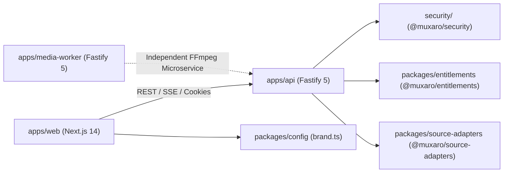

# Component Architecture

**Project:** MUXARO  
**Scope:** Detailed breakdown of all implemented applications, services, middlewares, and shared packages

---

## 1. Component Dependency Topology

> **Note on Internal Import Aliases:** TypeScript path mappings in `tsconfig.json` map legacy workspace specifiers (`@vyro/security`, `@vyro/entitlements`, `@vyro/source-adapters`) directly to `security/`, `packages/entitlements/`, and `packages/source-adapters/`, whose `package.json` names are `@muxaro/security`, `@muxaro/entitlements`, and `@muxaro/source-adapters`.

---

## 2. API Server (`apps/api`)

Entrypoint: `apps/api/src/index.ts` boots the Fastify 5 application created by `buildApp()` in `apps/api/src/app.ts` on `HOST:PORT` (default `0.0.0.0:4000`) with graceful `SIGINT`/`SIGTERM` shutdown.

### 2.1 Application Lifecycle Pipeline (`apps/api/src/app.ts`)
1. **Database & Admin Bootstrap:** Calls `getDb()` to initialize SQLite WAL and all 22 tables, then `adminService.syncBootstrapAdminFromEnv()` to promote any email listed in `MUXARO_ADMIN_EMAIL`.
2. **Fastify Plugins:**
   - `@fastify/cors` with `credentials: true`, origin reflection (`CORS_ORIGIN`), and exposed rate-limit/range headers (`x-request-id`, `Retry-After`, `RateLimit-*`, `Content-Disposition`, `Content-Range`, `Accept-Ranges`, `ETag`).
   - `@fastify/sensible` for HTTP error utilities.
   - `@fastify/swagger` + `@fastify/swagger-ui` mounted at `/docs` (OpenAPI v2.0.0 spec).
3. **Global Hooks:**
   - `preHandler`: Multi-layer rate limiting (exempting `GET` polling/health/SSE/download routes) and 10-second duplicate mutation flood detection (`>8` identical requests).
   - `onSend`: Injects `x-request-id`, `X-Content-Type-Options: nosniff`, `Referrer-Policy: strict-origin-when-cross-origin`, and `X-Frame-Options: DENY` (outside `/docs`).
   - `onResponse`: Structured, redacted JSON error logging for HTTP `>= 500` responses (suppressed when `NODE_ENV=test`).
   - `setErrorHandler`: Standardized `{ success: false, error: { code, message, details }, requestId }` envelope with secret redaction and safe 5xx masking.
4. **Route Modules (13 plugins mounted under `/api/v1`):**
   - `routes/health.ts` — Liveness & production readiness probes
   - `routes/auth.ts` — Registration, login, email verification, password reset, Google OAuth PKCE, sessions, TOTP MFA
   - `routes/me.ts` — Profile CRUD, customer-safe identity (`MXR-...`), active device sessions
   - `routes/entitlements.ts` — Rolling quotas, credits, and immutable ledger queries
   - `routes/rewards.ts` — Google Ad Manager rewarded ad config, session lifecycle, and SSV callbacks
   - `routes/media.ts` — URL inspection, single-stream upload, resumable multipart uploads, cached manifest fetch
   - `routes/jobs.ts` — Job submission, polling, SSE progress stream, cancel, retry, download redirect
   - `routes/batches.ts` — Tracked multi-item batches (`MXB-...`) with `001`/`002`/`003` child jobs
   - `routes/playlists.ts` — Playlist discovery, sequential item download, and pure-Node streaming ZIP packaging
   - `routes/tools.ts` — Standalone A/V merge endpoint (`/tools/merge`)
   - `routes/account.ts` — Backwards-compatible quota snapshot and paginated job history
   - `routes/download.ts` — Signed HMAC download delivery with full RFC 9110 HTTP Range (`206`/`416`/`If-Range`)
   - `routes/admin.ts` — Public redacted `/admin/metrics` plus 11 MFA-gated Admin Control Centre endpoints

### 2.2 Core Services (`apps/api/src/services/`)

| Service File | Responsibilities | Persistence / Backing Store |
| :--- | :--- | :--- |
| `auth.service.ts` | Email/password auth (Argon2id / Scrypt fallback), anti-enumeration flows, email verification codes, password resets, Google OAuth 2.0 + PKCE + JWKS RS256 verification, TOTP MFA enrollment/verification | `users`, `oauth_accounts`, `oauth_states`, `user_sessions`, `email_verifications`, `password_resets`, `user_mfa`, `security_events` |
| `mfa.service.ts` | Pure-Node RFC 6238 TOTP (HMAC-SHA1, 6 digits, 30s period, ±1 step skew), Base32 codec, `otpauth://` URI generation, AES-256-GCM at-rest secret encryption | `user_mfa` |
| `id.service.ts` | Cryptographic non-sequential IDs: RFC 9562 UUIDv7 internal user IDs, `MXR-XXXXXXXX` public IDs, `MXB-YYYYMMDD-XXXXXX` batch IDs, `MXJ-XXXXXXXXXX` job IDs, `MXRWD-XXXXXXXXXXXX` reward session IDs | Stateless (`node:crypto`) |
| `request-identity.ts` | Unified identity resolution (`muxaro_session` cookie, Bearer token, guest session) and strict `isOwnerOrAdmin()` IDOR enforcement with `IDOR_ATTEMPT` security logging | `user_sessions`, `users`, `security_events` |
| `entitlements.service.ts` | Rolling 24-hour quota enforcement (`video` & `playlist` buckets), FIFO extra reward credit evaluation, atomic two-phase reservation/commit/rollback, idempotency execution, live policy lookup from `system_settings` | `entitlements`, `quota_reservations`, `credit_ledger`, `system_settings` |
| `rewards.service.ts` | GAM SSV reward session lifecycle, HMAC-SHA256 `custom_data` binding, Google verifier key fetching & 12h caching, ECDSA-SHA256 (DER + IEEE P1363) verification, replay defense | `reward_sessions`, `reward_provider_events`, `credit_ledger`, `security_events` |
| `ratelimit.service.ts` | 10-policy hybrid sliding-window + token-bucket limiter, progressive login failure delays, active reward claim guard, duplicate flood detector, PII/secret redactor | `rate_limit_counters`, `security_events`, in-memory window cache |
| `adapter.service.ts` | External media inspection (`yt-dlp --dump-single-json` + `@muxaro/source-adapters` fallback), local upload registration & `ffprobe` inspection, variant deduplication, 60-min upload TTL cleanup | In-memory `assetCache`, `.muxaro-uploads/` |
| `turboflow.service.ts` | Selects processing lane (`instant`, `smart`, `power`), queue class, stream-copy eligibility, and maps technical error codes to user-friendly copy | Stateless |
| `queue.service.ts` | 6-class isolated queues, 3-tier fair priority scheduler with anti-starvation aging, per-tier concurrency caps, p50/p95 latency telemetry, real `yt-dlp`/`ffmpeg`/`ffprobe` execution, cancellation, retries, 60-min artifact TTL cleanup | `processing_jobs`, `job_events`, `output_artifacts`, `batches`, `.muxaro-artifacts/` |
| `token.service.ts` | Tamper-proof HMAC-SHA256 base64url signed download tokens with `timingSafeEqual` verification and TTL expiry | Stateless (`config.signedTokenSecret`) |
| `storage.service.ts` | Zero-dependency AWS SigV4 client for Cloudflare R2 (`putObject`, `headObject`, `deleteObject`, `getPresignedDownloadUrl`, multipart helpers) with honest `r2` vs `local` mode detection | Cloudflare R2 API / local fallback |
| `admin.service.ts` | Unified support search (`MXR-`/`MXB-`/`MXJ-`/`req_`), user management (suspend/restore/revoke), live `system_settings` updates with bounds checks, DB-derived DAU/MAU & funnel analytics, immutable `admin_audit_logs` | All core tables + `admin_audit_logs`, `analytics_events`, `system_settings` |

---

## 3. Standalone Media Worker (`apps/media-worker`)

A dedicated Fastify 5 media processing microservice (`PORT` default `3002`, `5000` in Docker Compose) exposing Zod-validated internal endpoints:

| Endpoint | Module | Function |
| :--- | :--- | :--- |
| `GET /health` | `service.ts` | Verifies `ffmpeg -version`, `ffprobe -version`, scratch disk utilization (`>85%` → `degraded`), CPU/RAM metrics |
| `POST /api/probe` | `prober/ffprobe.ts` | Extracts structured container, video, and audio metadata |
| `POST /api/process-video` | `transcoder/video.ts` | Auto-selects stream copy (`-c:v copy`) vs transcode (`libx264`, `libx265`, `libvpx-vp9`, `libsvtav1`), downscale-only dimension clamping (up to 8K) |
| `POST /api/extract-audio` | `transcoder/audio.ts` | Audio extraction with native stream-copy detection and `AudioQualityHonestyReport` (flags false-fidelity upsampling) |
| `POST /api/merge` | `merger/merger.ts` | Audio/video multiplexing with millisecond `audioOffsetMs` synchronization and stream-copy preference |
| `POST /api/package` | `packager/zipper.ts` | ZIP archive packaging via `archiver` with sanitized entry names and manifest metadata |
| `POST /api/verify` | `verification/verifier.ts` | Post-processing integrity gate (non-zero bytes, playable streams, duration tolerance ±2s, expected container) |
| `GET /api/scratch/stats` | `scratch/disk-manager.ts` | Reports bounded scratch disk usage (default 50 GB cap, 60-min stale workspace reaper) |

> **Integration Status:** Currently, `apps/api` executes `yt-dlp`/`ffmpeg`/`ffprobe` directly via `QueueService` (`apps/api/src/services/queue.service.ts`) so single-node deployments work with zero extra hops. `apps/media-worker` is fully implemented, unit-tested, and containerized (`infra/Dockerfile.media`, `infra/cloudrun/worker-service.yaml`) ready for remote HTTP/queue offload in multi-node deployments.

---

## 4. Shared Packages

### 4.1 `security/` (`@muxaro/security`)
- **`ssrf-guard.ts`:** Blocks 16 IPv4 reserved/private/metadata CIDRs, IPv6 private/link-local/IPv4-mapped ranges, obfuscated IP encodings (hex/octal/decimal), disallowed schemes/ports, cloud metadata hosts, and DNS rebinding via two-phase resolution and pinned-IP agents.
- **`ffmpeg-sanitizer.ts`:** Strict shell metacharacter rejection, safe filename normalization, directory-jail path canonicalization (`validateSafePath`), codec/preset/resolution allowlists, and `-protocol_whitelist file,crypto,data`.
- **`validation.ts`:** Payload schema validators (`validateInspectMediaRequest`, `validateMergeJobRequest`) and `hasPrototypePollution()` recursive guard (`__proto__`, `constructor`, `prototype`).
- **`rate-limiter.ts`:** Route-level sliding-window `RateLimiter` (`inspect`, `createJob`, `jobStatus`, `download`, `auth`, `global`) with `RateLimitStore` interface.

### 4.2 `packages/source-adapters/` (`@muxaro/source-adapters`)
- **`adapter-registry.ts`:** Priority-ordered registry (`YouTubePermittedAdapter` at priority 100, `DirectMediaAdapter` at priority 10).
- **`direct-adapter.ts`:** Direct progressive HTTP/HTTPS media URL inspection (`HEAD`/range probing, MIME detection, container classification).
- **`youtube-permitted-adapter.ts`:** Permitted oEmbed/metadata inspection enforcing rights/policy boundaries.
- **`rights-validator.ts`:** `AbuseDetector` and `RightsDeclaration` policy validation.

### 4.3 `packages/entitlements/` (`@muxaro/entitlements`)
- Provides reusable domain types (`Session`, `QuotaSummary`, `QuotaReservation`, `JobQuotaType`, `PlanTier`, `UserRole`, `QuotaBucket`), `EntitlementsEngine`, `InMemoryEntitlementStore`, `IdempotencyManager`, sliding-window math, RBAC helpers, and SQL reference schema (`sql-schema.ts`).

---

## 5. Web Application (`apps/web`)

Built with **Next.js 14 App Router**, **React 18**, **TypeScript**, and **Tailwind CSS** (`apps/web/package.json`):
- **Core Pages:** `/` (Workspace & Inspector), `/tools/*` (Audio Extractor, A/V Merger, Video Merger, Media Converter, Batch Processing, Playlist Processing), `/dashboard`, `/credits`, `/account`, `/admin`, `/status`, `/docs/[slug]`, `/login`, `/register`, `/verify-email`, `/reset-password`, `/privacy`, `/terms`, `/dmca`.
- **API Integration (`apps/web/lib/`):** `api-client.ts` (cookie + `x-muxaro-csrf` header injection), `auth-context.tsx` (session state hydration), `background-download.ts`, `format-normalizer.ts`, `device-mode.ts`, `analytics.ts`.
