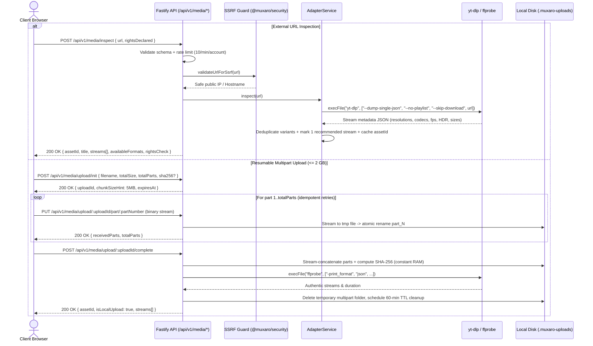
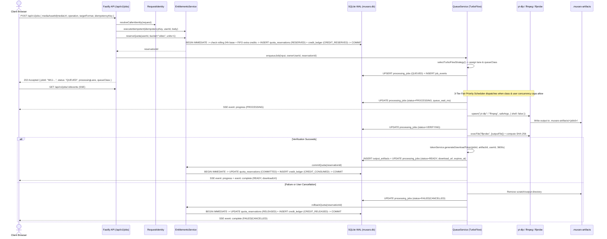
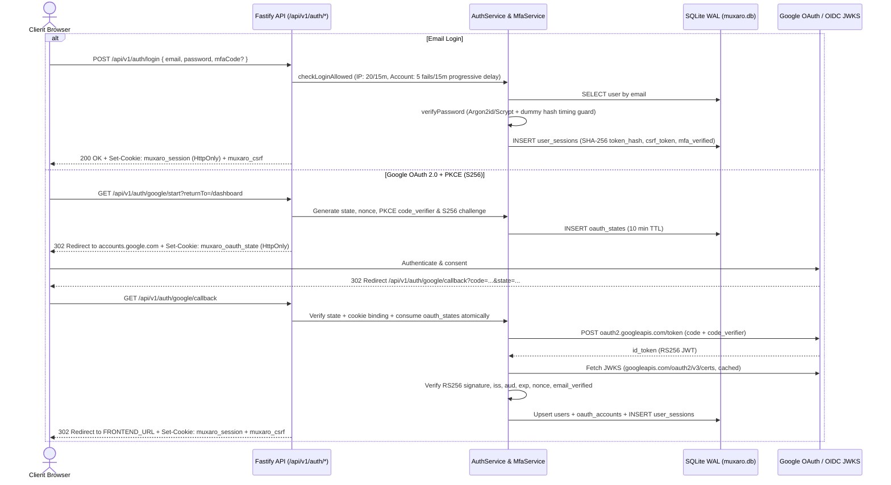

# Data Flow Architecture

**Project:** MUXARO  
**Scope:** End-to-end synchronous and asynchronous data flows across authentication, media inspection, local uploads, job execution, batches/playlists, rewarded ads SSV, and signed downloads.

---

## 1. Media Inspection & Local Upload Flow

MUXARO supports two ingestion paths: **external URL inspection** and **local file upload** (single-stream or resumable multipart up to 2 GB).

---

## 2. Asynchronous Job Execution & Quota Settlement Flow

Every job creation (`POST /api/v1/jobs`) passes through prototype pollution checks, SSRF validation, idempotency deduplication, atomic SQLite quota reservation, TurboFlow lane classification, priority scheduling, FFprobe verification, and quota settlement.

---

## 3. Authentication & Session Flow (Email + Google OAuth 2.0 PKCE + Admin MFA)

---

## 4. Batch & Playlist Packaging Data Flow

MUXARO implements two distinct multi-item workflows:

1. **Tracked Batches (`POST /api/v1/batches`):**
   - Validates up to `max_playlist_items` (default 50) items upfront (SSRF + upload path checks).
   - Reserves 1 `PLAYLIST_DOWNLOAD` quota slot (for `>1` items) or 1 `VIDEO_DOWNLOAD` slot (for 1 item).
   - Inserts a parent row in `batches` (`MXB-YYYYMMDD-XXXXXX`) and enqueues individual `processing_jobs` (`MXJ-XXXXXXXXXX`) numbered `"001"`, `"002"`, `"003"`, each processed independently through TurboFlow lanes.
   - `QueueService` updates parent batch rollup counts (`completed_items`, `failed_items`, `cancelled_items`, `progress`, `status`) on every child state change.

2. **Playlist Discovery & ZIP Packaging (`POST /api/v1/playlists/inspect`, `POST /api/v1/playlists/jobs`):**
   - Inspects up to 50 playlist entries via `yt-dlp --flat-playlist --dump-single-json`.
   - Reserves 1 `PLAYLIST_DOWNLOAD` quota slot (strictly isolated from individual video credits; rewarded credits never apply to playlists).
   - Executes inside the bounded `playlist-packaging` lane (concurrency cap: 1) sequentially fetching each entry, signing per-item download tokens, and streaming all completed items into a zero-dependency Store-method ZIP archive (`createStreamingZipArchive`) with CRC-32 and SHA-256 verification.
   - Commits quota if at least 1 item succeeded (`COMPLETED` or `PARTIAL_FAILURE`); rolls back quota if all items fail (`FAILED`).

---

## 5. Rewarded Ads Server-Side Verification (SSV) Flow

Credits are **never** awarded from client requests (`POST /api/v1/rewards/sessions/:id/refresh` actively rejects `rewarded: true` / `grant: true` payloads with `403 ERR_CLIENT_REWARD_FORBIDDEN`).

1. Authenticated user calls `POST /api/v1/rewards/sessions` → server verifies GAM config, enforces max 1 active `PENDING` session and daily cap (default 3 verified ads / rolling 24h), signs `custom_data` via HMAC-SHA256 binding `{ s: sessionId, u: userId, exp }`, stores `custom_data_hash` in `reward_sessions` (`MXRWD-...`, 10-min TTL).
2. Browser renders Google Ad Manager rewarded slot with server-issued `customData`.
3. Upon ad completion, Google's backend invokes `GET` or `POST /api/v1/rewards/provider-callback`.
4. `RewardsService.verifyAndProcessProviderCallback()` resolves the public ECDSA key for `key_id` (cached 12h from `GAM_SSV_KEY_URL` or pinned `GAM_SSV_PUBLIC_KEY_PEM`), verifies the ECDSA-SHA256 signature (DER or IEEE P1363), validates the HMAC-signed `custom_data`, and inside a `BEGIN IMMEDIATE` transaction:
   - Checks `reward_provider_events.provider_transaction_id` (`UNIQUE` replay guard; duplicates return `200` idempotently with `creditsGranted: 0`).
   - Transitions `reward_sessions.status` from `PENDING` → `VERIFIED`.
   - Appends an immutable `REWARD_GRANTED` entry (`+2` credits, rolling 24h expiry) to `credit_ledger` and updates `entitlements.extra_credits_balance`.
5. Client polls `GET /api/v1/rewards/sessions/:id` or `POST .../refresh` to display updated quota balance.

---

## 6. Signed Resumable Download Delivery Flow

1. Client hits `GET /api/v1/jobs/:id/download` (with owner/admin check) → `302 Redirect` to `/api/v1/download/:token` (propagating `?inline=1` when requested).
2. `GET /api/v1/download/:token` verifies the HMAC-SHA256 token (`tokenService.verifyDownloadToken`), validates `artifact.ownerUserId === payload.userId`, enforces cross-account IDOR protection if a different authenticated session cookie/header is present, and verifies `validateSafePath(filePath, [ARTIFACTS_ROOT], { mustExist: true })`.
3. Computes strong `ETag` (`"<sha256>"` or `"<size>-<mtimeMs>"`), validates `If-Range` and `Range: bytes=...` per RFC 9110, and streams directly from disk via `fs.createReadStream(resolvedPath, { start, end })` with zero RAM buffering (`206 Partial Content`, `200 OK`, or `416 Range Not Satisfiable`).
4. Logs a privacy-safe `download_started` event into `analytics_events` for full downloads.
