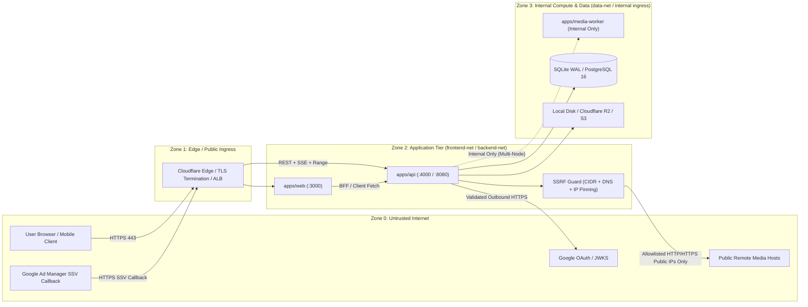

# Networking Architecture

**Project:** MUXARO  
**Scope:** Port topology, HTTP/SSE/Range transport behavior, CORS & header policy, SSRF egress boundary, and Docker/Cloud network segmentation

---

## 1. Service Port & Endpoint Topology

| Service | Default Local Bind | Docker Compose Port | Cloud Run Port | Exposure Policy |
| :--- | :--- | :--- | :--- | :--- |
| `apps/web` (Next.js 14) | `0.0.0.0:3000` | `3000:3000` | Cloudflare Pages / Static or SSR | Public HTTPS (`muxaro.app`) |
| `apps/api` (Fastify 5) | `0.0.0.0:4000` | `4000:4000` | `8080` | Public HTTPS (`api.muxaro.app`) |
| `apps/media-worker` (Fastify 5) | `0.0.0.0:3002` | `5000:5000` | `8080` | **Internal-only** (`run.googleapis.com/ingress: internal`) |
| PostgreSQL 16 *(Docker/Infra)* | — | `5432:5432` | Private VPC / Data Subnet | Internal `data-net` only |
| Redis 7 *(Docker/Infra)* | — | `6379:6379` | Private VPC / Data Subnet | Internal `data-net` only |
| MinIO *(Docker/Infra)* | — | `9000` (API) / `9001` (Console) | Replaced by Cloudflare R2 / S3 in cloud | Internal `data-net` only |

---

## 2. Network Security Boundaries

### Docker Compose Network Segmentation (`infra/docker-compose.yml`)
- **`frontend-net`:** Connects `web` and `api`.
- **`backend-net`:** Connects `api` and `media-worker` (not reachable from `web`).
- **`data-net`:** Connects `api`, `media-worker`, `postgres`, `redis`, and `minio` (isolated from `web`).

### Cloud Run & Terraform Segmentation (`infra/cloudrun/`, `infra/terraform/modules/networking/`)
- Cloud Run `muxaro-worker` declares `run.googleapis.com/ingress: internal`, preventing direct internet traffic.
- AWS Terraform `modules/networking` creates segmented subnets (`public_subnet_ids` for ALB, `app_subnet_ids` for ECS Web/API, `worker_subnet_ids` for worker ASG, `data_subnet_ids` for RDS/ElastiCache) with dedicated security groups per tier.

---

## 3. Transport Protocols & HTTP Behavior

### 3.1 CORS Policy (`apps/api/src/app.ts`)
- **`credentials: true`** so `HttpOnly` cookies (`muxaro_session`, `muxaro_guest`, `muxaro_oauth_state`) and `muxaro_csrf` work across origins (e.g., `muxaro.app` → `api.muxaro.app`).
- **Origin Resolution:** Uses explicit comma-separated `CORS_ORIGIN` list in production; reflects exact request `Origin` when configured as `*` or unset in local dev (never sends literal `*` with `credentials: true`).
- **Allowed Methods:** `GET, POST, PUT, PATCH, DELETE, OPTIONS`.
- **Allowed Headers:** `Content-Type`, `Authorization`, `Idempotency-Key`, `x-request-id`, `x-file-name`, `x-muxaro-csrf`.
- **Exposed Headers:** `x-request-id`, `Retry-After`, `RateLimit-Limit`, `RateLimit-Remaining`, `RateLimit-Reset`, `Content-Disposition`, `Content-Range`, `Accept-Ranges`, `ETag`.

### 3.2 Proxy & Client IP Handling
- `TRUST_PROXY=true` enables extracting the leftmost IP from `X-Forwarded-For` (`extractClientIp` in `apps/api/src/services/ratelimit.service.ts`). When `TRUST_PROXY` is unset/false, `X-Forwarded-For` is ignored to prevent IP spoofing against rate limits.
- `isSecureRequest()` in `apps/api/src/middleware/auth.middleware.ts` checks `NODE_ENV=production`, `X-Forwarded-Proto: https`, or `request.protocol === 'https'` to set the `Secure` attribute on cookies.

### 3.3 Server-Sent Events (SSE) Transport (`GET /api/v1/jobs/:id/events`)
- Headers set explicitly:
  - `Content-Type: text/event-stream`
  - `Cache-Control: no-cache, no-transform`
  - `Connection: keep-alive`
  - `X-Accel-Buffering: no` (prevents reverse proxies like Nginx/Cloudflare from buffering progress chunks)
- Emits `: heartbeat\n\n` every **15 seconds** to keep load balancer / proxy idle timers alive.
- Emits `event: progress` snapshots and closes cleanly after emitting `event: complete` on terminal status (`READY`, `FAILED`, `CANCELLED`, `EXPIRED`).

### 3.4 Resumable Binary Range Delivery (`GET /api/v1/download/:token`)
- Full RFC 9110 support: `Accept-Ranges: bytes`, `ETag` (strong SHA-256 or size-mtime validator), `Last-Modified`, `If-Range` conditional validation, `206 Partial Content` with `Content-Range: bytes start-end/total`, suffix ranges (`bytes=-N`), and `416 Range Not Satisfiable` with `Content-Range: bytes */total`.
- Binary streaming via `fs.createReadStream` with `Cache-Control: private, no-cache, must-revalidate` and `X-Content-Type-Options: nosniff`.

### 3.5 Defensive Response Headers (`apps/api/src/app.ts`)
Applied via global `onSend` hook on every response:
- `x-request-id: req_<16-hex>`
- `X-Content-Type-Options: nosniff`
- `Referrer-Policy: strict-origin-when-cross-origin`
- `X-Frame-Options: DENY` (omitted only on `/docs` Swagger UI)

---

## 4. Outbound Egress & SSRF Defense (`security/src/ssrf-guard.ts`)

Every user-supplied URL (`POST /api/v1/media/inspect`, `POST /api/v1/jobs`, `POST /api/v1/batches`, `POST /api/v1/playlists/inspect`, `POST /api/v1/playlists/jobs`, and per-item URLs inside playlists) is validated before outbound network access:

- **Protocol Allowlist:** Strictly `http:` and `https:` (`file://`, `gopher://`, `ftp://`, `data:`, etc. rejected).
- **Port Allowlist:** Defaults to ports `80` and `443`.
- **Blocked IPv4 CIDRs (16 ranges):** `0.0.0.0/8`, `10.0.0.0/8`, `100.64.0.0/10` (CGNAT), `127.0.0.0/8` (loopback), `169.254.0.0/16` (link-local & AWS/GCP/Azure metadata), `172.16.0.0/12`, `192.0.0.0/24`, `192.0.2.0/24`, `192.88.99.0/24`, `192.168.0.0/16`, `198.18.0.0/15`, `198.51.100.0/24`, `203.0.113.0/24`, `224.0.0.0/4`, `240.0.0.0/4`, `255.255.255.255/32`.
- **Blocked IPv6 Ranges:** Loopback (`::1`), unspecified (`::`), unique local (`fc00::/7`), link-local (`fe80::/10`), multicast (`ff00::/8`), and IPv4-mapped IPv6 (`::ffff:x.x.x.x`) de-encapsulated and checked against all IPv4 rules.
- **Obfuscation & Rebinding Mitigation:** Normalizes decimal/hex/octal/abbreviated IP forms and fullwidth dots, resolves DNS prior to connection, rejects if *any* returned A/AAAA record is private, and supports IP-pinned safe HTTP agents + redirect target re-validation (max 5 redirects).
- **FFmpeg Protocol Whitelist:** `ffprobe` and `ffmpeg` invocations restrict protocols via `-protocol_whitelist file,crypto,data` on local files.
