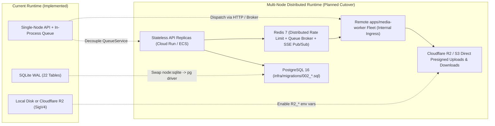

# Scalability & Capacity Architecture

**Project:** MUXARO  
**Scope:** Implemented Concurrency Guardrails, Bottleneck Analysis, and Provisioned Horizontal Scaling Architecture

---

## 1. Current Implemented Concurrency & Backpressure Controls

In the active single-node runtime (`apps/api`), stability under concurrent load is enforced by deterministic queue caps, per-tier isolation, streaming I/O, and SQLite WAL locking rather than unbounded worker spawning.

### 1.1 Queue Class Isolation Caps (`apps/api/src/services/queue.service.ts`)

Heavy CPU transcodes and playlists cannot starve fast remux or audio extraction jobs because each queue class enforces an independent concurrency cap:

| Queue Class | TurboFlow Lane | Concurrency Cap | Workload Profile |
| :--- | :--- | :---: | :--- |
| `instant-processing` | `instant` | **4** | Zero-reencode stream copy (`-c copy`, `+faststart`); I/O-bound |
| `audio-processing` | `smart` | **4** | Audio stream extraction / lightweight audio transcoding |
| `merge-processing` | `smart` | **2** | Audio/video multiplexing & sync offset remuxing |
| `video-transcoding` | `power` | **2** | Bounded FFmpeg H.264/HEVC/VP9/AV1 transcode & compression |
| `high-resolution-processing` | `power` | **1** | 4K (2160p) and 8K (4320p) compute-heavy video pipelines |
| `playlist-packaging` | `power` | **1** | Multi-item playlist download & streaming ZIP assembly |

- **Global Waiting Cap (Backpressure):** `MAX_TOTAL_QUEUED = 200`. Exceeding 200 waiting jobs immediately fails fast with HTTP `503 ERR_BACKPRESSURE` rather than exhausting heap memory.
- **Subprocess Timeout Guard:** `PROCESS_TIMEOUT_MS = 10 * 60 * 1000` (10 minutes per job in `QueueService`; 15 minutes default in `apps/media-worker/src/process/executor.ts`; 3 minutes per playlist item).

### 1.2 Per-Tier Concurrency & Fair Scheduling
Configured dynamically in `system_settings` (defaults seeded in `apps/api/src/db/database.ts`):

| Account Tier | Priority Weight | Default Max Concurrent Jobs / User | Rolling 24h Individual Limit | Rolling 24h Playlist Limit |
| :--- | :---: | :---: | :---: | :---: |
| **PREMIUM** | `6` | `5` (`premium_max_concurrent`) | `100` | `10` |
| **REGISTERED (FREE)** | `3` | `2` (`free_max_concurrent`) | `10` (+ up to `6` via rewarded ads = `16`) | `1` |
| **GUEST** | `1` | `1` (`guest_max_concurrent`) | `3` | `0` |

- **Anti-Starvation Aging:** Waiting jobs gain `+1` effective priority weight for every `5,000 ms` waited (`ANTI_STARVATION_AGING_STEP_MS`), capped at `+12` (`ANTI_STARVATION_MAX_BOOST`), guaranteeing guest jobs are never permanently starved behind continuous premium traffic.
- **Per-Class Round-Robin Fairness:** `lastServedUserPerClass` penalizes back-to-back dispatches for the same user when other users are waiting in the same queue class.

### 1.3 Constant-Memory Streaming I/O
- **Uploads (`apps/api/src/routes/media.ts`):** Single-stream uploads (`POST /api/v1/media/upload`) use Node `stream.pipeline` with a byte-counting `Transform` guard (max 2 GB); multipart completion (`assemblePartsStream`) concatenates parts and computes SHA-256 via backpressure-aware streams without loading files into RAM.
- **ZIP Packaging (`apps/api/src/routes/playlists.ts`):** Pure-Node Store-method ZIP generator streams file payloads chunk-by-chunk while calculating CRC-32 and SHA-256.
- **Downloads (`apps/api/src/routes/download.ts`):** Streams artifacts directly via `fs.createReadStream(resolvedPath, { start, end })` with full HTTP Range (`206`) support.
- **Storage Reclamation:** Local uploads and completed artifacts automatically expire and unlink after **60 minutes** (`DEFAULT_RETENTION_MINUTES = 60`), while `apps/media-worker/src/scratch/disk-manager.ts` enforces a configurable 50 GB scratch quota with automatic stale-workspace reaping.

---

## 2. Single-Node Scaling Ceilings (Honest Baseline)

When operating in the default single-process SQLite + local-disk mode, horizontal scale is bounded by:
1. **Single-Writer SQLite Lock:** WAL mode allows concurrent readers alongside one writer (`busy_timeout = 5000 ms`), which comfortably handles single-instance API traffic but cannot be shared across multiple API containers on separate hosts without an external relational database.
2. **In-Process Queue & SSE EventEmitter:** Active queue state (`classQueues`), SSE listeners (`queueService.on('job:<id>')`), `playlistJobs`, `multipartSessions`, and `adapterService.assetCache` reside in Node.js process memory.
3. **Ephemeral Container Disk:** Unless Cloudflare R2 (`R2_*`) is configured, artifacts written to `.muxaro-artifacts/` are local to the container that created them.

---

## 3. Provisioned Horizontal Scaling Topologies (IaC Blueprints)

The repository already includes infrastructure definitions for scaling out beyond a single node once runtime storage/queue adapters are switched from local single-node mode to distributed backends.

### 3.1 Cloud Run Scale-to-Zero Topology (`infra/cloudrun/`)
- **`muxaro-api` (`infra/cloudrun/api-service.yaml`):** Knative `minScale: 0`, `maxScale: 2`, `1 vCPU`, `1 GiB RAM`, `containerConcurrency: 40`, `timeoutSeconds: 300`, `startup-cpu-boost: true`, public ingress.
- **`muxaro-worker` (`infra/cloudrun/worker-service.yaml`):** Knative `minScale: 0`, `maxScale: 2`, `2 vCPU`, `2 GiB RAM`, `containerConcurrency: 2`, `timeoutSeconds: 600`, `cpu-throttling: false`, **internal-only ingress** (`run.googleapis.com/ingress: internal`).

### 3.2 AWS Auto-Scaling Fleet (`infra/terraform/`)
Provisioned modular Terraform stack (`infra/terraform/main.tf`) supporting multi-AZ deployment:
- **Edge & Ingress:** Cloudflare DNS/WAF (`modules/cloudflare`) → AWS ALB (`modules/alb`).
- **Web & API Compute:** AWS ECS services (`modules/ecs`) running `apps/web` and `apps/api` in private application subnets.
- **State Tier:** Amazon RDS PostgreSQL 16 (`modules/database`) and Amazon ElastiCache Redis (`modules/redis`) in isolated data subnets.
- **Queue & Worker Tier:** Amazon SQS (`modules/sqs`) feeding auto-scaling Spot + On-Demand worker instances (`modules/workers`) in isolated worker subnets, backed by Amazon S3 (`modules/s3`).

### 3.3 Roadmap to Full Multi-Node Cutover *(Planned)*

| Migration Step | Status | Existing Assets in Repo |
| :--- | :--- | :--- |
| Object Storage offload to Cloudflare R2 | **Implemented** | `apps/api/src/services/storage.service.ts` (pure-Node SigV4) |
| Standalone Media Worker microservice | **Implemented** | `apps/media-worker/`, `infra/Dockerfile.media`, `infra/cloudrun/worker-service.yaml` |
| PostgreSQL 16 22-table DDL & migration runner | **Provisioned (DDL Ready)** | `infra/migrations/002_account_rewards_analytics.sql`, `infra/scripts/run-migrations.sh` |
| Runtime `pg` DB driver cutover in `apps/api` | **Planned** | Currently reads `MUXARO_DB_PATH` with `node:sqlite` |
| Distributed Redis rate-limit + SSE Pub/Sub + Queue broker | **Planned** | `RedisRateLimitClient` interface in `ratelimit.service.ts`; Redis in `infra/docker-compose.yml` & Terraform |

For detailed 100k-session capacity modeling, see the reference capacity plan in `docs/CAPACITY_PLAN.md`.
