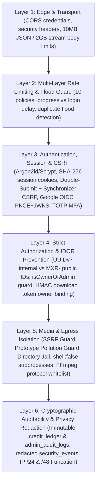

# Security Architecture

**Project:** MUXARO  
**Scope:** Implemented Cryptographic Primitives, Identity & Session Security, Access Control, Anti-Abuse, SSV Fraud Prevention, and Subprocess Sandboxing

---

## 1. Security Model & Defense-in-Depth Layers

MUXARO treats all client input (URLs, filenames, request payloads, cookies, query strings, and uploaded media containers) as untrusted. Security controls are enforced across six independent layers:

---

## 2. Cryptographic Primitives (Pure Node.js `node:crypto`)

| Mechanism | Algorithm / Parameters | Source Implementation |
| :--- | :--- | :--- |
| **Password Hashing** | Primary: Node 24 native **Argon2id** (`m=19456` [19 MiB], `t=2`, `p=1`, 16-byte random salt, 32-byte tag). Fallback: **Scrypt** (`N=16384`, `r=8`, `p=1`, 64-byte key). | `apps/api/src/services/auth.service.ts` |
| **Timing-Attack Defense** | Constant-time `crypto.timingSafeEqual` + cached dummy hash verification (`runDummyPasswordCheck`) when email does not exist | `apps/api/src/services/auth.service.ts` |
| **Session & Recovery Tokens** | Cryptographically random tokens hashed via **SHA-256** before DB storage; zero plaintext tokens stored | `apps/api/src/services/auth.service.ts` |
| **TOTP MFA** | **RFC 6238** HMAC-SHA1, 160-bit Base32 secret, 6 digits, 30s period, ±1 step skew, replay counter guard | `apps/api/src/services/mfa.service.ts` |
| **TOTP Secret Encryption** | **AES-256-GCM** (12-byte random IV + auth tag) keyed by SHA-256 of `MFA_ENCRYPTION_KEY` (or `SESSION_SECRET`) | `apps/api/src/services/mfa.service.ts` |
| **Google OAuth 2.0** | Authorization Code + **PKCE (`S256`)** + server-side `state` + `HttpOnly` cookie state binding + OIDC `nonce` + **JWKS RS256** signature validation | `apps/api/src/services/auth.service.ts` |
| **Download Tokens** | **HMAC-SHA256** (`base64url(payload).base64url(mac)`) binding `jobId`, `artifactId`, `filename`, `userId`, `expiresAt` | `apps/api/src/services/token.service.ts` |
| **GAM Reward SSV** | **ECDSA-SHA256** (ASN.1 DER & IEEE P1363) against Google verifier public keys + **HMAC-SHA256** signed `custom_data` | `apps/api/src/services/rewards.service.ts` |
| **Cloudflare R2 S3 Auth** | **AWS Signature Version 4** (`AWS4-HMAC-SHA256`) for header signing and presigned GET URLs + `x-amz-meta-sha256` integrity tags | `apps/api/src/services/storage.service.ts` |
| **Rate-Limit Bucket Keys** | Keyed **HMAC-SHA256** (truncated to 24 hex chars) so raw IPs and emails are never persisted in `rate_limit_counters` | `apps/api/src/services/ratelimit.service.ts` |

---

## 3. Authentication, CSRF & Session Hardening

### 3.1 Cookies Issued by `apps/api/src/middleware/auth.middleware.ts`
| Cookie | `HttpOnly` | `SameSite` | `Secure` | Path | Purpose |
| :--- | :---: | :---: | :---: | :---: | :--- |
| `muxaro_session` | `true` | `Lax` | Prod / HTTPS | `/` | Opaque 30-day session token (SHA-256 stored in `user_sessions`) |
| `muxaro_csrf` | `false` | `Lax` | Prod / HTTPS | `/` | Readable by frontend JS to echo in `x-muxaro-csrf` header |
| `muxaro_guest` | `true` | `Lax` | Prod / HTTPS | `/` | Cryptographic `guest_<32-hex>` isolation cookie for anonymous visitors |
| `muxaro_oauth_state` | `true` | `Lax` | Prod / HTTPS | `/api/v1/auth/google` | Single-use 10-min OAuth state binding cookie |

### 3.2 Hybrid CSRF Protection (`verifyCsrf`)
- Applies to all state-mutating (`POST`, `PUT`, `PATCH`, `DELETE`) cookie-authenticated requests.
- Validates **both** synchronizer token equality (`x-muxaro-csrf` header === `user_sessions.csrf_token`) **and** double-submit cookie equality (`x-muxaro-csrf` === `muxaro_csrf` cookie) using constant-time comparison.
- Violations return `403 ERR_CSRF_INVALID` and record a `HIGH` severity `CSRF_REJECTED` event in `security_events`.
- Bearer-authenticated API requests are exempt because browsers do not auto-attach `Authorization` headers.

### 3.3 Admin Privilege & Mandatory MFA (`requireAdminMfa`)
- All 11 admin control endpoints under `/api/v1/admin/*` (everything except public redacted `/api/v1/admin/metrics`) enforce `requireAdminMfa`:
  1. Valid active session + valid CSRF token.
  2. `user.role === 'admin'` (otherwise `403 ERR_ADMIN_REQUIRED` + `ADMIN_ACCESS_DENIED` security event).
  3. `user.mfaEnabled === true && session.mfaVerified === true` (otherwise `403 ERR_ADMIN_MFA_REQUIRED` + `ADMIN_MFA_REQUIRED` security event).
- Optional bootstrap promotion via `MUXARO_ADMIN_EMAIL` promotes an existing user's role to `ADMIN` with an audit log entry, never sets hardcoded passwords, and never bypasses TOTP MFA.

### 3.4 Anti-Enumeration & Open-Redirect Defense
- `POST /api/v1/auth/forgot-password` and `POST /api/v1/auth/resend-verification` return generic `200 OK` responses regardless of whether an email exists.
- `POST /api/v1/auth/login` runs a dummy password check when the user is absent and returns a uniform `401 ERR_INVALID_CREDENTIALS`.
- `sanitizeReturnTo()` strictly allows single-slash relative paths (`/dashboard`), rejecting `//evil.com`, `/\evil.com`, CRLF characters, and scheme tricks (`http:`).

---

## 4. Strict IDOR & Resource Isolation

- **Dual User Identifier Standard (`id.service.ts`):** Internal relational joins use RFC 9562 UUIDv7 (`users.id`), whereas support UI, admin search, and customer views expose non-sequential `MXR-XXXXXXXX` (`public_user_id`).
- **Per-Resource Ownership Checks (`request-identity.ts`):** `GET/POST /api/v1/jobs/:id/*`, `GET/POST /api/v1/batches/:id/*`, `GET /api/v1/playlists/jobs/:id`, `GET/POST /api/v1/rewards/sessions/:id`, `DELETE /api/v1/me/sessions/:sessionId`, and `GET /api/v1/download/:token` enforce `isOwnerOrAdmin()`.
- Cross-account access returns `403 ERR_FORBIDDEN` and persists a redacted `IDOR_ATTEMPT` row into `security_events`.
- Internal disk paths (`filePath`, `localFilePath`, `zipFilePath`) are stripped by serializers (`toPublicArtifact`, `toPublicMediaAssetInfo`, `toPublicPlaylistJob`) before any JSON response leaves the API.

---

## 5. Subprocess & Filesystem Hardening

- **No Shell Execution:** All `ffmpeg`, `ffprobe`, and `yt-dlp` subprocesses execute with `shell: false` (`child_process.spawn` / `execFile`) and validated argument arrays.
- **Directory Jails (`validateSafePath`):**
  - Local uploads are strictly jailed inside `.muxaro-uploads/` (`UPLOADS_ROOT`).
  - Output artifacts are strictly jailed inside `.muxaro-artifacts/` (`ARTIFACTS_ROOT`).
  - Path traversal (`..`), null bytes, symlinks escaping root, and shell metacharacters are rejected before disk I/O.
- **Filename Sanitization (`sanitizeFilename`):** Strips directory separators, leading dots, control characters, and caps length at 200 characters.
- **Prototype Pollution Guard (`hasPrototypePollution`):** Rejects `__proto__`, `constructor`, and `prototype` keys on job and batch mutation payloads.

---

## 6. Privacy-Preserving Telemetry & Redaction

`redactSensitiveData()` (`apps/api/src/services/ratelimit.service.ts`) recursively scrubs sensitive keys (`password`, `token`, `secret`, `authorization`, `cookie`, `csrf`, `api_key`, `signature`, `jwt`, `session_id`, `code_verifier`, `backup_codes`, `media_url`, `source_url`, etc.), masks email addresses (`ab***@domain.com`), strips URL paths/query strings, and truncates IP addresses to `/24` (IPv4) or `/48` (IPv6) before writing to `security_events`, `admin_audit_logs`, error responses, or console logs.

Production startup validation (`validateProductionConfig()` in `apps/api/src/config.ts`) verifies that default development secrets are replaced with 32+ character random strings and that `API_BASE_URL`/`SITE_URL` do not reference `localhost`.
