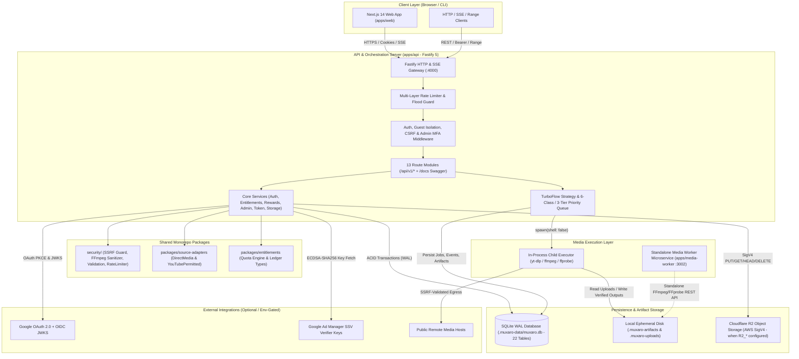

# System Architecture

**Project:** MUXARO — *Your Media. One Powerful Workspace.*  
**Scope:** Implemented Runtime Architecture & Provisioned Cloud Topologies  
**Source of Truth:** `apps/api/`, `apps/media-worker/`, `apps/web/`, `packages/`, `security/`, `infra/`

---

## 1. Architectural Overview

MUXARO is a modular TypeScript monorepo implementing an asynchronous media inspection, transcoding, stream-copying, merging, batch/playlist processing, and account/entitlement platform.

To maintain strict engineering honesty, this document distinguishes between:
- **Implemented Runtime Architecture:** What executes today in `apps/api`, `apps/web`, `apps/media-worker`, `packages/*`, and `security/`.
- **Provisioned Infrastructure & Planned Evolution:** IaC blueprints and container manifests already committed in `infra/` (Docker Compose with PostgreSQL 16 + Redis 7 + MinIO, Google Cloud Run specs, and AWS ECS/RDS/SQS Terraform modules) designed for multi-node horizontal scaling.

### Core Engineering Principles
1. **Asynchronous Job Decoupling:** Media fetches, FFmpeg remux/transcoding, audio extraction, A/V merging, and ZIP packaging run asynchronously outside HTTP request cycles. Clients receive `202 Accepted` immediately and observe progress via Server-Sent Events (`GET /api/v1/jobs/:id/events`) or polling (`GET /api/v1/jobs/:id`).
2. **Stream-Copy First (TurboFlow):** The TurboFlow strategy engine (`apps/api/src/services/turboflow.service.ts`) and `MediaClassifier` (`apps/media-worker/src/prober/classifier.ts`) select the lowest-cost valid execution lane (`instant`, `smart`, `power`), prioritizing lossless `-c copy` remuxing whenever source codecs match target container requirements.
3. **Zero-Shell Subprocess Discipline:** External binaries (`ffmpeg`, `ffprobe`, `yt-dlp`) are invoked exclusively via `child_process.spawn(..., { shell: false })` or `execFile` with explicit argument arrays and strict argument/path sanitization (`security/src/ffmpeg-sanitizer.ts`, `apps/media-worker/src/process/sanitizer.ts`).
4. **Atomic Rolling-24h Quotas & Immutable Ledger:** Job quota reservations, commits, rollbacks, and rewarded ad credits execute inside SQLite `BEGIN IMMEDIATE` transactions (`apps/api/src/db/database.ts`), recording every credit state transition in an append-only `credit_ledger`.
5. **Defense-in-Depth Trust Boundaries:** SSRF validation with DNS resolution and private CIDR blocking (`security/src/ssrf-guard.ts`), cookie + double-submit CSRF protection (`apps/api/src/middleware/auth.middleware.ts`), per-resource IDOR ownership guards (`apps/api/src/services/request-identity.ts`), HMAC-SHA256 signed download tokens, and ECDSA-SHA256 Server-Side Verification (SSV) for rewarded ads.

---

## 2. Global System Architecture (Implemented Runtime)

---

## 3. Monorepo Workspace Architecture

| Workspace Path | Package Name | Runtime / Framework | Role |
| :--- | :--- | :--- | :--- |
| `apps/api` | `@muxaro/api` | Node.js 24 (`node:sqlite`), Fastify 5, TypeScript | Primary REST & SSE API server, auth/MFA, entitlements, rewards SSV, admin control centre, TurboFlow queue & media execution, signed Range downloads |
| `apps/web` | `@muxaro/web` | Next.js 14 App Router, React 18, Tailwind CSS | Customer workspace UI, media inspector, tools suite, dashboard, credits ledger, admin console, status & docs |
| `apps/media-worker` | `@muxaro/media-worker` | Node.js, Fastify 5, Zod, Archiver | Standalone FFmpeg/FFprobe processing microservice with scratch disk manager, classifier, transcoder, audio extractor, merger, packager, and output verifier |
| `packages/entitlements` | `@muxaro/entitlements` | TypeScript (zero runtime deps) | Entitlements domain engine, sliding-window quota rules, reservation logic, idempotency manager, RBAC, and SQL schema definitions |
| `packages/source-adapters` | `@muxaro/source-adapters` | TypeScript (zero runtime deps) | Source adapter registry (`DirectMediaAdapter`, `YouTubePermittedAdapter`), HTTP header inspector, MIME detector, SSRF filter, and rights declaration validator |
| `packages/config` | — | TypeScript | Shared brand constants (`brand.ts`) |
| `security` | `@muxaro/security` | TypeScript (zero runtime deps) | SSRF guard (IPv4/IPv6 CIDR, DNS rebinding, IP pinning), FFmpeg sanitizer, request validation, prototype pollution guard, sliding-window `RateLimiter` |
| `infra` | — | Docker, Compose, Cloud Run, Terraform | Multi-stage Dockerfiles, local stack orchestration (Postgres 16, Redis 7, MinIO), Cloud Run Knative specs, AWS Terraform modules, SQL migration scripts |

---

## 4. Runtime Storage & Deployment Modes

MUXARO adapts cleanly based on environment configuration without faking unconfigured services:

| Subsystem | Default Local / Single-Node Runtime | Configured / Distributed Mode (Implemented or Provisioned) |
| :--- | :--- | :--- |
| **Relational Database** | SQLite (`node:sqlite` `DatabaseSync`) in WAL mode at `.muxaro-data/muxaro.db` (`MUXARO_DB_PATH`), 22 tables auto-initialized on boot | PostgreSQL 16 schema & migration scripts provisioned in `infra/scripts/init-db.sql`, `infra/migrations/002_account_rewards_analytics.sql`, and `infra/scripts/run-migrations.sh` *(planned runtime driver cutover)* |
| **Object & Artifact Storage** | Local directory-jailed ephemeral disk (`.muxaro-artifacts/` and `.muxaro-uploads/`), 60-minute artifact TTL | Pure-Node AWS SigV4 Cloudflare R2 client (`apps/api/src/services/storage.service.ts`) activated automatically when all 4 `R2_*` env vars are set (`mode: 'r2'`); MinIO/S3 provisioned in `infra/` |
| **Job Queue & Execution** | In-process SQLite-persisted TurboFlow 6-class / 3-tier priority queue (`apps/api/src/services/queue.service.ts`) spawning `yt-dlp`/`ffmpeg`/`ffprobe` | Standalone `apps/media-worker` REST microservice (`:3002` / `:5000`); Redis 7 / AWS SQS / Cloud Run internal worker specs provisioned in `infra/` *(planned distributed broker cutover)* |
| **Rate Limiting** | Atomic SQLite-hybrid sliding-window + token-bucket (`rate_limit_counters` table) + in-memory burst cache | Pluggable `RedisRateLimitClient` interface defined in `apps/api/src/services/ratelimit.service.ts` *(planned Redis Lua adapter)* |
| **Google OAuth 2.0** | Disabled (`googleAuthConfigured: false`, returns `503 ERR_GOOGLE_AUTH_NOT_CONFIGURED`) | Live OAuth 2.0 Authorization Code + PKCE (S256) + JWKS RS256 ID token verification when `GOOGLE_CLIENT_ID`, `GOOGLE_CLIENT_SECRET`, and `GOOGLE_REDIRECT_URI` are set |
| **Rewarded Ads (GAM SSV)** | Disabled (`configured: false`, returns `503 ERR_REWARDED_ADS_NOT_CONFIGURED`) | Live Google Ad Manager ECDSA-SHA256 SSV verification when `GAM_REWARDED_AD_UNIT_PATH` is configured and `rewarded_ads_enabled=true` |

---

## 5. Related Architecture Documents

- [Component Architecture](./COMPONENT_ARCHITECTURE.md) — Internal modules, services, and package boundaries
- [Data Flow](./DATA_FLOW.md) — End-to-end synchronous and asynchronous data flows
- [Scalability](./SCALABILITY.md) — Current single-node ceilings and provisioned horizontal scaling paths
- [Networking](./NETWORKING.md) — Port topology, CORS, headers, SSRF egress controls, and VPC/Cloud Run boundaries
- [Security Architecture](./SECURITY_ARCHITECTURE.md) — Cryptographic primitives, auth/MFA, CSRF, IDOR, SSV, and subprocess hardening
- [Technology Decisions](./TECHNOLOGY_DECISIONS.md) — Tech stack rationale and ADR index (`docs/architecture/adr/`)
- [Consolidated Mermaid Diagrams](../diagrams/MERMAID_DIAGRAMS.md) — Visual architecture & lifecycle diagrams
