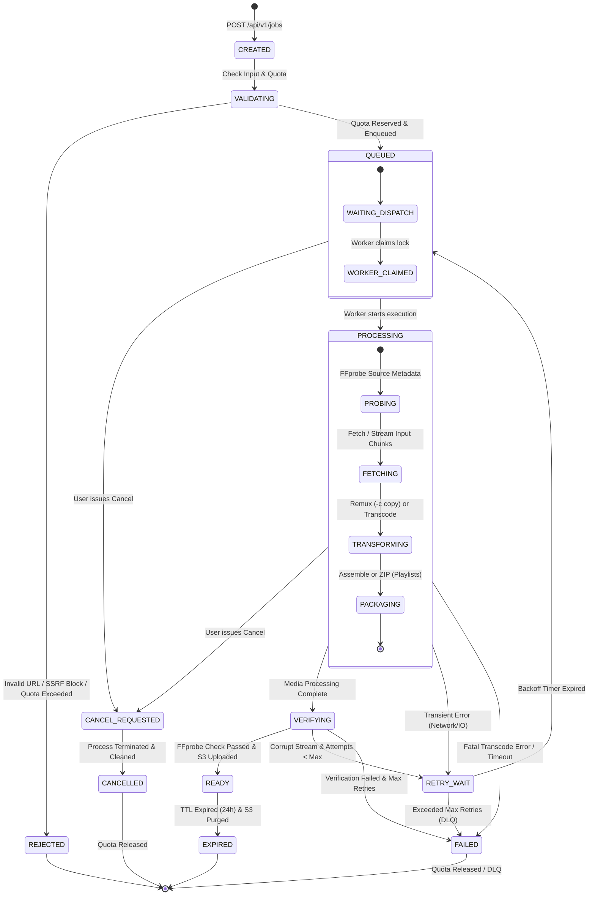

# Distributed Queue Lifecycle & Job State Machine Specification
**Project:** MUXARO Media Processing Platform (Formerly Project VYRO)  
**Author:** Principal Architect & System Designer (AGENT 01)  
**Document Status:** Approved Engineering Specification  
**Brand Identity:** MUXARO — "Your Media. One Powerful Workspace."  
**Engine:** Redis 7 Cluster + BullMQ + PostgreSQL 16 State Mirror  
**Last Updated:** November 2026  

---

## 1. Overview & Core Principles

The media processing pipeline relies on a distributed, asynchronous queue that decouples synchronous user requests from CPU-intensive media manipulation. To prevent data corruption, ghost jobs, double-billing of quotas, and unrecoverable worker crashes, the system enforces a deterministic, finite state machine (FSM).

### Core Invariants:
1. **Single Source of Truth with Dual Persistence:** Real-time job coordination, locks, and progress updates occur within **Redis 7 (BullMQ)** for sub-millisecond throughput. The canonical audit history, quota reservations, and terminal outcomes are synchronously mirrored into **PostgreSQL 16**.
2. **Atomic Quota Binding:** A job cannot transition to `QUEUED` without a prior atomic quota reservation in PostgreSQL. If a job terminates in `FAILED`, `REJECTED`, or `CANCELLED`, the reserved quota is automatically refunded or released.
3. **Mandatory Output Verification Gate:** A job can never transition directly from `PROCESSING` to `READY`. It must pass an exhaustive `VERIFYING` phase (FFprobe validation of duration, stream integrity, and file size).
4. **Idempotency Guarantee:** Every submission carries a unique `idempotency_key`. Resubmissions return the existing job record without re-enqueuing or re-decrementing user quotas.

---

## 2. Complete State Machine Diagram



---

## 3. Comprehensive State Definitions & Guard Conditions

| State | Scope | Description | Allowed Next States | Quota Ledger Effect |
| :--- | :--- | :--- | :--- | :--- |
| **`CREATED`** | API Gateway | Job payload received; UUID generated; idempotency lock acquired. | `VALIDATING`, `REJECTED` | None |
| **`VALIDATING`** | API Gateway | Validating source URL via SSRF guard, checking permissions, validating user session. | `QUEUED`, `REJECTED` | Evaluates rolling 24h quota window |
| **`REJECTED`** | Terminal | Job rejected at admission (e.g., SSRF blocked, invalid codec, quota exceeded). | `[*]` | None (0 consumed) |
| **`QUEUED`** | BullMQ / Redis | Quota successfully reserved in Postgres; job enqueued in BullMQ waiting for idle worker. | `PROCESSING`, `CANCEL_REQUESTED` | **RESERVED** (Held against user allowance) |
| **`PROCESSING`** | Media Worker | Worker holds lock; actively executing sub-steps (probing, fetching, transcode/remux, packaging). | `VERIFYING`, `RETRY_WAIT`, `FAILED`, `CANCEL_REQUESTED` | **RESERVED** |
| **`CANCEL_REQUESTED`** | Transient | User triggered cancellation; cancellation signal emitted via Redis Pub/Sub to worker. | `CANCELLED` | **RESERVED** |
| **`CANCELLED`** | Terminal | Worker intercepted cancel token, killed FFmpeg child process, purged scratch files. | `[*]` | **RELEASED** (Refunded in full to user) |
| **`VERIFYING`** | Media Worker | FFmpeg finished. Worker runs strict FFprobe validation against generated artifact. | `READY`, `RETRY_WAIT`, `FAILED` | **RESERVED** |
| **`RETRY_WAIT`** | BullMQ Delay | Transient failure occurred (network timeout, rate limit); waiting in exponential backoff queue. | `QUEUED`, `FAILED` | **RESERVED** |
| **`READY`** | Terminal (Active) | Output verified, persisted to S3/MinIO, signed download URL generated. Available to user. | `EXPIRED` | **CONSUMED** (Permanently deducted from allowance) |
| **`FAILED`** | Terminal (Dead) | Fatal error or max retries exhausted. Moved to Dead-Letter Queue (DLQ) for engineering triage. | `[*]` | **RELEASED** (Refunded in full to user) |
| **`EXPIRED`** | Terminal (Pruned) | Artifact retention window (24 hours) elapsed. Media artifact purged from S3; record archived. | `[*]` | **CONSUMED** (Remains in historical ledger) |

---

## 4. Processing Sub-Phases & Granular Progress Tracking

During the `PROCESSING` state, the worker publishes continuous, monotonic progress updates (0% to 100%) via Redis Pub/Sub, which the API Gateway streams to clients over Server-Sent Events (`GET /api/v1/jobs/:id/events`):

```json
{
  "jobId": "018d96b1-4f12-789a-b812-4871e42a9b1c",
  "status": "PROCESSING",
  "subPhase": "TRANSFORMING",
  "progress": 68.5,
  "metrics": {
    "fps": 142.0,
    "speed": "4.8x",
    "etaSeconds": 12,
    "currentFrame": 4820,
    "totalFrames": 7035,
    "targetResolution": "1080p",
    "operation": "REMUX_STREAM_COPY"
  },
  "timestamp": "2026-11-18T11:42:10.124Z"
}
```

### Sub-Phase Breakdown:
1. **`PROBING` (0% - 10%):** Validates remote/uploaded headers, runs FFprobe to extract stream indexes, audio channels, and genuine video height/width.
2. **`FETCHING` (10% - 40%):** Downloads input streams into isolated NVMe scratch directory (`/tmp/muxaro-scratch/{jobId}/`). For direct progressive streams, chunked streaming may feed directly into FFmpeg stdin.
3. **`TRANSFORMING` (40% - 85%):**
   - **Stream-Copy Mode (`-c copy`):** High-speed container remuxing. Typically completes within 1–5 seconds. Progress tracks byte throughput.
   - **Transcode Mode:** When resolution scaling or audio transcoding is strictly requested. FFmpeg emits `progress` output on stderr every 500ms. Progress calculates: `(currentFrame / totalFrames) * 100`.
4. **`PACKAGING` (85% - 95%):** For single items, writes faststart headers (`-movflags +faststart`). For playlist jobs, compresses completed media artifacts into an uncompressed or deflate ZIP stream.
5. **`VERIFYING` (95% - 100%):** Runs verification suite before pushing to S3.

---

## 5. Verification Gate Protocol (Integrity Audit)

To guarantee that no corrupt, zero-byte, or desynced media is ever served to users, the worker executes the **Verification Protocol** before transitioning to `READY`:

```typescript
interface VerificationCriteria {
  minFileSizeBytes: number;       // > 1024 bytes (reject zero-byte / truncated headers)
  expectedDurationSeconds: number;// Output must match source within ±1.0s tolerance
  requireVideoStream: boolean;    // Must contain active video stream if video job
  requireAudioStream: boolean;    // Must contain active audio stream if audio/mux job
  maxAudioVideoDriftSeconds: 0.5; // Audio and video end timestamps must not drift >500ms
}
```

### Verification CLI Execution:
```bash
ffprobe -v error -show_entries format=duration,size,bit_rate -show_entries stream=codec_name,codec_type,width,height,duration -of json /tmp/muxaro-scratch/{jobId}/output.mp4
```

If the verification fails:
- If `attemptNumber < maxRetries` (default: 3), state transitions to `RETRY_WAIT`.
- If `attemptNumber >= maxRetries`, state transitions to `FAILED`, an alert is fired to SRE, and the quota reservation is rolled back.

---

## 6. Worker Heartbeat, Stalls & Dead-Letter Queue (DLQ)

### 6.1 Worker Heartbeats
- Every active worker sends a heartbeat key to Redis every 5 seconds: `SETEX worker:heartbeat:{workerId} 15 "ALIVE"`.
- BullMQ lock duration is configured to **30 seconds**. The worker automatically extends its lock every 10 seconds while CPU tasks run.

### 6.2 Stall Detection & Ghost Job Recovery
If a worker crashes, experiences an OOM kill, or is terminated by the OS:
1. The BullMQ lock expires after 30 seconds.
2. The BullMQ master coordinator detects the stalled job.
3. If attempts remain, the job is requeued into `RETRY_WAIT`.
4. If attempts are exhausted, the job transitions to `FAILED` with error code `ERR_WORKER_STALLED_TIMEOUT`.

### 6.3 Dead-Letter Queue (DLQ) Policy
Jobs that fail permanently (e.g. unrecoverable upstream network disconnects, corrupted media files, unsupported exotic codecs) are moved to the DLQ:
- Redis Key: `bull:muxaro-media:dead-letter`
- Postgres: Record updated to `status = 'FAILED'`, with full JSON error stack in `error_details`.
- Retention in DLQ: 7 days for developer post-mortem inspection.
- Auto-Alert: If DLQ rate exceeds 2% of total throughput over a 5-minute rolling window, an alert is triggered in the admin dashboard.

---

## 7. Cancellation Token Propagation Protocol

When a user cancels a running job via `POST /api/v1/jobs/:id/cancel`:

1. **API Gateway:** Updates PostgreSQL status to `CANCEL_REQUESTED`.
2. **Pub/Sub Broadcast:** Emits message to Redis channel `job:cancel`:
   ```json
   { "jobId": "018d96b1-4f12-789a-b812-4871e42a9b1c", "timestamp": 1731930000 }
   ```
3. **Media Worker:**
   - Active worker listening on `job:cancel` matches `jobId`.
   - Sends `SIGTERM` to the active FFmpeg child process.
   - If process does not exit within 3000ms, sends `SIGKILL`.
   - Recursively deletes `/tmp/muxaro-scratch/{jobId}/`.
   - Updates PostgreSQL status to `CANCELLED`.
   - Triggers `entitlements.releaseReservation(jobId)` to restore the user's quota.

---
*Signed by AGENT 01 (Principal Architect & System Designer)*  
*Distribution: Swarm Board (@coordinator, @api, @frontend, @media, @adapters, @entitlements)*
