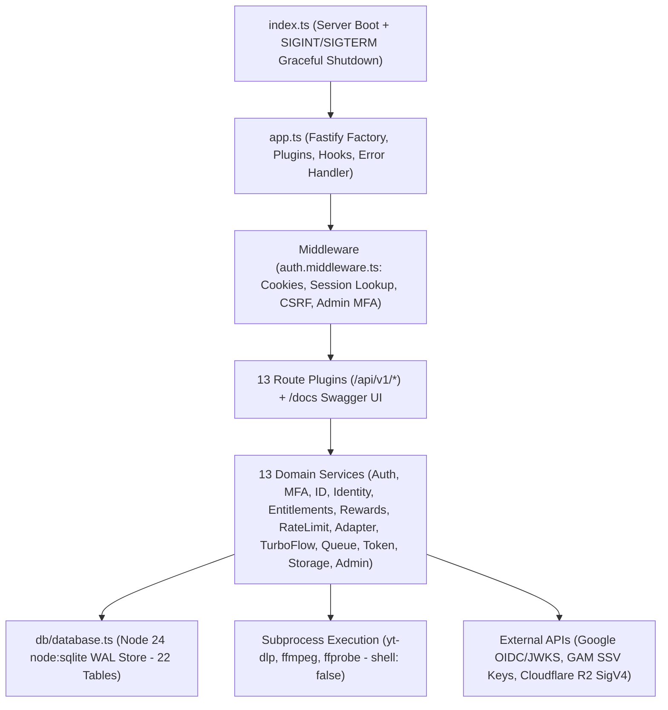

# Backend Architecture

**Project:** MUXARO  
**Primary Service:** `apps/api` (`@muxaro/api`)  
**Companion Microservice:** `apps/media-worker` (`@muxaro/media-worker`)

---

## 1. Backend Overview

The MUXARO backend is built around **Fastify 5** on **Node.js (TypeScript ESM)** with a lean dependency footprint (only 5 runtime npm packages in `apps/api/package.json`) and direct integration with shared workspace libraries (`security/`, `packages/entitlements/`, `packages/source-adapters/`).

### Architectural Layers in `apps/api/src/`

---

## 2. Bootstrapping & Configuration (`apps/api/src/config.ts`)

`config.ts` loads runtime parameters from environment variables with safe development defaults and a fail-safe production validator (`validateProductionConfig()`):

| Config Field | Environment Variable | Default (Dev) | Notes |
| :--- | :--- | :--- | :--- |
| `env` | `NODE_ENV` | `development` | `development \| production \| test` |
| `port` / `host` | `PORT`, `HOST` | `4000`, `0.0.0.0` | Cloud Run overrides `PORT=8080` |
| `apiBaseUrl` | `API_BASE_URL` / `BASE_URL` | `http://localhost:4000` | Must not contain `localhost` in production |
| `siteUrl` | `SITE_URL` / `NEXT_PUBLIC_SITE_URL` | `http://localhost:3000` | Used for origin & redirect baselines |
| `sessionSecret` | `SESSION_SECRET` | Dev fallback | Production requires >= 32-char random secret |
| `signedTokenSecret` | `SIGNED_TOKEN_SECRET` | Dev fallback | Signs download tokens & GAM `custom_data`; >= 32 chars in prod |
| `corsOrigin` | `CORS_ORIGIN` | `true` (reflect origin) | Comma-separated origins in production |
| `maxPayloadBytes` | `MAX_PAYLOAD_BYTES` | `10485760` (10 MB) | JSON payload cap; binary upload routes override to 2 GB |
| `rateLimitEnabled` | `RATE_LIMIT_ENABLED` | `true` | Disabled only when explicitly `'false'` |
| `workerConcurrency` | `WORKER_CONCURRENCY` | `4` | Worker concurrency hint |
| `storageMode` | `R2_ACCOUNT_ID`, `R2_ACCESS_KEY_ID`, `R2_SECRET_ACCESS_KEY`, `R2_BUCKET_NAME` | `local` | Switches to `r2` ONLY when all 4 R2 vars are set |
| `MUXARO_DB_PATH` | `MUXARO_DB_PATH` | `.muxaro-data/muxaro.db` | Read by `db/database.ts` |

---

## 3. Request Lifecycle & Middleware Order

Every HTTP request to `apps/api` traverses the following sequence:

1. **Request ID Generation:** `genReqId` assigns `req_<16-hex>` (exposed via `x-request-id` response header and included in every JSON response envelope).
2. **CORS Evaluation:** `@fastify/cors` with `credentials: true` and explicit allowed/exposed headers.
3. **Global `preHandler` Hook (`app.ts`):**
   - Bypasses tight throttling for exempt `GET`/`HEAD`/`OPTIONS` polling, health, SSE, and download routes (`rateLimitService.isExemptPollingRoute`).
   - Matches mutation policy (`media_inspect`, `job_create`, `upload_init`, `job_cancel`, `reward_claim`, `register_ip`, `auth_recovery`), evaluates via `SqliteHybridRateLimitBackend`, and injects `RateLimit-*` headers.
   - Runs 10-second duplicate mutation flood detection (`>8` identical payload fingerprints) on JSON `POST`/`PATCH`/`DELETE` routes (skipping `/auth/login`, `/rewards/provider-callback`, and `/media/upload*`).
4. **Route-Level `preHandler` Guards:**
   - `requireAuth` (session validation + CSRF verification for cookie auth).
   - `requireAdminMfa` + `adminGuard` (`admin` role + verified TOTP MFA + `admin_api` 60/min rate limit).
   - `@muxaro/security` `RateLimiter` hooks on media/job/playlist/tool/download endpoints.
5. **Handler Execution & Persistence:** Executes domain logic inside `runInTransaction()` (`BEGIN IMMEDIATE`) for atomic writes (auth, quotas, credit ledger, rewards, admin actions).
6. **Global `onSend` Hook:** Appends `x-request-id`, `X-Content-Type-Options: nosniff`, `Referrer-Policy`, and `X-Frame-Options: DENY`.
7. **Centralized Error Handler:** Enforces the uniform error envelope, scrubs sensitive fields via `redactSensitiveData()`, attaches `Retry-After` on `429`, and masks internal `5xx` error messages.

---

## 4. Identity & Identifier Architecture (`id.service.ts` & `request-identity.ts`)

| Entity | Format | Example | Storage / Exposure Rule |
| :--- | :--- | :--- | :--- |
| Internal User ID | RFC 9562 UUIDv7 | `01933f9a-...` | Internal PK & FKs (`users.id`); time-ordered |
| Public User ID | `MXR-<8-base32>` | `MXR-7K9P2M4Q` | Customer-facing & support search (`users.public_user_id`), non-ambiguous Crockford-like alphabet excluding `0/O/1/I/L` |
| Batch / Playlist ID | `MXB-YYYYMMDD-<6-base32>` | `MXB-20261118-9A4K2P` | Parent batch tracking (`batches.id`) |
| Processing Job ID | `MXJ-<10-base32>` | `MXJ-GJHFUYCVTT` | Single & child jobs (`processing_jobs.id`) |
| Batch Item Number | 3-digit zero-padded | `001`, `002`, `003` | Ordered child job numbering (`processing_jobs.item_number`) |
| Reward Session ID | `MXRWD-<12-base32>` | `MXRWD-8K4M2P9Q7R3T` | GAM SSV session tracking (`reward_sessions.id`) |
| Request ID | `req_<16-hex>` | `req_a1b2c3d4e5f67890` | End-to-end correlation across logs, DB, and responses |

---

## 5. Graceful Shutdown & Ephemeral Lifecycle

- `apps/api/src/index.ts` handles `SIGINT` and `SIGTERM` by calling `await app.close()` cleanly.
- Background cleanup timers (`.unref()`'d so they never block Node exit) handle:
  - Hourly reset of `completedLastHour` / `failedLastHour` queue counters (`queue.service.ts`).
  - 60-minute TTL auto-removal of `.muxaro-artifacts/<jobId>/` and `.muxaro-uploads/<assetId>/` directories.
  - 60-minute TTL cleanup of abandoned multipart upload sessions (`media.ts`).
  - 60-second GC sweep of expired in-memory and SQLite `rate_limit_counters` buckets (`ratelimit.service.ts`).
