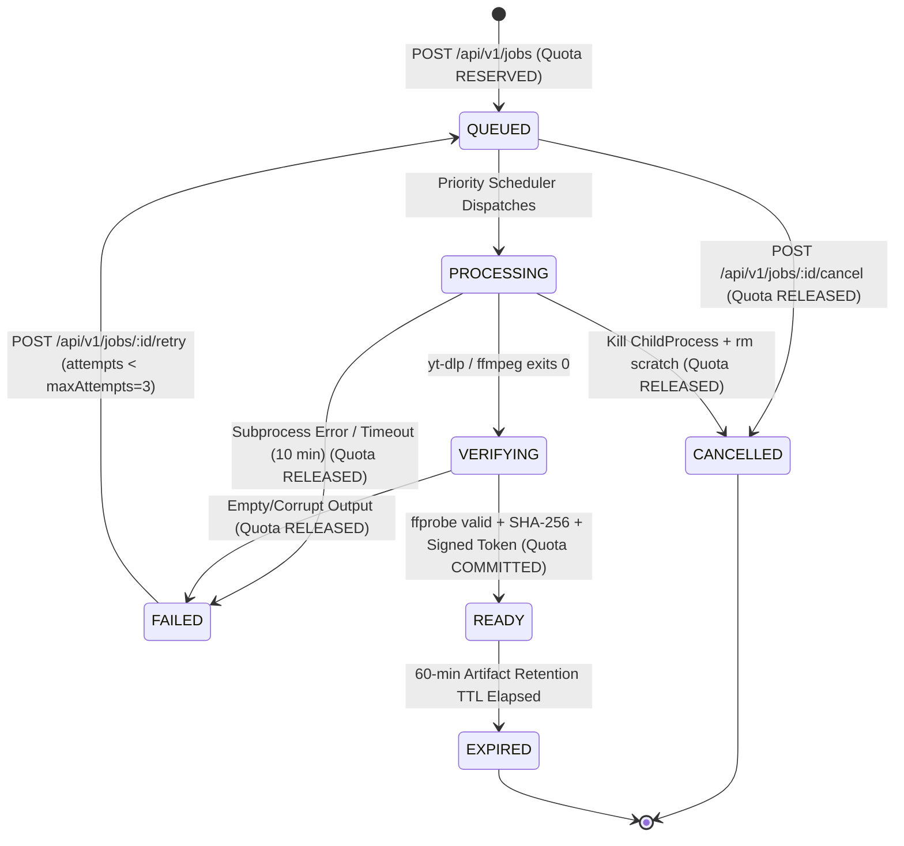

# Job Processing & Lifecycle

**Project:** MUXARO  
**Primary Implementations:** `apps/api/src/services/queue.service.ts`, `apps/api/src/routes/jobs.ts`, `apps/api/src/routes/batches.ts`, `apps/api/src/routes/playlists.ts`

---

## 1. Supported Job Operations

Defined in `apps/api/src/types/index.ts` (`JobOperation`):

| Operation | Route(s) | Typical TurboFlow Lane | Default Queue Class |
| :--- | :--- | :--- | :--- |
| `REMUX_STREAM_COPY` | `POST /api/v1/jobs`, `POST /api/v1/batches` | `instant` (or `power` if codec/container mismatch) | `instant-processing` |
| `EXTRACT_AUDIO` | `POST /api/v1/jobs`, `POST /api/v1/batches` | `smart` | `audio-processing` |
| `MERGE_AUDIO_VIDEO` | `POST /api/v1/tools/merge`, `POST /api/v1/jobs` | `smart` | `merge-processing` |
| `TRANSCODE_VIDEO` | `POST /api/v1/jobs`, `POST /api/v1/batches` | `power` | `video-transcoding` or `high-resolution-processing` (>=2160p) |
| `CONVERT_FORMAT` | `POST /api/v1/jobs`, `POST /api/v1/batches` | `power` | `video-transcoding` or `high-resolution-processing` (>=2160p) |
| `PLAYLIST_BATCH` | `POST /api/v1/playlists/jobs` | `power` | `playlist-packaging` |

---

## 2. Implemented Job Lifecycle State Machine

Defined by `JobStatus` in `apps/api/src/types/index.ts` and driven by `QueueService`:

### State & Quota Invariants
- **`QUEUED`:** Job persisted to `processing_jobs` (`MXJ-XXXXXXXXXX`) with an active `quota_reservations` row (`status = 'RESERVED'`).
- **`PROCESSING`:** Worker slot acquired in both `classActiveCount[queueClass]` and `userActiveCount[ownerUserId]`. Records `started_at` and `queue_wait_ms`.
- **`VERIFYING`:** Executes `ffprobe -v quiet -print_format json -show_format -show_streams -protocol_whitelist file,crypto,data <outputPath>` and verifies at least one playable video or audio stream exists plus non-zero file size, then streams SHA-256 checksum.
- **`READY`:** Inserts row in `output_artifacts`, issues 60-minute HMAC-SHA256 signed download URL, calls `entitlementsService.commitQuota(reservationId)`, and schedules the 60-minute artifact cleanup timer.
- **`FAILED` / `CANCELLED`:** Terminates any running child process (using `taskkill /T /F` on Windows or `SIGTERM`/`SIGKILL` on POSIX), removes `.muxaro-artifacts/<jobId>/`, and calls `entitlementsService.rollbackQuota(reservationId)` so the user's quota is immediately refunded.
- **`EXPIRED`:** After `DEFAULT_RETENTION_MINUTES` (60 minutes), the artifact file is deleted from disk and the job transitions to `EXPIRED`.

---

## 3. Real-Time Progress & Observability

### Event Persistence & SSE Streaming
- Every job state change calls `persistJobUpsert()` (updates `processing_jobs`), `persistJobEvent()` (appends row to `job_events`), and `emitProgress()` (broadcasts on `EventEmitter` channel `job:<jobId>`).
- `GET /api/v1/jobs/:id/events` immediately sends an `event: progress` snapshot of the current state. If already terminal (`READY`, `FAILED`, `CANCELLED`, `EXPIRED`), it emits `event: complete` and closes; otherwise it streams live progress updates with a `: heartbeat` comment every 15 seconds until completion or client disconnect.
- `GET /api/v1/jobs/:id` is explicitly exempted from tight rate limiting (`isExemptPollingRoute`) so long-running 4K/8K transcodes or batch monitors never trip `429`.

### Latency Telemetry
`QueueService` tracks rolling 500-sample windows per `PriorityTier` (`PREMIUM`, `REGISTERED`, `GUEST`) for:
- `queueWaitP50Ms`, `queueWaitP95Ms`
- `processingP50Ms`, `processingP95Ms`

These metrics are exposed via `GET /api/v1/admin/metrics` (redacted public health summary) and `GET /api/v1/admin/analytics` (MFA-protected admin analytics).

---

## 4. Cancellation & Retry Semantics

### Cancellation (`POST /api/v1/jobs/:id/cancel` and `POST /api/v1/batches/:id/cancel`)
1. Enforces strict `isOwnerOrAdmin()` ownership verification (`403 ERR_FORBIDDEN` + `IDOR_ATTEMPT` log on mismatch).
2. If queued: splices `jobId` out of `classQueues[queueClass]`.
3. If active: kills the tracked `ChildProcess` from `activeProcesses`.
4. Deletes `.muxaro-artifacts/<jobId>/`, marks status `CANCELLED`, rolls back quota reservation, updates parent batch counters (if `batchId` is set), and emits terminal SSE event.

### Retry (`POST /api/v1/jobs/:id/retry`)
1. Requires owner/admin authorization.
2. Only permitted when `job.status === 'FAILED'` and `job.attempts < job.maxAttempts` (default `maxAttempts = 3`).
3. Checks global backpressure (`< 200` waiting jobs), resets status/progress/error fields, re-enqueues into the job's assigned `queueClass`, and triggers `dispatchAllClasses()`.

---

## 5. Batch & Playlist Job Orchestration

### Tracked Batches (`POST /api/v1/batches`)
- Creates a persistent `batches` record (`MXB-YYYYMMDD-XXXXXX`) and N child rows in `processing_jobs` linked via `batch_id` with sequential `item_number` (`"001"` .. `"050"`).
- Child job completions/failures/cancellations automatically recalculate `completed_items`, `failed_items`, `cancelled_items`, `progress`, and aggregate batch status (`QUEUED`, `PROCESSING`, `COMPLETED`, `PARTIAL_FAILURE`, `FAILED`, `CANCELLED`).

### Playlist ZIP Jobs (`POST /api/v1/playlists/jobs`)
- Runs inside the `playlist-packaging` lane (`cap: 1`).
- Discovers up to 50 items via `yt-dlp --flat-playlist --dump-single-json`, downloads each item with per-item SSRF validation and a 3-minute timeout, registers per-item signed download URLs, and packages all succeeded files into a verified Store-method ZIP archive (`playlist.zip`) with a signed download link valid for 60 minutes.
- State progression: `QUEUED` → `PROCESSING` → `PACKAGING` → `COMPLETED` / `PARTIAL_FAILURE` / `FAILED`.
- **Implementation Note:** Playlist ZIP jobs are tracked in-memory in `playlistJobs` (`apps/api/src/routes/playlists.ts`), whereas tracked batches (`POST /api/v1/batches`) and individual jobs (`POST /api/v1/jobs`) persist across restarts in SQLite (`batches`, `processing_jobs`, `output_artifacts`).
