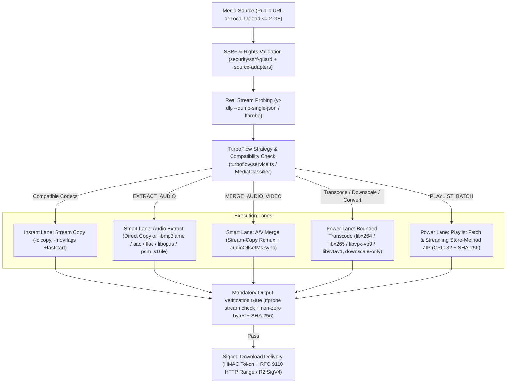

# Media Processing Pipeline

**Project:** MUXARO  
**Implementations:** `apps/api/src/services/adapter.service.ts`, `apps/api/src/services/turboflow.service.ts`, `apps/api/src/services/queue.service.ts`, `apps/media-worker/src/`, `security/src/ffmpeg-sanitizer.ts`

---

## 1. End-to-End Media Pipeline

---

## 2. Authentic Stream Probing & Variant Deduplication

### 2.1 External URL Inspection (`apps/api/src/services/adapter.service.ts`)
- Runs `yt-dlp --dump-single-json --no-warnings --no-playlist --skip-download <url>` via `execFile` (`timeout: 20s`, `maxBuffer: 16 MB`, `windowsHide: true`).
- Falls back to `@muxaro/source-adapters` (`DirectMediaAdapter` / `YouTubePermittedAdapter`) when appropriate.
- **Strict Variant Deduplication:** Groups video streams by `(heightBucket, fpsBucket [30|60], hdr [sdr|hdr])` so users never see duplicate confusing 1080p options. Prefers MP4/H.264 highest-bitrate variant per bucket.
- **Resolution Buckets:** `8K (4320p)`, `4K (2160p)`, `1440p`, `1080p`, `720p`, `480p`, `360p`.
- **Single Recommended Stream:** `markRecommendedVideoStream()` marks **exactly one** video stream as `recommended: true` (preferring 1080p SDR, falling back to highest `<= 1080p`, or highest available).
- **Honest File Size Estimation:** Distinguishes exact container byte sizes (`sizeIsEstimate: false`) from bitrate-derived estimates (`sizeIsEstimate: true`).

### 2.2 Local File Inspection (`registerLocalUpload`)
- Inspects uploaded files with `ffprobe -v quiet -print_format json -show_format -show_streams -protocol_whitelist file,crypto,data <path>`.
- Rejects files lacking playable video or audio streams with `ERR_INVALID_MEDIA_FILE`.

---

## 3. Stream-Copy First & Codec Compatibility Matrix

Both `turboflow.service.ts` (`apps/api`) and `MediaClassifier` (`apps/media-worker/src/prober/classifier.ts`) enforce stream-copy preference and honest quality labeling (`losslessPreserved` is **never** `true` when transcoding occurs):

| Target Container | Natively Compatible Video Codecs (Stream Copy) | Natively Compatible Audio Codecs (Stream Copy) |
| :--- | :--- | :--- |
| **`mp4`** | `h264`/`avc`/`avc1`, `hevc`/`h265`/`hev1`/`hvc1`, `av1`/`av01`, `vp9`/`vp09`, `mpeg4` | `aac`/`mp4a`, `mp3`, `opus`, `ac3`, `eac3` *(+ `alac` in worker)* |
| **`mkv`** | Virtually all video codecs (`true`) | Virtually all audio codecs (`true`) |
| **`webm`** | `vp8`, `vp9`/`vp09`, `av1`/`av01` | `opus`, `vorbis` |
| **`m4a` / `aac`** | — | `aac` / `mp4a` |
| **`mp3`** | — | `mp3` |
| **`flac`** | — | `flac` |
| **`opus` / `ogg`** | — | `opus` / `vorbis` |
| **`wav`** | — | `pcm_*` (`pcm_s16le`, `pcm_s24le`, `pcm_s32le`, `pcm_f32le`) |

### Strict Downscale-Only & Authentic Audio Honesty (`apps/media-worker`)
- **No Fake Upscaling:** `MediaClassifier.computeTargetDimensions()` never upscales beyond source dimensions and enforces even pixel dimensions (`width % 2 === 0`, `height % 2 === 0`) required by H.264/H.265 encoders.
- **Audio Honesty Verdicts (`evaluateAudioHonesty`):**
  - `NATIVE_COPY`: Bit-for-bit `-c:a copy` with zero generational loss.
  - `TRANSPARENT_ENCODE`: Standard conversion (`libmp3lame`, `aac`, `flac`, `pcm_s16le`, `libopus`, `libvorbis`).
  - `LOSSY_TO_LOSSY_DEGRADATION`: Flags requesting higher lossy bitrate than source (e.g., 128k AAC → 320k MP3).
  - `FALSE_FIDELITY_UPSAMPLING`: Flags converting a lossy source to lossless `FLAC`/`WAV` (warns that discarded high frequencies cannot be restored).

---

## 4. Transcoding Encoders & Parameters (`apps/media-worker`)

| Target Codec / Format | FFmpeg Encoder | Default Quality / Flags |
| :--- | :--- | :--- |
| H.264 (`mp4` / `mkv`) | `libx264` | `-preset medium`, `-movflags +faststart` (for MP4) |
| HEVC (`h265`) | `libx265` | `-crf 23`, `-preset medium`, `-pix_fmt yuv420p10le` (HDR) / `yuv420p` (SDR) |
| VP9 (`webm`) | `libvpx-vp9` | `-crf 30 -b:v 0 -row-mt 1` |
| AV1 | `libsvtav1` | `-crf 26 -preset 6` |
| MP3 | `libmp3lame` | `-b:a 320k` (default or requested `bitrateKbps`) |
| AAC / M4A | `aac` | `-b:a 256k` |
| FLAC | `flac` | `-compression_level 8` |
| WAV | `pcm_s16le` | Uncompressed 16-bit PCM |
| Opus | `libopus` | `-b:a 160k` |
| OGG Vorbis | `libvorbis` | `-q:a 6` |

---

## 5. Subprocess Sandboxing & Verification Gate

- **Safe Execution:** Every `ffmpeg`, `ffprobe`, and `yt-dlp` spawn uses `shell: false`, `windowsHide: true`, validated argument arrays (`ProcessSanitizer.validateArguments` / `security/src/ffmpeg-sanitizer.ts`), and bounded stdout/stderr buffers (10 MB in `FFmpegExecutor`).
- **Progress Parsing:** `FFmpegExecutor` passes `-progress pipe:1` and parses `out_time_us` / `fps` / `speed` key-value lines into monotonic percentage updates.
- **Output Verification (`verifyMediaWithFfprobe` & `OutputVerifier`):**
  1. Confirms file exists on disk and `size > 0`.
  2. Runs `ffprobe -protocol_whitelist file,crypto,data` to verify valid container headers and at least one playable video or audio stream.
  3. In `apps/media-worker`, validates expected video/audio stream presence, expected container, and duration deviation (`<= 2.0s` tolerance).
  4. Computes full-file **SHA-256** hash for strong `ETag` and integrity metadata.
- **Scratch Hygiene:** Job artifact directories under `.muxaro-artifacts/<jobId>/` are deleted automatically after 60 minutes (or immediately on failure/cancellation). `apps/media-worker` enforces a 50 GB scratch cap (`ScratchDiskManager`) and automatically reaps workspaces older than 1 hour.
