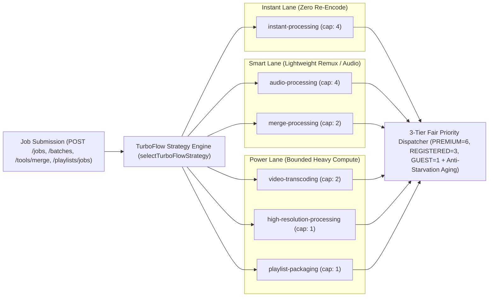

# Queue Design & Fair Priority Scheduling

**Project:** MUXARO  
**Primary Implementation:** `apps/api/src/services/queue.service.ts`  
**Strategy Engine:** `apps/api/src/services/turboflow.service.ts`

---

## 1. TurboFlow 6-Class Queue Architecture

Instead of a single FIFO queue where one 8K video transcode blocks dozens of sub-second stream copies, MUXARO partitions jobs into **6 isolated queue classes** mapped from **3 TurboFlow processing lanes**:

### Queue Class Configuration (`QUEUE_CLASS_CAPS`)

| Queue Class | Lane | Max Concurrent Slots | Routing Trigger (`turboflow.service.ts`) |
| :--- | :--- | :---: | :--- |
| `instant-processing` | `instant` | `4` | `REMUX_STREAM_COPY` where source video & audio codecs are natively container-compatible (`MP4`, `MKV`, `WebM`) |
| `audio-processing` | `smart` | `4` | `EXTRACT_AUDIO` (direct audio stream copy when codec matches target format, else audio transcode) |
| `merge-processing` | `smart` | `2` | `MERGE_AUDIO_VIDEO` (remux when compatible, else bounded audio/video transcode) |
| `video-transcoding` | `power` | `2` | `CONVERT_FORMAT`, `TRANSCODE_VIDEO`, `streamCopy: false`, local upload downscales, or incompatible container fallback (`< 2160p`) |
| `high-resolution-processing` | `power` | `1` | Same as `video-transcoding` when source or target height `>= 2160` (4K / 8K) |
| `playlist-packaging` | `power` | `1` | `PLAYLIST_BATCH` multi-item downloads and streaming ZIP packaging |

---

## 2. Three-Tier Fair Priority Scheduler & Anti-Starvation Aging

When a slot opens in a queue class (`classActiveCount < QUEUE_CLASS_CAPS[queueClass]`), the dispatcher scans waiting jobs in that class and computes an **effective priority score** for every eligible candidate:

### 2.1 Base Tier Weights (`TIER_PRIORITY_WEIGHTS`)
- **`PREMIUM` (includes `ADMIN` / `PRO`):** Base weight = **`6`** (max `5` concurrent active jobs per user)
- **`REGISTERED` (Free authenticated account):** Base weight = **`3`** (max `2` concurrent active jobs per user)
- **`GUEST` (Anonymous session):** Base weight = **`1`** (max `1` concurrent active job per user)

### 2.2 Anti-Starvation Aging Formula
To guarantee that lower-tier jobs never starve indefinitely under sustained high-tier traffic:

$$\text{agingBoost} = \min\left(12,\ \left\lfloor \frac{\text{nowMs} - \text{queuedAtMs}}{5000} \right\rfloor\right)$$

$$\text{effectiveScore} = \text{baseWeight} + \text{agingBoost} - \text{sameUserPenalty}$$

- Every **5 seconds** (`ANTI_STARVATION_AGING_STEP_MS = 5000`) spent waiting adds `+1` priority weight, capped at `+12` (`ANTI_STARVATION_MAX_BOOST = 12`).
- Thus, a `GUEST` job waiting 25 seconds reaches `1 + 5 = 6` (matching a freshly queued `PREMIUM` job) and after 30 seconds surpasses it (`7 > 6`).
- **Per-User Concurrency Enforcement:** Before selecting a candidate, the scheduler verifies `userActiveCount.get(job.ownerUserId) < getTierConcurrencyCap(job.ownerTier)` (live values read from `system_settings`).
- **Round-Robin Same-User Fairness:** Tracks `lastServedUserPerClass` so one user submitting a 20-item batch cannot monopolize all slots in a class when other users have queued jobs.

---

## 3. Backpressure & Failure Isolation

- **Global Queue Depth Limit:** `MAX_TOTAL_QUEUED = 200` across all 6 waiting queues. Submissions beyond this threshold fail immediately with HTTP `503` and error code `ERR_BACKPRESSURE`.
- **SQLite Hydration on Lookup:** `getJob(jobId)` checks the in-memory `jobs` Map first and falls back to `SELECT * FROM processing_jobs WHERE id = ?` (hydrating `output_artifacts` as well), preserving job history and signed downloads across server restarts.
- **Standalone Artifact Registry:** Playlist child files and ZIP archives register into `standaloneArtifacts` + SQLite `output_artifacts` with automatic 60-minute expiration timers.

---

## 4. Planned Distributed Queue Evolution

While the current runtime queue is in-process (persisted to SQLite WAL), the repository includes infrastructure blueprints for distributed broker scaling:
- **Design Spec:** `docs/architecture/adr/ADR-002-distributed-queue-architecture.md` and `docs/architecture/queue-state-machine.md` specify Redis 7 + BullMQ with a PostgreSQL Transactional Outbox (`outbox_events`).
- **IaC Provisioning:** `infra/docker-compose.yml` provisions `redis:7-alpine`, and `infra/terraform/modules/sqs/main.tf` provisions AWS SQS media job queues feeding auto-scaled workers.
- **Cutover Status:** *Planned* — migrating `QueueService` dispatch from in-memory `classQueues` to Redis BullMQ or SQS will enable stateless multi-replica `apps/api` deployments dispatching directly to `apps/media-worker`.
