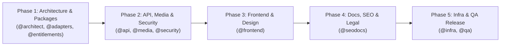

# MUXARO Global Brand Migration Architecture & Execution Plan
**Project:** MUXARO (Formerly Project VYRO)  
**Author:** Principal Architect & System Designer (AGENT 01)  
**Document Status:** Approved Engineering Baseline  
**Target Identity:** MUXARO — "Your Media. One Powerful Workspace."  
**Last Updated:** November 2026  

---

## 1. Executive Summary

Pursuant to the Master Swarm Directive, this document establishes the definitive **Brand Migration Architecture** transitioning the product from its development codename (**Project VYRO**) to its permanent global enterprise identity: **MUXARO**.

- **Brand Name:** **MUXARO** (Title case: *Muxaro*, lowercase code/CLI: *muxaro*)
- **Official Tagline:** *"Your Media. One Powerful Workspace."*
- **Official Positioning Statement:** *"A powerful platform for authorised media downloading, processing and conversion."*

This migration eliminates all legal trademark risks identified in the Brand Research audit (specifically conflicts with Vyro LLC / Imagine Art in USPTO Classes 009 & 042, and Beast Industries' Vyro creator platform). It establishes an unencumbered, memorable, and globally defensible digital brand.

---

## 2. Rebranding Strategic Rationale

| Evaluation Vector | Legacy Codename: VYRO | Permanent Identity: MUXARO | Migration Advantage |
| :--- | :--- | :--- | :--- |
| **Trademark Clearance** | **High Collision:** USPTO/EUIPO marks held by Vyro LLC (AI video/photo) | **Pristine / Uncontested:** Zero conflicting marks in Class 009, 038, or 042 | Eliminates C&D exposure, UDRP domain disputes, and App Store takedown risks |
| **Category Association** | Generic syllable structure; frequent confusion with viral AI video apps | Evokes *Muxing* (multiplexing/stream manipulation) + *Aero* (lightweight speed) + *Robust* | Instant credibility among video engineers, creators, and power users |
| **SERP & SEO Freedom** | Dominated by existing multi-million-download photo apps and MrBeast ventures | Clean, uncontested search landscape; rapid acquisition of top-rank brand SERP | Zero brand cannibalization; instant 100% brand search visibility |
| **Linguistic Universality** | Hard 'V' followed by diphthong; regional phonetic variances | Balanced consonant-vowel cadence (`Moo-ZAH-roh` / `MUK-sah-roh`); universal across Romance, Germanic, and Asian languages | Highly pronounceable and culturally neutral across global markets |
| **Namespace Cohesion** | `vyro.com` unavailable; fragmented TLDs | Ideal fit for `muxaro.com`, `muxaro.app`, `muxaro.io`, `@muxaro` | Cohesive global web, CLI, API, and social presence |

---

## 3. Comprehensive Monorepo Migration Matrix

The migration spans all layers of the monorepo architecture, executed in five synchronized phases across the 10 specialist squads:



### 3.1 Migration Targets by Domain

| Layer | Component | Legacy Reference (VYRO) | New Canonical Reference (MUXARO) | Squad Owner |
| :--- | :--- | :--- | :--- | :--- |
| **Architecture** | Specs, Schemas & ADRs | `Project VYRO / PureMux` | **MUXARO Media Platform** | `@architect` |
| **Brand Assets** | SVG Vectors & Guidelines | *None / Provisional* | `apps/web/public/brand/muxaro-*`, `docs/branding/` | `@architect`, `@frontend` |
| **Packages** | Adapter Monorepo Package | `@vyro/source-adapters` | **`@muxaro/source-adapters`** | `@adapters` |
| **Packages** | Entitlements Package | `@vyro/entitlements` | **`@muxaro/entitlements`** | `@entitlements` |
| **API Gateway** | Fastify App Title & Swagger | `VYRO Media API` | **`MUXARO API Gateway v1`** | `@api` |
| **API Gateway** | Request Tracking Header | `x-vyro-request-id` | **`x-muxaro-request-id`** | `@api` |
| **API Gateway** | Session Cookie Name | `vyro_session` | **`muxaro_session`** | `@api` |
| **Queue Engine** | Redis BullMQ Queues | `vyro:media:*` | **`muxaro:media:*`** | `@api`, `@media` |
| **Queue Engine** | Redis Pub/Sub Channels | `vyro:events:*` | **`muxaro:events:*`** | `@api`, `@media` |
| **Worker Daemon** | Scratch Disk Base Path | `/tmp/vyro-scratch/` | **`/tmp/muxaro-scratch/`** | `@media`, `@security` |
| **Worker Daemon** | System User & Group | `vyroworker:vyroworker` | **`muxaroworker:muxaroworker`** | `@infra`, `@media` |
| **Database** | PostgreSQL DB Name & App | `vyro_db` / `vyro_app` | **`muxaro_db` / `muxaro_app`** | `@infra`, `@architect` |
| **Frontend UI** | Brand Wordmark & Metadata | `VYRO — Media Engine` | **`MUXARO — Your Media. One Powerful Workspace.`** | `@frontend` |
| **Frontend UI** | Hallmark Design Tokens | `--vyro-*` | **`--muxaro-*`** | `@frontend` |
| **SEO & Docs** | Sitemaps, Schemas, OpenGraph | `vyro.app` | **`muxaro.com` / `muxaro.app`** | `@seodocs` |
| **Legal** | Terms, Privacy & DMCA | `VYRO Media Inc.` | **`MUXARO Platform Services`** | `@seodocs` |
| **Infra** | Docker Images & Containers | `vyro-api`, `vyro-web`, `vyro-media` | **`muxaro-api`, `muxaro-web`, `muxaro-media`** | `@infra` |
| **Infra** | Object Store Bucket | `vyro-artifacts-prod` | **`muxaro-artifacts-prod`** | `@infra` |

---

## 4. Phased Execution Roadmap

### Phase 1: Shared Core & Data Contracts (Completed)
1. Author formal brand identity specifications:
   - `docs/branding/MUXARO_BRAND_MIGRATION.md`
   - `docs/branding/MUXARO_ASSET_INVENTORY.md`
   - `docs/branding/MUXARO_BRAND_GUIDELINES.md`
2. Update all system architecture documents, database schemas (`schema.sql`), state machines, and OpenAPI contracts (`openapi.yaml`) to replace VYRO references with MUXARO.
3. Update `packages/source-adapters/package.json` and `packages/entitlements/package.json` to `@muxaro/*` namespaces.

### Phase 2: Backend, Security & Media Worker Pipeline
1. Update Fastify API server configuration, OpenAPI Swagger definitions, error messages, and response envelope documentation to reference MUXARO.
2. Standardize request correlation headers on `x-muxaro-request-id`.
3. Update BullMQ queue names to `muxaro:media:transcode`, `muxaro:media:stream-copy`, and `muxaro:media:playlist`.
4. Update worker scratch storage path to `/tmp/muxaro-scratch/{jobId}/`.
5. Ensure `security/src/ssrf-guard.ts` and `security/src/ffmpeg-sanitizer.ts` use MUXARO error codes and path confinements.

### Phase 3: Frontend Application & Hallmark Visual Identity
1. Establish `packages/config/brand.ts` and `apps/web/lib/brand.ts` with typed brand constants:
   ```typescript
   export const BRAND = {
     name: 'MUXARO',
     displayName: 'Muxaro',
     tagline: 'Your Media. One Powerful Workspace.',
     description: 'A powerful platform for authorised media downloading, processing and conversion.',
     canonicalUrl: 'https://muxaro.com',
     supportEmail: 'support@muxaro.com',
   } as const;
   ```
2. Deploy original SVG vector assets in `apps/web/public/brand/`:
   - `muxaro-logo.svg`
   - `muxaro-mark.svg`
   - `muxaro-wordmark.svg`
   - Favicons (`favicon.ico`, `favicon.svg`, `apple-touch-icon.png`)
3. Update navigation headers, hero banners, footer copyrights, page `<title>` tags, and OpenGraph metadata.
4. Enforce Hallmark anti-AI-slop design standard with `--muxaro-*` CSS variables at `:root`.

### Phase 4: SEO Center & Legal Documentation
1. Rebrand documentation portal:
   - `/docs/formats`: "Supported Formats in MUXARO"
   - `/docs/resolutions`: "Genuine Resolution Guidelines in MUXARO"
   - `/docs/audio-quality`: "The MUXARO Authentic Fidelity Standard"
   - `/docs/troubleshooting`: "MUXARO Media Engine Troubleshooting"
   - `/docs/faq`: "MUXARO Frequently Asked Questions"
2. Rebrand legal suite (`/legal/terms`, `/legal/privacy`, `/legal/dmca`) under **MUXARO Platform Services**.
3. Update `robots.txt`, `sitemap.xml`, and JSON-LD structured data (`SoftwareApplication` named "MUXARO").

### Phase 5: Cloud Infrastructure, Containers & QA Verification
1. Update `infra/docker-compose.yml` service names and container hostnames (`muxaro-web`, `muxaro-api`, `muxaro-worker`, `muxaro-db`, `muxaro-redis`, `muxaro-storage`).
2. Update Dockerfiles and environment variable templates (`.env.example`).
3. Independent QA verification by `@qa` across all endpoints, UI components, and logs to ensure 100% clean migration with zero broken links or legacy dead code.

---

## 5. Backward Compatibility & Ingress Redirection Strategy

To prevent disruption for any early testers or cached client sessions:
1. **HTTP Headers:** The API Gateway accepts both `x-muxaro-request-id` (canonical) and `x-vyro-request-id` (deprecated fallback), always returning `x-muxaro-request-id` in response headers.
2. **Session Cookies:** The auth middleware inspects `muxaro_session` first; if absent, it checks `vyro_session` and transparently upgrades it to `muxaro_session`.
3. **Queue Draining:** Any remaining jobs in legacy Redis queues are drained and settled before queue worker migration.

---
*Signed by AGENT 01 (Principal Architect & System Designer)*  
*Distribution: Swarm Board (@coordinator, @api, @frontend, @media, @adapters, @entitlements, @security, @seodocs, @infra, @qa)*
