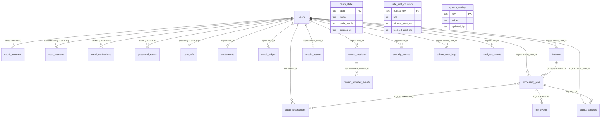

# Database Relationships & Entity-Relationship Diagram

**Project:** MUXARO  
**Source of Truth:** `apps/api/src/db/database.ts` (SQLite WAL 22-table DDL with `PRAGMA foreign_keys = ON`)

---

## 1. Entity-Relationship Diagram (All 22 Implemented Tables)

---

## 2. Hard Foreign-Key Constraints vs. Logical Polymorphic References

MUXARO intentionally mixes **strict SQLite `REFERENCES` foreign keys** with **logical `user_id` / `owner_user_id` references** for a critical architectural reason: **Guest Isolation**.

### 2.1 Enforced SQL Foreign Keys (`PRAGMA foreign_keys = ON`)

| Child Table | Foreign Key Column | Parent Table | Delete Action | Rationale |
| :--- | :--- | :--- | :--- | :--- |
| `oauth_accounts` | `user_id` | `users(id)` | `ON DELETE CASCADE` | OAuth links exist only for registered accounts |
| `user_sessions` | `user_id` | `users(id)` | `ON DELETE CASCADE` | Sessions belong exclusively to registered users |
| `email_verifications` | `user_id` | `users(id)` | `ON DELETE CASCADE` | Verification codes belong exclusively to registered users |
| `password_resets` | `user_id` | `users(id)` | `ON DELETE CASCADE` | Reset tokens belong exclusively to registered users |
| `user_mfa` | `user_id` | `users(id)` | `ON DELETE CASCADE` | TOTP enrollment belongs exclusively to registered users |
| `processing_jobs` | `batch_id` | `batches(id)` | `ON DELETE SET NULL` | Preserves child job history if a batch row is deleted |
| `job_events` | `job_id` | `processing_jobs(id)` | `ON DELETE CASCADE` | Timeline events belong strictly to their parent job |

### 2.2 Logical References (Supporting Both Registered UUIDs & Guest IDs)

Tables such as `entitlements`, `quota_reservations`, `credit_ledger`, `processing_jobs`, `batches`, `output_artifacts`, `media_assets`, `security_events`, and `analytics_events` intentionally do **not** declare a hard `REFERENCES users(id)` FK on `user_id` / `owner_user_id`:
- Registered users store their RFC 9562 UUIDv7 (`users.id`).
- Anonymous guests store their cryptographic session ID (`guest_<32-hex>` from `muxaro_guest` cookie).
- Audit trails (`credit_ledger`, `admin_audit_logs`, `security_events`) remain intact even if a user account is soft-deleted or a system bootstrap action (`system_bootstrap`) writes an audit entry.

---

## 3. Cross-Table Integrity Invariants Enforced in Application Transactions

1. **Account Deletion (`DELETE /api/v1/me`):** Soft-deletes `users` (`account_status = 'DELETED'`, `deleted_at = now`) and immediately sets `revoked_at = now` on all `user_sessions` in a single atomic transaction.
2. **Quota Reservation ↔ Credit Ledger:** Whenever `quota_reservations` inserts/updates a `source = 'extra'` reservation (`RESERVED` → `COMMITTED` or `RELEASED` or `EXPIRED`), `EntitlementsService` appends the matching immutable row (`CREDIT_RESERVED`, `CREDIT_CONSUMED`, `CREDIT_RELEASED`) to `credit_ledger` and updates `entitlements.extra_credits_balance` in the same `BEGIN IMMEDIATE` transaction.
3. **Reward SSV Settlement:** `reward_provider_events` (`UNIQUE provider_transaction_id`), `reward_sessions` (`PENDING` → `VERIFIED`), `credit_ledger` (`REWARD_GRANTED`), and `entitlements` all commit atomically together.
4. **Batch Rollup Consistency:** `QueueService` updates `batches` (`completed_items`, `failed_items`, `cancelled_items`, `progress`, `status`) whenever any child `processing_jobs` row with a non-null `batch_id` transitions state.
