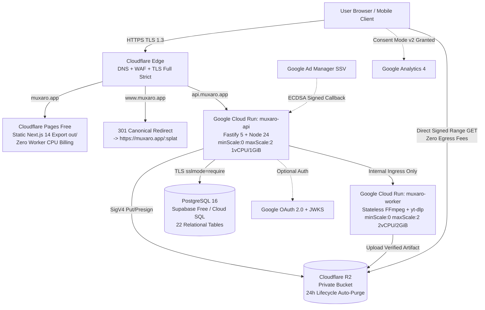

# MUXARO Production Deployment Architecture
**Product:** MUXARO — *Your Media. One Powerful Workspace.*  
**Author:** AGENT 01 — Principal Architect & System Designer  
**Date:** 18 November 2026  

---

## 1. End-to-End Production Topology

---

## 2. Architectural Rationale: Cloudflare Pages Free (Option A) vs. Workers

1. **Zero Cloudflare Workers 10 ms CPU Limit Risk:** Cloudflare Workers Free enforces a strict **10 ms CPU execution ceiling per request**, which Next.js SSR adapters (`@cloudflare/next-on-pages` / OpenNext) can easily exceed under RSC payload serialization.
2. **Verified Static Compatibility:** All `30 / 30` routes in `apps/web` already prerender cleanly as static/SSG pages (`CLOUDFLARE_PAGES=1 npx next build` → `apps/web/out/`), while dynamic user state (auth sessions, media inspection, job progress, My Downloads, Usage, Admin) flows directly to `https://api.muxaro.app/api/v1` via browser `fetch(..., { credentials: 'include' })`.
3. **Zero Frontend Hosting Cost & Sub-50ms Global TTFB:** Static HTML/JS/CSS/SVG assets are served directly from Cloudflare's 300+ edge POPs with immutable caching on `/_next/static/*` and `noindex, nofollow` headers on private routes.

---

## 3. Cloud Run API vs. Internal Media Worker Split

- **`muxaro-api` (Public API Service):** Handles lightweight HTTP I/O — authentication, CSRF, multi-layer rate limiting, quota reservations, URL inspection, presigned R2 URLs, and admin queries (`1 vCPU / 1 GiB`, concurrency `40`, `minScale: 0`, `maxScale: 2`).
- **`muxaro-worker` (Internal-Only Processing Service):** Handles CPU/memory-intensive `ffmpeg` transcoding, remuxing, audio extraction, and ZIP packaging (`2 vCPU / 2 GiB`, concurrency `2`, timeout `600s`, ingress `internal`, non-root user, bounded `/tmp` scratch). Keeping the worker private prevents direct internet abuse of compute-heavy endpoints and isolates API latency from media encoding spikes.
- **Direct R2 Presigned Delivery:** Completed artifacts are uploaded to Cloudflare R2 and delivered to users via short-lived AWS SigV4 presigned URLs supporting HTTP `Range` (`206`), eliminating Cloud Run bandwidth egress charges.
