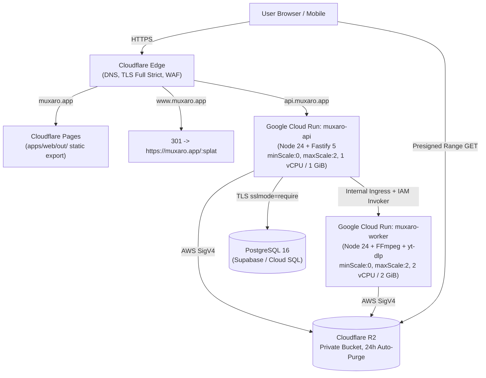

# MUXARO Production Deployment Guide

**Target Architecture:** Cloudflare Pages (Static Frontend) + Google Cloud Run (`muxaro-api` Public API + `muxaro-worker` Internal Media Worker) + PostgreSQL 16 (Supabase / Cloud SQL) + Cloudflare R2 (Private Object Storage)  
**Deployment Status Notice:** All Dockerfiles, Cloud Run manifests, Cloudflare Pages configs, migration scripts, and CI/CD templates are implemented and locally validated in this repository. **Live cloud infrastructure, domain registration (`muxaro.app`), and production secrets have not been provisioned yet** and require owner cloud accounts and explicit approval.

---

## 1. Production Architecture Overview



---

## 2. Pre-Deployment Checklist

Before running a first production deployment, confirm every prerequisite:

- [ ] Domain `muxaro.app` registered and authoritative DNS zone active in Cloudflare (see [Custom Domain](./CUSTOM_DOMAIN.md)).
- [ ] Google Cloud project created with **Cloud Run**, **Artifact Registry**, and **Secret Manager** APIs enabled.
- [ ] All production cryptographic secrets generated (`openssl rand -hex 32`) and stored in **Google Secret Manager** (see [Secrets Management](../security/SECRETS_MANAGEMENT.md)).
- [ ] Private Cloudflare R2 bucket created with 24-hour lifecycle rules and scoped API token (see [Storage Setup](./STORAGE_SETUP.md)).
- [ ] PostgreSQL 16 database provisioned and schema migrations applied via `infra/scripts/run-migrations.sh` (see [Database Setup](./DATABASE_SETUP.md)).
- [ ] **Runtime Readiness Gate:** Confirm how authentication cookies traverse `muxaro.app` ↔ `api.muxaro.app` (either same-origin `/api/v1/*` proxy on `muxaro.app` or explicit `Domain=.muxaro.app` cookie config in `apps/api/src/middleware/auth.middleware.ts`), and ensure `apps/api` runtime persistence matches your chosen database backend (SQLite single-instance vs. PostgreSQL multi-instance).
- [ ] GitHub `production` environment configured with **Required reviewers** and OIDC Workload Identity secrets.

---

## 3. Step-by-Step Deployment Procedure

### Step 1: Build & Deploy Static Web Frontend to Cloudflare Pages

See [Cloudflare Setup](./CLOUDFLARE_SETUP.md) for full details.

```bash
cd apps/web
CLOUDFLARE_PAGES=1 \
NEXT_PUBLIC_SITE_URL="https://muxaro.app" \
NEXT_PUBLIC_API_URL="https://api.muxaro.app" \
npm run build

# Verify static output integrity before uploading
cd ../..
node qa/harness/verify-static-export.mjs

# Deploy via Wrangler (or GitHub Actions)
npx wrangler pages deploy apps/web/out --project-name=muxaro
```

### Step 2: Create Artifact Registry & Least-Privilege Service Accounts (GCP)

```bash
export GCP_PROJECT_ID="your-gcp-project-id"
export GCP_REGION="us-central1"

gcloud artifacts repositories create muxaro \
  --repository-format=docker \
  --location="$GCP_REGION" \
  --project="$GCP_PROJECT_ID"

gcloud iam service-accounts create muxaro-api-sa \
  --display-name="MUXARO Public API Service" \
  --project="$GCP_PROJECT_ID"

gcloud iam service-accounts create muxaro-worker-sa \
  --display-name="MUXARO Internal Media Worker" \
  --project="$GCP_PROJECT_ID"
```

Grant `roles/secretmanager.secretAccessor` to each service account scoped strictly to the secrets referenced in `infra/cloudrun/api-service.yaml` and `infra/cloudrun/worker-service.yaml`.

### Step 3: Build & Push Container Images

```bash
export IMAGE_TAG="$(git rev-parse --short HEAD)"
gcloud auth configure-docker "${GCP_REGION}-docker.pkg.dev"

# Public API container (Node 24 + Fastify 5 + FFmpeg/yt-dlp fallback, UID 10001)
docker build -f infra/Dockerfile.api \
  -t "${GCP_REGION}-docker.pkg.dev/${GCP_PROJECT_ID}/muxaro/muxaro-api:${IMAGE_TAG}" .
docker push "${GCP_REGION}-docker.pkg.dev/${GCP_PROJECT_ID}/muxaro/muxaro-api:${IMAGE_TAG}"

# Internal Media Worker container (Node 24 + FFmpeg + yt-dlp, UID 10001)
docker build -f infra/Dockerfile.worker \
  -t "${GCP_REGION}-docker.pkg.dev/${GCP_PROJECT_ID}/muxaro/muxaro-worker:${IMAGE_TAG}" .
docker push "${GCP_REGION}-docker.pkg.dev/${GCP_PROJECT_ID}/muxaro/muxaro-worker:${IMAGE_TAG}"
```

### Step 4: Deploy Cloud Run Services

```bash
# Deploy internal media worker FIRST (ingress: internal ONLY)
sed -e "s|REGION|${GCP_REGION}|g" \
    -e "s|PROJECT_ID|${GCP_PROJECT_ID}|g" \
    -e "s|IMAGE_TAG|${IMAGE_TAG}|g" \
    infra/cloudrun/worker-service.yaml > /tmp/worker-service.yaml
gcloud run services replace /tmp/worker-service.yaml --region="$GCP_REGION" --project="$GCP_PROJECT_ID"

# Allow ONLY muxaro-api-sa to invoke muxaro-worker (NEVER allUsers)
gcloud run services add-iam-policy-binding muxaro-worker \
  --region="$GCP_REGION" \
  --project="$GCP_PROJECT_ID" \
  --member="serviceAccount:muxaro-api-sa@${GCP_PROJECT_ID}.iam.gserviceaccount.com" \
  --role="roles/run.invoker"

# Deploy public API service
sed -e "s|REGION|${GCP_REGION}|g" \
    -e "s|PROJECT_ID|${GCP_PROJECT_ID}|g" \
    -e "s|IMAGE_TAG|${IMAGE_TAG}|g" \
    infra/cloudrun/api-service.yaml > /tmp/api-service.yaml
gcloud run services replace /tmp/api-service.yaml --region="$GCP_REGION" --project="$GCP_PROJECT_ID"
```

---

## 4. Cost & Scaling Guardrails

Both Cloud Run manifests enforce strict default cost caps:

| Service | `minScale` | `maxScale` | CPU / Memory | Concurrency | Timeout | Ingress |
| :--- | :---: | :---: | :--- | :---: | :---: | :--- |
| **`muxaro-api`** | `0` | `2` | `1 vCPU / 1 GiB` (`cpu-throttling: true`) | `40` | `300s` | `all` |
| **`muxaro-worker`** | `0` | `2` | `2 vCPU / 2 GiB` (`cpu-throttling: false`) | `2` | `600s` | **`internal`** |

---

## 5. Post-Deployment Verification

```bash
# 1. Verify frontend security headers & canonical redirect
curl -sI https://muxaro.app/
curl -sI https://www.muxaro.app/tools   # Expect 301 -> https://muxaro.app/tools

# 2. Verify API liveness and honest readiness probe
curl -fsS https://api.muxaro.app/api/v1/health
curl -fsS https://api.muxaro.app/api/v1/ready

# 3. Verify worker is NOT publicly reachable (must reject external callers)
gcloud run services describe muxaro-worker --region="$GCP_REGION" \
  --format="value(metadata.annotations['run.googleapis.com/ingress'])"
# Expected output: internal
```

If any post-deploy check fails, immediately execute [Rollback Procedures](./ROLLBACK.md).
