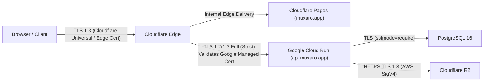

# MUXARO SSL/TLS & HTTPS Security Guide (`muxaro.app`)

> **Certificate Issuance Status (Truthfulness Notice):** No live TLS certificate has been issued for `muxaro.app` or `api.muxaro.app` yet because domain registration and cloud deployment have not been executed. This document specifies the exact validation, encryption, HSTS, cookie, mixed-content, and automated renewal procedures required during live provisioning.

---

## 1. End-to-End TLS Architecture

Because `.app` is a Google Registry top-level domain included in the **global browser HSTS preload list**, modern browsers refuse plaintext HTTP connections to `muxaro.app` and all subdomains. Every public hop must terminate valid, CA-signed TLS certificates:



---

## 2. Certificate Provisioning & DNS Validation Process

### 2.1 Frontend Edge Certificate (`muxaro.app` & `www.muxaro.app`)
- **Issuer:** Cloudflare Universal SSL / Pages Managed Certificate (Let's Encrypt / Google Trust Services).
- **Validation Method:** Automatic **DNS-01** validation performed by Cloudflare when the `muxaro.app` zone is authoritative on Cloudflare DNS and custom domains are bound in Cloudflare Pages.
- **Renewal:** Fully automated by Cloudflare prior to expiry (zero manual CSR/key rotation required).

### 2.2 API Origin Certificate (`api.muxaro.app`)
- **Issuer:** Google Cloud Run Managed TLS Certificate (Let's Encrypt / Google Trust Services).
- **Validation Sequence:**
  1. Complete domain ownership verification in GCP for `muxaro.app` (DNS `TXT` record).
  2. Map `api.muxaro.app` to `muxaro-api` via `gcloud beta run domain-mappings create`.
  3. Set the `api` `CNAME` (`ghs.googlehosted.com.`) in Cloudflare to **DNS Only (Grey Cloud)** until Google's managed certificate status transitions to `Ready` (`CertificateProvisioned: True`, typically 10–20 minutes).
  4. Switch `api` to **Proxied (Orange Cloud)** in Cloudflare once the origin certificate is active.
- **Renewal:** Automatically renewed by Google Cloud Run (~30 days before expiration). Keep Cloudflare SSL/TLS mode on **Full (Strict)** so Cloudflare validates the origin certificate chain on every connection (never use `Flexible` or non-strict `Full`).

---

## 3. HTTPS Enforcement & HSTS Rollout Policy

### 3.1 Cloudflare SSL/TLS Settings
| Setting | Required Value | Purpose |
| :--- | :--- | :--- |
| **SSL/TLS Encryption Mode** | **Full (Strict)** | Enforces authenticated TLS between Cloudflare Edge and Cloud Run origin |
| **Minimum TLS Version** | **TLS 1.2** | Disables deprecated TLS 1.0 and TLS 1.1 |
| **TLS 1.3** | **Enabled** | Enables modern AEAD cipher suites and 1-RTT handshakes |
| **Always Use HTTPS** | **Enabled** | Redirects any `http://` request with `301` to `https://` |
| **Automatic HTTPS Rewrites** | **Enabled** | Rewrites accidental insecure asset URLs to HTTPS |

### 3.2 Staged Custom HSTS Header Rollout
Because `.app` is natively HSTS-preloaded by browsers, do **not** immediately emit a 1-year `Strict-Transport-Security` header with `includeSubDomains; preload` until every subdomain (`muxaro.app`, `www.muxaro.app`, `api.muxaro.app`) has been verified healthy:
1. **Day 0–7 (Initial Validation):** `Strict-Transport-Security: max-age=300`
2. **Day 7+ (Verified Stable):** `Strict-Transport-Security: max-age=15552000; includeSubDomains`
3. **Mature Production:** `Strict-Transport-Security: max-age=31536000; includeSubDomains; preload`

---

## 4. Secure Cookies & Proxy Header Trust

In `apps/api/src/middleware/auth.middleware.ts`:
- `isSecureRequest(request)` sets the `Secure` cookie flag whenever `NODE_ENV === 'production'`, `x-forwarded-proto === 'https'`, or `request.protocol === 'https'`.
- `setAuthCookies()` issues:
  - `muxaro_session`: `HttpOnly; Secure; SameSite=Lax; Path=/; Max-Age=2592000`
  - `muxaro_csrf`: `Secure; SameSite=Lax; Path=/; Max-Age=2592000`
- `setGuestCookie()` issues `muxaro_guest`: `HttpOnly; Secure; SameSite=Lax; Path=/; Max-Age=2592000`.
- `TRUST_PROXY=true` in `infra/cloudrun/api-service.yaml` ensures Fastify reads `X-Forwarded-Proto` and client IP accurately behind Cloud Run / Cloudflare ingress.

> **Important Cross-Subdomain Check:** `serializeCookie()` currently omits a `Domain` attribute (host-only). Before going live with split origins (`muxaro.app` and `api.muxaro.app`), either configure a same-origin `/api/v1/*` proxy on `muxaro.app` or add `Domain=.muxaro.app` support to `auth.middleware.ts` and verify cookie round-tripping over HTTPS.

---

## 5. Mixed-Content Prevention

- `apps/web/app/layout.tsx` self-hosts `Inter` and `JetBrains_Mono` via `next/font/google` (no external `http://` font stylesheets).
- All brand assets resolve via relative `/brand/*` paths.
- `apps/web/lib/api-client.ts` derives API URLs from `NEXT_PUBLIC_API_URL` (`https://api.muxaro.app` in production) or relative `/api/v1`.
- Presigned Cloudflare R2 download URLs (`storage.service.ts`) strictly use `https://<R2_ACCOUNT_ID>.r2.cloudflarestorage.com`.
- `apps/api/src/config.ts` (`validateProductionConfig`) rejects `localhost` origins when `NODE_ENV=production`.

---

## 6. Post-Provisioning TLS Verification Commands

Run these checks **after** live domain and Cloud Run provisioning:

```bash
# Inspect TLS version, certificate chain, and expiration on web & API
openssl s_client -connect muxaro.app:443 -servername muxaro.app </dev/null 2>/dev/null \
  | openssl x509 -noout -issuer -subject -dates

openssl s_client -connect api.muxaro.app:443 -servername api.muxaro.app </dev/null 2>/dev/null \
  | openssl x509 -noout -issuer -subject -dates

# Verify HTTP -> HTTPS redirect and security headers
curl -sI http://muxaro.app/
curl -sI https://muxaro.app/
curl -sI https://api.muxaro.app/api/v1/health
```
