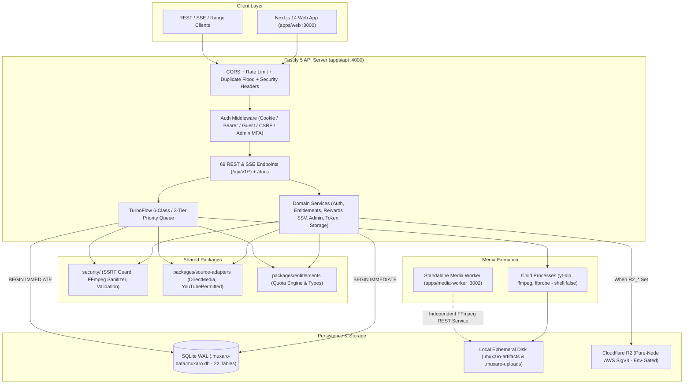
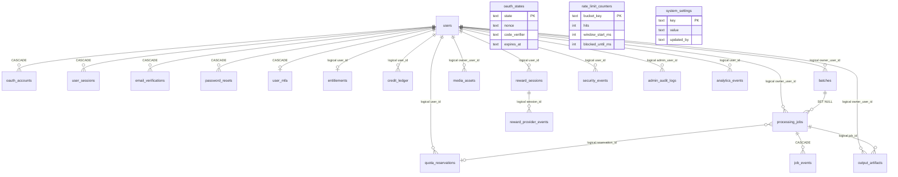
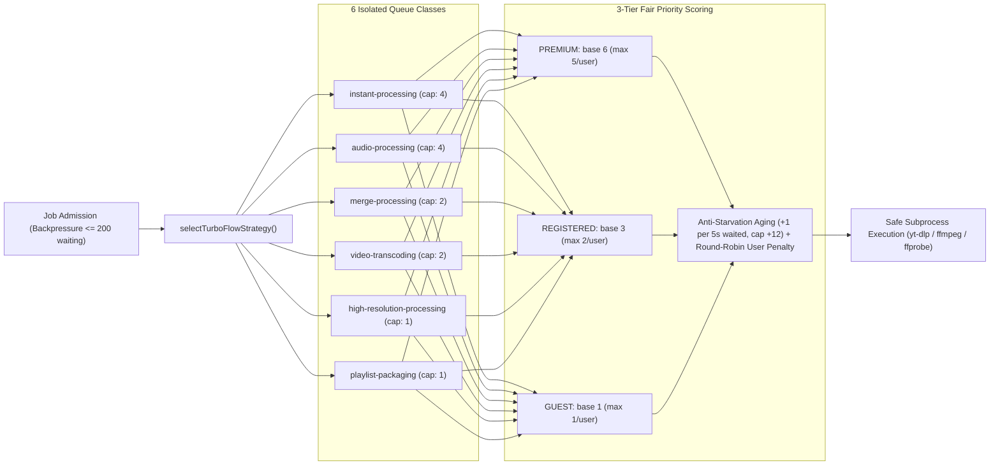
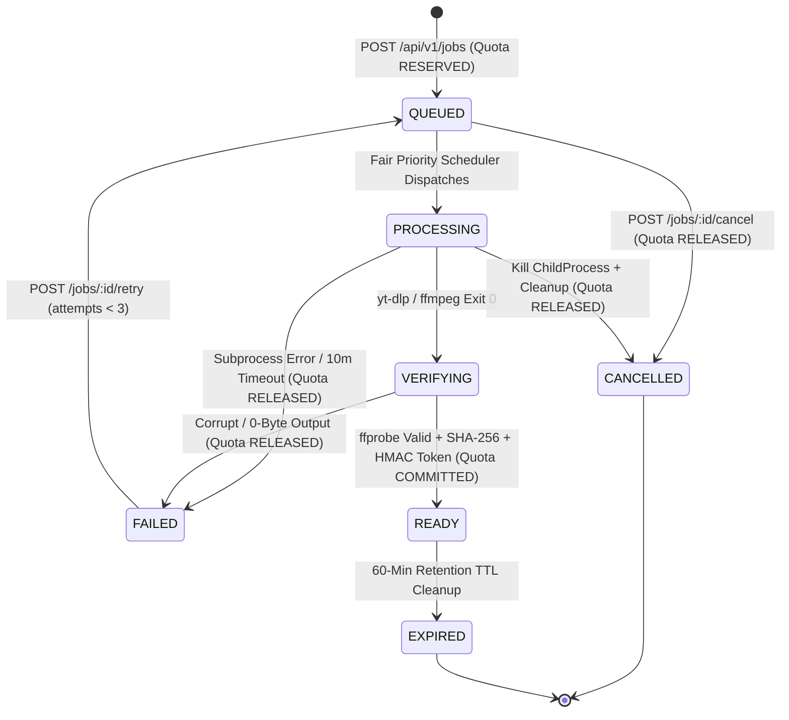
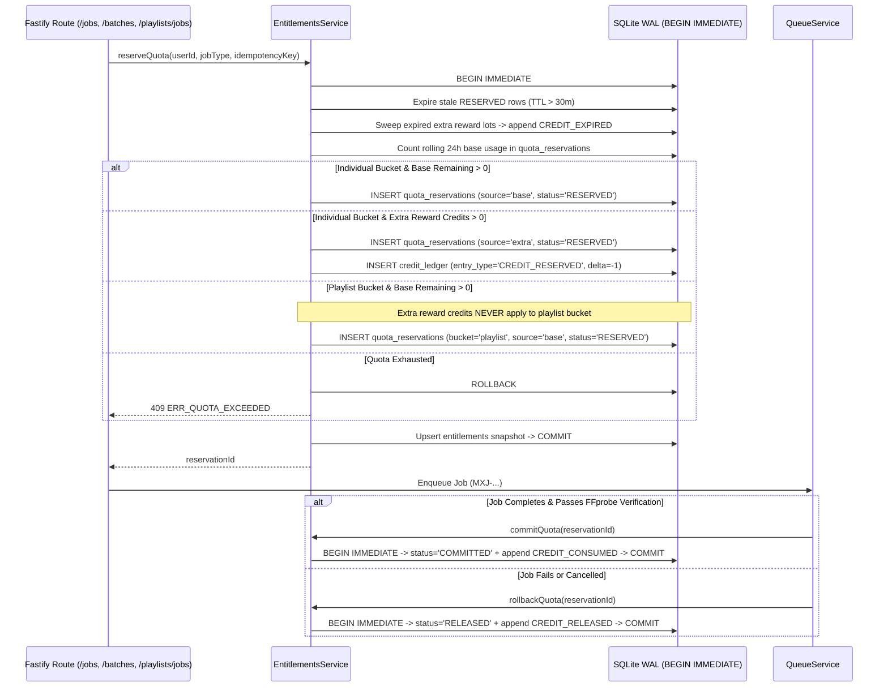
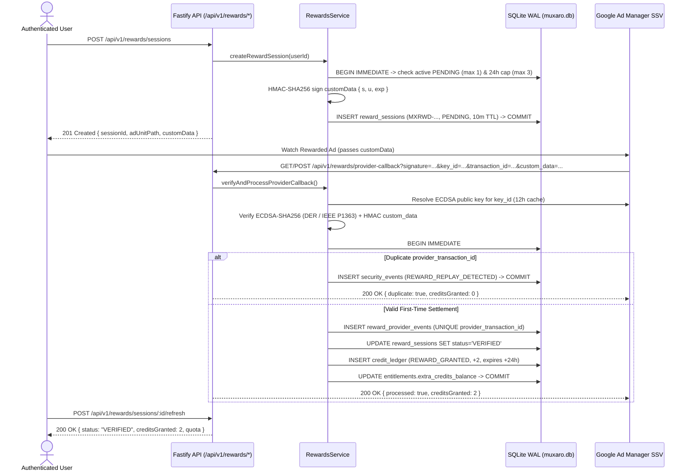
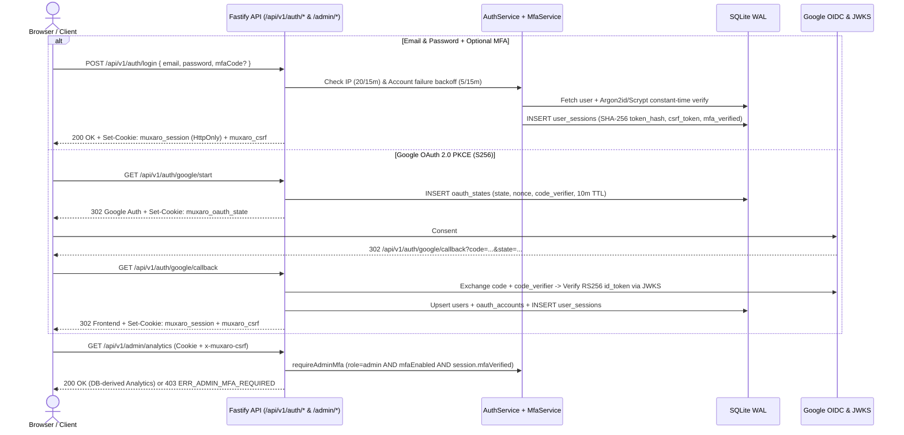
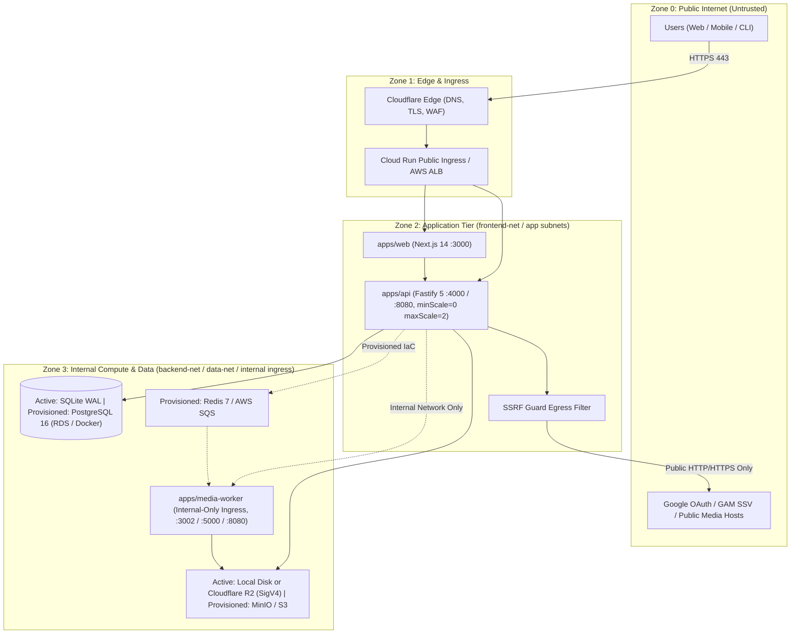

# Consolidated System & Architecture Mermaid Diagrams

**Project:** MUXARO  
**Purpose:** Single visual reference consolidating verified Mermaid diagrams grounded strictly in the implemented codebase (`apps/api`, `apps/media-worker`, `apps/web`, `packages/*`, `security/`, `infra/`).

---

## 1. Global System Architecture (Implemented Runtime)

---

## 2. Database Entity-Relationship Diagram (All 22 Implemented Tables)

---

## 3. TurboFlow Queue Architecture & 3-Tier Fair Priority Scheduler

---

## 4. Job Lifecycle State Machine

---

## 5. Atomic Quota Reservation & Immutable Ledger Flow

---

## 6. Rewarded Ads Server-Side Verification (GAM SSV) Flow

---

## 7. Authentication & Admin MFA Sequence

---

## 8. Deployment Topology & Network Security Boundaries

