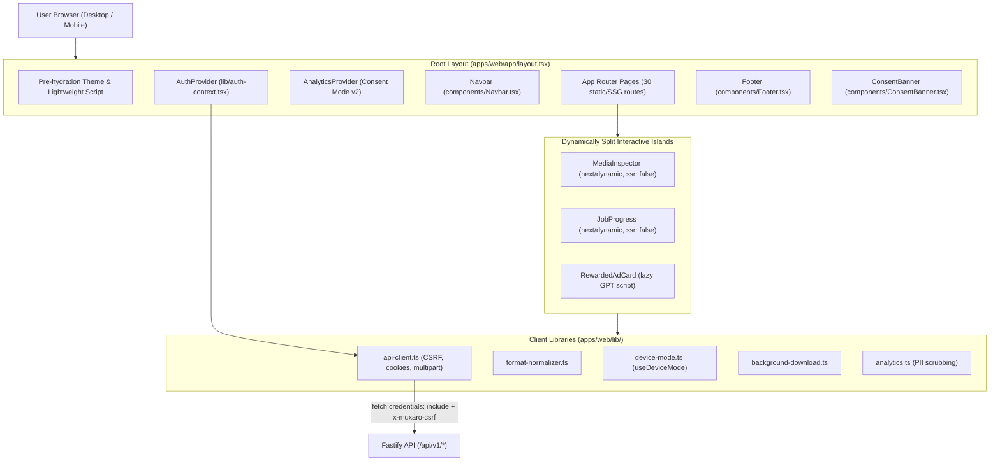

# MUXARO Frontend Architecture

**Package:** `@muxaro/web` (`apps/web`)  
**Framework:** Next.js `14.2.24` (App Router) + React `18.3.1` + TypeScript `5.6.3`  
**Styling:** Tailwind CSS `3.4.14` + CSS Custom Properties (`apps/web/app/globals.css`)  
**Icons:** `lucide-react` `^0.453.0`  
**Deployment Model:** Dual-mode — Local/Node server with `/api/v1/*` rewrites, or Static Export (`CLOUDFLARE_PAGES=1` → `apps/web/out/`) for Cloudflare Pages.

---

## 1. High-Level Architecture

`apps/web` is a Next.js 14 App Router application engineered to prerender all public and shell routes cleanly as static HTML/SSG bundles while hydrating interactive media workspace, authentication, download queue, and administration flows against the Fastify API (`apps/api`).



---

## 2. Directory Structure

```text
apps/web/
├── app/                         # Next.js 14 App Router pages & layouts
│   ├── layout.tsx               # Root HTML, next/font/google, pre-paint theme script, providers
│   ├── globals.css              # Hallmark-compliant design tokens, Aurora Flow CSS, dark mode
│   ├── page.tsx                 # Primary workspace (Paste URL / Upload File + dynamic islands)
│   ├── robots.ts                # Dynamic robots.txt generation
│   ├── sitemap.ts               # Dynamic sitemap.xml generation
│   ├── login/                   # Email/password + Google OAuth login
│   ├── register/                # Account registration
│   ├── verify-email/            # Single-use email verification flow
│   ├── reset-password/          # Password reset request & confirmation
│   ├── account/                 # Profile, public ID (MXR-*), MFA setup, active sessions
│   ├── dashboard/               # My Downloads: server-persisted job & batch queue
│   ├── credits/                 # Usage & Limits: rolling 24h allowance, credit ledger, rewarded ads
│   ├── admin/                   # MFA-gated Admin Control Centre
│   ├── status/                  # Public redacted service status page
│   ├── tools/                   # Tools directory + 7 dedicated workflow pages
│   │   ├── media-converter/
│   │   ├── audio-extractor/
│   │   ├── audio-video-merger/
│   │   ├── video-merger/
│   │   ├── batch-processing/
│   │   ├── playlist-processing/
│   │   └── playlist-batch/
│   ├── docs/                    # Markdown-backed user documentation + [slug] SSG pages
│   ├── privacy/                 # Privacy Policy (rendered from content/legal/privacy.md)
│   ├── terms/                   # Terms of Service (rendered from content/legal/terms.md)
│   └── dmca/                    # DMCA Policy (rendered from content/legal/dmca.md)
├── components/                  # Shared UI components
│   ├── Navbar.tsx               # Sticky header, live quota pill, account dropdown, theme & lightweight toggles
│   ├── Footer.tsx               # 4-column semantic footer with status link
│   ├── MediaInspector.tsx       # Video / Audio / Merge configuration island
│   ├── JobProgress.tsx          # Visibility-aware polling, Range preview, auto-download toggle, retry/cancel
│   ├── RewardedAdCard.tsx       # Opt-in GAM rewarded ads with server-side verification polling
│   ├── ConsentBanner.tsx        # Consent Mode v2 privacy banner (Essential / Customize / Accept all)
│   ├── AnalyticsProvider.tsx    # Gtag/GTM bootstrap with default-denied consent
│   └── DimensionTick.tsx        # Monospace metric readout bar
├── content/                     # Static Markdown docs (`docs/*.md`) & legal copy (`legal/*.md`)
├── lib/                         # Client SDK, context, normalizers, telemetry, types
├── public/                      # Brand SVGs/PNGs, Cloudflare Pages `_headers` & `_redirects`
├── next.config.mjs              # Conditional static export (`CLOUDFLARE_PAGES=1`) & dev API proxy
├── tailwind.config.ts           # Semantic token-mapped Tailwind theme
└── wrangler.toml                # Cloudflare Pages build output configuration (`out`)
```

---

## 3. Routing & Rendering Modes

### 3.1 Dual Build Mode (`apps/web/next.config.mjs`)

`next.config.mjs` inspects `process.env.CLOUDFLARE_PAGES`:

| Mode | Trigger | Output | API Routing |
| :--- | :--- | :--- | :--- |
| **Local / Docker Server** | `CLOUDFLARE_PAGES` unset or `0` | `.next/` | Next.js `rewrites()` proxies `/api/v1/:path*` to `API_INTERNAL_URL` (default `http://127.0.0.1:4000`). Same-origin browser requests avoid CORS preflight. |
| **Cloudflare Pages Static Export** | `CLOUDFLARE_PAGES=1` | `apps/web/out/` (`output: 'export'`, `images: { unoptimized: true }`) | Client code calls `NEXT_PUBLIC_API_URL` (e.g., `https://api.muxaro.app/api/v1`) directly with `credentials: 'include'`. |

All 30 routes—including dynamic `/docs/[slug]` routes via `generateStaticParams`—prerender without requiring a Node.js SSR runtime at the edge.

### 3.2 Route Classification & SEO Indexing

Private/interactive account routes carry `X-Robots-Tag: noindex, nofollow` in `apps/web/public/_headers` (and route-level metadata layouts):

- **Public indexable routes:** `/`, `/tools`, `/tools/*`, `/docs`, `/docs/[slug]`, `/status`, `/privacy`, `/terms`, `/dmca`.
- **Non-indexed account/auth routes:** `/account`, `/admin`, `/dashboard`, `/credits`, `/login`, `/register`, `/verify-email`, `/reset-password`.

---

## 4. API Communication Layer (`apps/web/lib/api-client.ts`)

All frontend-to-backend calls flow through the typed `api` client in `apps/web/lib/api-client.ts`:

- **Base URL resolution (`getApiBaseUrl()`):** Uses `NEXT_PUBLIC_API_URL` (normalized to end in `/api/v1`) when set; otherwise defaults to `/api/v1` in the browser (handled by Next.js rewrites locally) or `API_INTERNAL_URL` during server-side execution.
- **Credentials & CSRF:** Every request uses `credentials: 'include'`. Mutating requests (`POST`, `PUT`, `PATCH`, `DELETE`) automatically read the `muxaro_csrf` cookie (or cached token from session responses) and attach the `x-muxaro-csrf` header.
- **Streaming & Resumable Uploads:** Files larger than 5 MB are sliced into 5 MB chunks (`MULTIPART_CHUNK_BYTES = 5 * 1024 * 1024`) via `file.slice()`—never buffering the whole file in browser memory—with up to 3 automatic retries per part (`MAX_PART_RETRIES = 3`) and `AbortController` cancellation support.
- **Payload Normalization:** `normalizeJob()` and `format-normalizer.ts` map backend job responses, stream lists, and human-friendly error messages (`mapFriendlyError()` in `lib/background-download.ts`) so raw uppercase error codes never leak into primary user copy.

---

## 5. Privacy, Consent & Security Controls in the Frontend

1. **Zero Secret Exposure:** Only `NEXT_PUBLIC_*` environment variables are read by client bundles; API keys, session secrets, R2 credentials, and OAuth secrets live exclusively on the API server.
2. **Consent Mode v2 (`AnalyticsProvider.tsx` & `ConsentBanner.tsx`):** `analytics_storage`, `ad_storage`, `ad_user_data`, and `ad_personalization` default to `'denied'` before any Google script initializes. If `NEXT_PUBLIC_GA_MEASUREMENT_ID` and `NEXT_PUBLIC_GTM_CONTAINER_ID` are unset, no third-party analytics script is injected.
3. **PII Scrubbing (`lib/analytics.ts`):** `sanitizeAnalyticsParams()` strips emails, URLs, tokens, JWTs, local file paths, and blocked parameter keys before emitting events.
4. **Edge Security Headers (`public/_headers`):** Applies `X-Content-Type-Options: nosniff`, `X-Frame-Options: DENY`, `Referrer-Policy: strict-origin-when-cross-origin`, and restrictive `Permissions-Policy` across all exported routes.
5. **Safe Redirects & Avatars:** Return paths (`returnTo`) are restricted to single-slash relative paths (`startsWith('/') && !startsWith('//')`), and avatar URLs in `Navbar.tsx` are validated via `isSafeAvatarUrl()`.

---

## 6. Related Documentation

- [Design System](./DESIGN_SYSTEM.md)
- [Component Guide](./COMPONENT_GUIDE.md)
- [State Management](./STATE_MANAGEMENT.md)
- [Responsive Design](./RESPONSIVE_DESIGN.md)
- [Frontend Performance](./PERFORMANCE.md)
