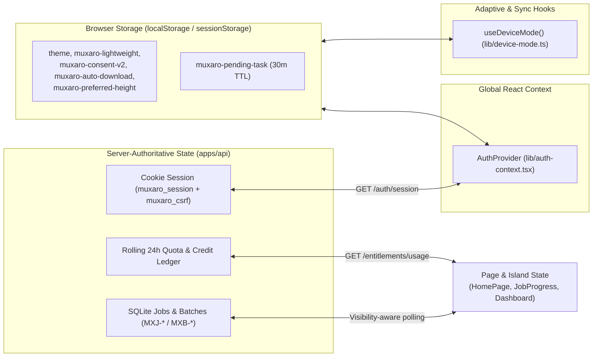

# MUXARO Frontend State Management

MUXARO intentionally avoids heavy global state libraries (Redux/Zustand) to keep the shared client JavaScript bundle lean (`~87.3 kB` gzipped across all routes). Instead, state is partitioned into four clear layers: React Context for authentication, custom hooks for device/network adaptation, local component state for workspace flows, and versioned browser storage keys for cross-tab preferences.

---

## 1. State Architecture Overview

---

## 2. Authentication State (`apps/web/lib/auth-context.tsx`)

`AuthProvider` wraps the entire application inside `apps/web/app/layout.tsx` and exposes `useAuth()`:

| Property / Method | Type | Purpose |
| :--- | :--- | :--- |
| `user` | `AuthUser \| null` | Active authenticated profile (`publicUserId`, `email`, `emailVerified`, `displayName`, `avatarUrl`, `role`, `tier`, `mfaEnabled`, `mfaVerified`) |
| `authenticated` | `boolean` | Derived (`user !== null`) |
| `loading` | `boolean` | `true` during initial `GET /api/v1/auth/session` hydration |
| `csrfToken` | `string \| null` | Synchronized from `/auth/session` response or `muxaro_csrf` cookie |
| `googleAuthConfigured` | `boolean` | Reflects server OAuth availability so login/register hide Google Sign-In when unconfigured |
| `refreshSession()` | `() => Promise<AuthUser \| null>` | Re-fetches `/api/v1/auth/session` with `credentials: 'include'` and `cache: 'no-store'` |
| `logout()` / `logoutAll()` | `() => Promise<void>` | Posts to `/auth/logout` or `/auth/logout-all` with `x-muxaro-csrf`, clears user/CSRF state and opaque analytics ID |
| `savePendingTask()` / `consumePendingTask()` | `(task) => void` / `() => PendingTaskState \| null` | Preserves in-progress workspace inputs (`url`, `mode`, `resolution`, `format`, `returnTo`) in `sessionStorage` across login/OAuth redirects (30-minute TTL) |

---

## 3. Adaptive Device & Network State (`apps/web/lib/device-mode.ts`)

`useDeviceMode()` combines five browser signals into a single reactive state object without external dependencies:

1. **Manual Lightweight Toggle:** Persisted under `localStorage['muxaro-lightweight']` and synchronized across components and browser tabs via a custom `muxaro-lightweight-change` `CustomEvent` plus the native `storage` event.
2. **Reduced Motion:** Listens to `window.matchMedia('(prefers-reduced-motion: reduce)')`.
3. **Save-Data & Slow Connection:** Safely feature-detects `navigator.connection?.saveData` and `effectiveType` (`'2g'` or `'slow-2g'`).
4. **Tab Visibility:** Listens to `document.visibilitychange` to set `tabHidden`.
5. **Derived Flags:**
   - `lightweight = manualLightweight || reducedMotion || saveData || slowConnection` (synced to `<html data-lightweight="true">`).
   - `shouldAnimateAurora = !lightweight && !tabHidden`.

---

## 4. Workspace & Polling State

### 4.1 Home Workspace (`apps/web/app/page.tsx`)
- Manages dual-mode input state (`activeTab: 'link' | 'upload'`), drag-and-drop flags, upload progress (`0–100%`), an `AbortController` ref (`uploadAbortRef`) for cancelling multipart uploads, inspected `MediaManifest`, active `ProcessingJob`, and restored `backgroundJobs` fetched from `api.getHistory()`.
- Automatically consumes any saved `muxaro-pending-task` upon returning from authentication.

### 4.2 Job Polling (`apps/web/components/JobProgress.tsx`)
- Uses `jobRef` + `onJobUpdateRef` to avoid stale closures during asynchronous polling.
- Merges partial backend updates monotonically via `mergeBackendPayload()` (clamping progress `0–100` and preserving known metadata).
- Halts polling immediately on terminal states (`READY`, `FAILED`, `CANCELLED`, `REJECTED`) or when the browser tab is hidden (`visibilityState === 'hidden'`).

---

## 5. Browser Storage Key Registry

All client storage keys used across `apps/web` are documented below:

| Key | Store | Owner Module | Default | Purpose |
| :--- | :--- | :--- | :--- | :--- |
| `theme` | `localStorage` | `layout.tsx`, `Navbar.tsx` | `'light'` | Persists `'light'` or `'dark'` canvas mode |
| `muxaro-lightweight` | `localStorage` | `layout.tsx`, `lib/device-mode.ts` | unset (`false`) | Persists manual Lightweight mode preference |
| `muxaro-consent-v2` | `localStorage` | `lib/analytics.ts`, `ConsentBanner.tsx` | unset (denied) | Stores versioned Consent Mode v2 JSON (`{ version: 2, decided, analytics, rewardedAds, updatedAt }`) |
| `muxaro-auto-download` | `localStorage` | `lib/background-download.ts`, `JobProgress.tsx` | `'false'` | Opt-in auto-download toggle (strictly OFF by default) |
| `muxaro-preferred-height` | `localStorage` | `lib/format-normalizer.ts` | unset | Remembers user's last selected video resolution height (e.g., `1080`) |
| `muxaro-pending-task` | `sessionStorage` | `lib/auth-context.tsx` | unset | Preserves workspace task across sign-in/OAuth redirects (expires after 30 minutes; consumed once) |

> **Security Note:** Session tokens (`muxaro_session`) are stored exclusively in `HttpOnly` cookies set by `apps/api` and are **never** stored in `localStorage` or `sessionStorage`.
