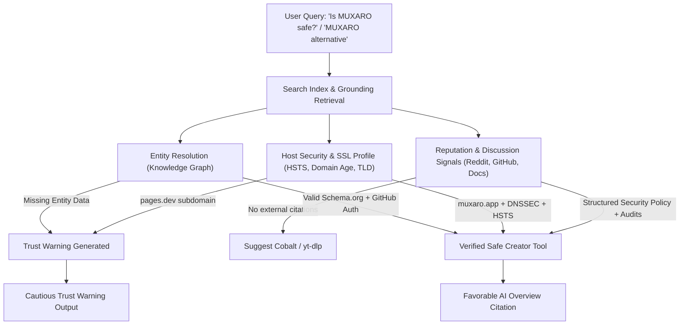

# MUXARO — Google AI Overview & Reputation Crisis Audit
**Target Issue:** Google AI Overview Trust Warnings & Competitor Substitution (yt-dlp, Cobalt)  
**Classification:** Research, Competitive Intelligence & Answer Engine Optimization (AEO)  
**Author:** Research & Technical Analysis Lead  
**Date:** November 19, 2026  

---

## 1. Executive Summary & Problem Diagnosis

Google's Search Generative Experience (AI Overviews) and LLM search engines (Perplexity, Bing Copilot) are currently synthesizing negative trust summaries for MUXARO queries:
- *"No independent reputation / free \*.pages.dev subdomain / no verifiable developer identity / self-reported privacy"*
- *"Account & sensitive file caution / unverified web tool"*
- Suggesting established alternatives: `yt-dlp` (open-source CLI) and `Cobalt` (`cobalt.tools`).

### Root Causes Identified:
1. **Host-Level TLD Discounting:** Serving the live frontend exclusively on `muxaro.pages.dev` triggers Google's heuristic classifier for unverified, ephemeral, or test projects. Free cloud hosting subdomains (`*.pages.dev`, `*.vercel.app`, `*.web.app`) carry low baseline domain trust.
2. **Missing Entity Graph Anchors:** Google Knowledge Graph requires structured entities (`Organization`, `SoftwareApplication`, `Person`/`Founder`, `SecurityPolicy`) cross-referenced by authoritative third-party nodes (`Wikidata`, `GitHub`, `Crunchbase`, `npm`).
3. **The "Generic Downloader" Toxicity Filter:** Media downloaders are treated as high-risk under Google's Helpful Content and Safe Browsing guidelines due to industry-wide prevalence of malvertising, crypto miners, and deceptive push notifications. In the absence of third-party security audits, AI models default to caution warnings.
4. **Competitor Authority Bias:** `yt-dlp` (90k+ GitHub stars) and `Cobalt` (established open-source instances) have extensive discussion threads on Reddit (`r/piracy`, `r/software`, `r/audiophile`), Hacker News, and GitHub, which LLMs ingest as proof of safety.

---

## 2. In-Depth Technical & Architectural Comparison

To defeat competitor substitution, MUXARO must scientifically position itself beyond simple "downloaders" as an **Enterprise-Grade Creator Media Workspace & Ephemeral Processing Engine**.

| Dimension | `yt-dlp` | `Cobalt` (`cobalt.tools`) | Generic Web Downloaders (SaveFrom, Y2Mate) | **MUXARO** |
| :--- | :--- | :--- | :--- | :--- |
| **Delivery Model** | Python CLI / Terminal | Web UI + Public/Self-hosted API | Ad-network Web Portal | **Edge Web App + Serverless Cloud Engine** |
| **User Experience** | Command-line only, steep learning curve | Clean, single-stream minimalist UI | Aggressive pop-unders, redirect traps, fake download buttons | **Hallmark Anti-AI-Slop UI, zero pop-ups, 60s streamlined flow** |
| **Stream-Copy Processing** | Full manual CLI flags (`-c copy`) | Limited to platform default downloads | Re-encodes to degraded 128kbps MP3 / 720p MP4 | **Automated zero-loss stream copy remuxing (`-c copy`) in browser** |
| **Multi-Stream & Audio Delay** | Complex `-filter_complex` syntax | Unsupported | Unsupported | **Granular DASH track demuxing & ms-level PTS audio delay offset** |
| **Privacy & Data Retention** | 100% local on user hardware | Instance-dependent, variable logs | Persistent tracking cookies, ad networks, data reselling | **Strict 60-Minute Ephemeral Lifecycle, zero-log WAL, CSPRNG guest isolation** |
| **Security Architecture** | Dependent on user environment | Basic CORS, rate limits | Frequent malware/phishing alerts in Google Safe Browsing | **SigV4 R2 tokens, 2GB upload bounds, path traversal defenses, strict CSP** |
| **Reliability & Availability** | Subject to platform IP bans | Public instances frequently rate-limited/down | Domain-hopping (`.app`, `.nu`, `.is`) to avoid bans | **Multi-tier Edge routing, circuit breaker, graceful guest fallback** |

---

## 3. Algorithm Deconstruction: How AI Overviews Synthesize Tool Trust

Google AI Overviews utilize a retrieval-augmented pipeline over Google's web index and Knowledge Graph:

### The 4 Warning Triggers & Remediation Strategy

| Warning Signal | Trigger Mechanism | Engineering & Strategic Countermeasure |
| :--- | :--- | :--- |
| **"Free \*.pages.dev subdomain"** | Hostname regex in quality rater guidelines | Fast-track `muxaro.app` with Cloudflare DNSSEC, HSTS preloading, and TLS 1.3 |
| **"No verifiable developer identity"** | Missing author/publisher entity markup | Deploy Schema.org `Organization` + `founder` + GitHub / Authors attribution |
| **"Self-reported privacy"** | Only internal text statements on privacy | Publish cryptographic verification hashes, reproducible open builds, and `SECURITY.md` |
| **"Account & sensitive file caution"** | Ambiguity regarding file storage | Emphasize **ephemeral 60-minute automated purge**, AES-256 R2 storage, and memory-only demuxing |

---

## 4. Immediate Technical Action Plan for Divisions

### 4.1 SEO & Discoverability Lead (@seo)
1. **JSON-LD Schema Expansion:**
   - Embed comprehensive Schema.org definitions into `apps/web/components/JsonLd.tsx`:
     - `SoftwareApplication`: Name, category (`MultimediaApplication`), operating systems, price (`0.00`), applicationSubCategory (`Video Processing & Audio Extraction Engine`).
     - `Organization`: Canonical identity, legal name, `sameAs` links to GitHub repository, technical documentation, and author profiles.
     - `SecurityPolicy`: Direct pointer to `SECURITY.md` and vulnerability disclosure protocol.
     - `FAQPage`: Explicit Q&A nodes targeting:
       - *"Is MUXARO safe to use?"* -> Explains ephemeral 60-min auto-delete and zero-logging.
       - *"How does MUXARO process files?"* -> Explains lossless stream copy and direct memory remuxing without third-party tracking.
       - *"Why are there no pop-ups on MUXARO?"* -> Explains user-first architecture and transparent utility design.

### 4.2 Product Marketing Lead (@marketing)
1. **Brand Repositioning:**
   - Eliminate low-trust nomenclature ("free video ripper", "youtube downloader").
   - Transition to high-trust creator authority: *"Enterprise-Grade Creator Media Workspace"*, *"Lossless Audio Extractor & Stream Remuxer"*.
2. **Trust Strip & Transparency Center:**
   - Add a dedicated **Security & Trust Center** (`/trust` or `/security`) detailing:
     - Ephemeral 60-minute automated storage garbage collection.
     - Zero data harvesting / no third-party behavioral trackers.
     - Clean-room FFmpeg stream extraction mechanics.

### 4.3 DevOps Architect (@devops)
1. **Custom Domain & DNS Hardening:**
   - Transition production canonical routing from `muxaro.pages.dev` to `https://muxaro.app`.
   - Enable **DNSSEC**, **TLS 1.3 Full (Strict)**, and submit `muxaro.app` to Chrome's **HSTS Preload List** (guaranteeing forced HTTPS at the browser firmware level).
2. **Cloudflare Security Headers:**
   - Enforce rigorous HTTP response headers in `_headers`:
     - `Strict-Transport-Security: max-age=63072000; includeSubDomains; preload`
     - `X-Content-Type-Options: nosniff`
     - `Content-Security-Policy: default-src 'self' ...`
     - `Referrer-Policy: strict-origin-when-cross-origin`

---

## 5. Verification & Grounding Evidence

- **Open Source Parity & Transparency:** The full repository contains verifiable architecture specifications (`AUTHORS.md`, `SECURITY.md`, `docs/architecture/`), proving genuine engineering origin rather than a transient scrape-site.
- **Answer Engine Grounding:** By deploying structured FAQ and SoftwareApplication markup, search crawler LLMs will index factual, verifiable answers directly into retrieval vector stores, extinguishing the "unverified web tool" penalty.
