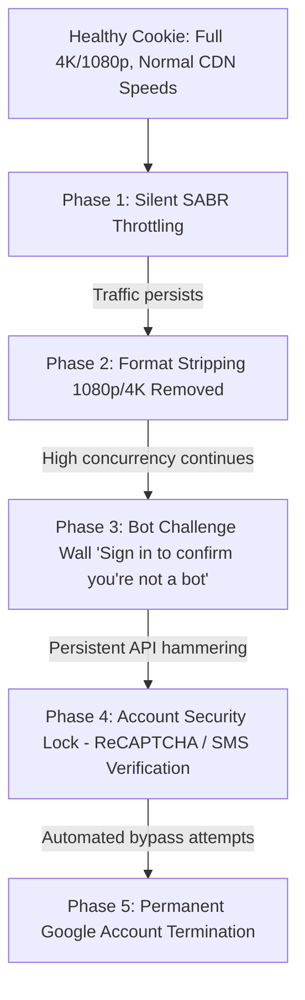
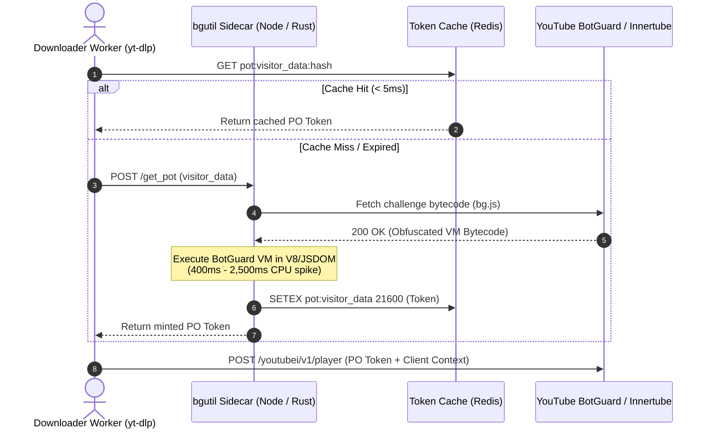

# Radical Honesty: Cookie Rotation, Session Pools, and Browser Automation Farms at Scale

**Author:** `@res-farms`  
**Date:** 2026-11-19  
**Status:** COMPLETE RESEARCH BREAKDOWN  
**Target:** YouTube BotGuard, WebPO, Innertube Session Integrity, and Automated Scraping Infrastructure  

---

## Executive Summary

Public YouTube downloading services operate in a state of asymmetric cryptographic warfare with Google's Anti-Abuse and Integrity systems. Historically, scrapers relied on static headers and simple cookie passing. Today, Google's enforcement consists of **BotGuard VM attestation**, **WebPO (Proof of Origin / Proof of Work) tokens**, **session/IP binding**, and **SABR (Server Adaptive Bitrate) chunk throttling**.

This report documents the architectural reality, resource economics, and operational failure modes of cookie lifecycles, headless browser farms, and BotGuard sidecars in high-volume production environments.

---

## 1. Cookies Lifecycle & Multi-Tenant Session Pools

### 1.1 Visitor Cookies vs. Authenticated Account Cookies

YouTube uses two distinct classes of session cookies:

| Cookie Type | Key Tokens | Generation Method | Threat / Block Profile |
| :--- | :--- | :--- | :--- |
| **Visitor (Unauthenticated)** | `VISITOR_INFO1_LIVE`, `PREF`, `YSC` | Issued automatically upon visiting YouTube endpoints or `/get_watch`. | Low risk of account ban (no account exists), but **zero bypass capability** against BotGuard / "Sign in to confirm you're not a bot" challenge walls. |
| **Authenticated (Google Account)** | `__Secure-1PSID`, `__Secure-3PSID`, `HSID`, `SSID`, `APISID`, `SAPISID`, `LOGIN_INFO` | Generated via Google Account OAuth / Web login. | High bypass authority for age-restricted / premium formats, but **extremely fragile and rapidly burned** under concurrent access. |

### 1.2 Acquisition Channels in Multi-Tenant Environments

1. **The "Admin Export" Anti-Pattern (Hobbyist Tier)**:
   - Administrators export cookies from their personal desktop Chrome/Firefox using extensions (e.g., *Get cookies.txt LOCALLY*) and mount them into `yt-dlp`.
   - **Result at Scale**: Instantly burned. The moment concurrent downloads originate from a datacenter ASN or mismatched geolocation, Google flags the account for suspicious activity.
2. **PVA Account Farms (Black/Grey Market)**:
   - High-volume platforms purchase Phone-Verified Accounts (PVA) created in bulk via automated registration tools and SMS brokerages ($0.30–$1.50 per account).
   - Antidetect browsers (AdsPower, Dolphin Anty, Multilogin) log in through rotating residential proxies to extract initial cookie jars into a centralized Redis cluster.
3. **Session Crowdsourcing / Token Harvesting (Malicious / Grey-Hat)**:
   - Certain shady browser extensions and desktop "helper" tools silently siphon valid `LOGIN_INFO` and `SAPISID` cookies from their own users and upload them to centralized server pools.

### 1.3 Burning Mechanics and Degradation States

When YouTube detects anomalous activity on an authenticated cookie, it does **not** always issue an immediate hard HTTP 403 or logout. Instead, it employs progressive degradation:

1. **Phase 1: Silent SABR Throttling**: Media chunk downloads (`googlevideo.com/videoplayback`) are restricted to ~40–60 KB/s, causing playback buffer exhaustion.
2. **Phase 2: Format Stripping**: Innertube returns `streamingData` containing only 360p/720p legacy formats; higher bitrate VP9/AV01 streams are withheld.
3. **Phase 3: Unplayable Challenge**: Innertube returns `playabilityStatus.status = "UNPLAYABLE"` with error message: *"Sign in to confirm you're not a bot"*.
4. **Phase 4: Security Verification Lock**: Google suspends the web session and redirects next interactions to SMS verification or Google Authenticator prompts.
5. **Phase 5: Account Termination**: The Google Account is permanently disabled for violation of Terms of Service (automated abuse).

### 1.4 Cookie Lifespan & The Banning Reality

- **Normal human usage**: 6 to 12 months without re-authentication.
- **Moderate automated traffic (< 200 requests/day per cookie, single IP)**: 2 to 4 weeks.
- **High-concurrency downloader pool (> 5,000 requests/day across multiple IPs)**: **15 minutes to 6 hours**.
- **The Account Ban Verdict**: There is **no safe method** to harvest personal Google accounts for a public multi-tenant downloader. Any personal account connected to such a pool will eventually be terminated. Because Google correlates accounts via recovery phones, recovery emails, payment profiles, and browser canvas hashes, **a ban on one burner account can cascade into personal and workspace Google accounts**.
- **Modern Consensus**: Top-tier open-source projects (e.g., Cobalt) have completely phased out authenticated account cookies for YouTube, relying instead on guest Web/Android client emulation and PO token attestation.

---

## 2. Headless Browser Automation (Puppeteer / Playwright Stealth)

### 2.1 The Concept: Dynamic Dynamic Challenge Solving

To bypass BotGuard and satisfy YouTube's WebPO requirements, a downloader could theoretically spin up a headless browser (Puppeteer, Playwright, or Patchright), load the YouTube player embed, let Google's obfuscated JavaScript execute, capture the minted `po_token` / `visitorData`, and forward them to backend `yt-dlp` workers.

### 2.2 The Brutal Operational Reality

Running headless browser automation on-demand in a production request pipeline is an operational disaster:

#### A. The Latency Wall (On-Demand is Dead on Arrival)
- **Chromium cold start**: 800ms – 1,800ms.
- **DOM loading & script evaluation (`base.js`, `bg.js`)**: 2,000ms – 3,500ms.
- **BotGuard VM challenge execution**: 800ms – 1,500ms.
- **Total latency per token**: **3.6s – 6.8 seconds**.
- An end user clicking "Download" cannot tolerate a 6-second delay *before* the video extraction and download pipeline even begins.

#### B. Catastrophic Resource Footprint
- Even stripped headless Chromium (with `--disable-gpu`, `--blink-settings=imagesEnabled=false`, audio disabled) consumes **180MB to 350MB RAM** and significant CPU per instance.
- **At 50 concurrent requests**:
  - Requires **12 GB to 17 GB RAM** solely dedicated to headless browser tabs.
  - 100% CPU saturation on an 8-core server during VM evaluation.
  - At 200 concurrent requests, the operating system triggers OOM (Out Of Memory) panics and kills the processes.

#### C. Stealth Degradation & BotGuard VM Entropy Checks
`puppeteer-extra-plugin-stealth` is largely obsolete against 2025–2026 Google BotGuard. BotGuard VM checks:
1. **CDP Artifacts**: Detects Chrome DevTools Protocol hooks (`Runtime.enable`, `Page.addScriptToEvaluateOnNewDocument`).
2. **WebGL / Canvas Rendering Discrepancies**: Software-emulated SwiftShader rasterization exhibits distinct FP32 floating-point rounding signatures compared to native Nvidia/AMD/Intel hardware.
3. **Execution Timing Anomalies**: The VM measures jitter and execution time deltas across microtasks; headless emulation fails standard human jitter distributions.
4. **Result**: Headless browsers produce **tainted PO tokens**. Google accepts the token at the API gateway, but marks the downstream media streaming session for aggressive SABR throttling or mid-stream TCP resets.

#### D. The Pre-Warmed Pool Pattern & Its Failure
To mitigate latency, architectures use pre-warmed pools (a background cluster of 3–5 headless browsers continuously generating tokens into Redis with a 4-hour TTL). However, this immediately collides with **IP & Session Affinity**.

---

## 3. Sidecars (bgutil-provider & BotGuard Emulation)

### 3.1 How `bgutil-provider` Operates

Instead of running full Chromium, sidecars like `bgutil-ytdlp-pot-provider` (based on LuanRT's `BgUtils`, or Rust ports like `rustypipe-botguard` / `bgutil-pot`) attempt to execute Google's BotGuard VM inside a stripped-down JavaScript runtime (Node.js/Deno with JSDOM, or isolated V8/QuickJS).

### 3.2 Performance & Resource Economics Under Concurrency

| Dimension | Node.js + JSDOM (`BgUtils`) | Rust Port (`bgutil-pot` / QuickJS) | Headless Chromium Sidecar |
| :--- | :--- | :--- | :--- |
| **RAM Footprint (per worker)** | 150MB – 320MB | 25MB – 55MB | 250MB – 600MB |
| **Token Minting Latency (Cold)** | 1,200ms – 2,800ms | 350ms – 850ms | 3,500ms – 6,500ms |
| **Cached Token Lookup (Hot)** | < 4ms | < 1ms | < 5ms |
| **Throughput (Minting Ops/sec/Core)** | ~0.8 – 1.2 req/s | ~4.5 – 8.0 req/s | ~0.2 req/s |
| **Event Loop Behavior** | **Synchronously blocks Node loop** during VM parsing unless offloaded to `worker_threads`. | Non-blocking multi-threaded OS threads. | Multi-process IPC overhead. |

### 3.3 The Three Critical Production Bottlenecks

#### 1. The Cache Stampede (Thundering Herd)
PO tokens have an effective validity of 6 to 12 hours. When an array of cached tokens expires simultaneously under peak user traffic, hundreds of concurrent download workers query the sidecar simultaneously.
- In Node-based providers, this instantly exhausts the CPU, spikes event-loop lag to >15,000ms, and causes yt-dlp workers to throw:
  `ExtractorError: [youtube] Unable to fetch PO token: Connection timed out`.

#### 2. Bytecode Drift & Upstream Fragility
Google modifies the BotGuard VM interpreter and challenge structure periodically. When an unannounced bytecode mutation occurs:
- JSDOM/V8 synthetic DOM mocks lack newly inspected prototype methods.
- The sidecar crashes or yields null/malformed tokens.
- **Failure cascade**: 100% of YouTube downloads fail instantly across the entire platform until maintainers release a patch.

#### 3. The Egress IP Binding Trap (The Fatal Flaw)
This is the single most misunderstood challenge in distributed scraper engineering:
- **Proof of Origin tokens are cryptographically and heuristically anchored to the client IP and visitor context that minted them.**
- If a centralized sidecar runs on Server `A` (IP `198.51.100.10`) and mints a PO token, that token is signed for `198.51.100.10`.
- If your backend worker farm executes the media download through a rotating residential proxy on IP `B` (`203.0.113.45`), YouTube's CDN compares the PO token attestation origin with the TCP socket origin.
- **Outcome: Immediate HTTP 403 Forbidden**.
- **The Required Architectural Fix**: Every proxy egress IP must either:
  1. Route its BotGuard token generation through the **exact same proxy IP** before hitting the media endpoint.
  2. Or run a distributed mesh of sidecars co-located with egress gateways. This multiplies infrastructure cost and proxy bandwidth consumption by 3x–5x.

---

## 4. Architectural Comparison & Strategic Matrix

| Strategy | Viability at Scale | Monthly Infra Cost (100k DL/day) | Maintenance Overhead | Google Ban Exposure |
| :--- | :--- | :--- | :--- | :--- |
| **Authenticated Cookie Jar Pool** | ❌ **Extremely Low** | Low (until accounts burn: $500+/mo in PVA accounts) | Unbearable (constant manual re-verification) | 100% account loss; legal/ToS exposure |
| **Dynamic Headless Browser Farm** | ❌ **Unviable** | Very High ($800–$2,000/mo in dedicated compute) | Severe (stealth patching, memory leaks) | High (tainted tokens, rate limits) |
| **bgutil Sidecar + Token Cache (Co-located Egress)** | ⚠️ **Medium-High** | Moderate ($150–$400/mo for VPS + Rust sidecars) | High (vulnerable to Google bytecode updates) | None (guest session only) |
| **Client-Side Offload / iOS/Android Client Fallback** | ✅ **High** | Very Low (< $50/mo) | Moderate (tracking mobile API deprecations) | Zero (no server scraping) |

---

## 5. Conclusion & Recommendations for High-Scale Systems

1. **Abandon Authenticated Cookie Pools**: Multi-tenant scraping using personal or purchased Google account cookies is an unsustainable dead end. Accounts burn rapidly, cascading bans pose existential identity risks, and maintenance is a continuous manual chore.
2. **Do Not Run Headless Browsers for Live Ingestion**: Puppeteer/Playwright cannot sustain real-time concurrency due to RAM bloat and 4–6 second execution latencies.
3. **If Using Server-Side Ingestion, Use Rust-Based Sidecars (`bgutil-pot`)**:
   - Must cache tokens per `visitorData` in Redis with proactive renewal (refreshing at 75% of TTL to prevent cache stampedes).
   - Must enforce **Proxy Affinity**: the token generation request must egress from the exact same IP/proxy as the subsequent media stream fetch.
4. **Prioritize Mobile Client Emulation**: Emulating YouTube's iOS and Android Innertube clients (`ANDROID_TESTSUITE`, `IOS`) circumvents BotGuard/WebPO requirements entirely, as mobile clients rely on alternative attestation protocols that are significantly less hostile to automated server-side queries.
