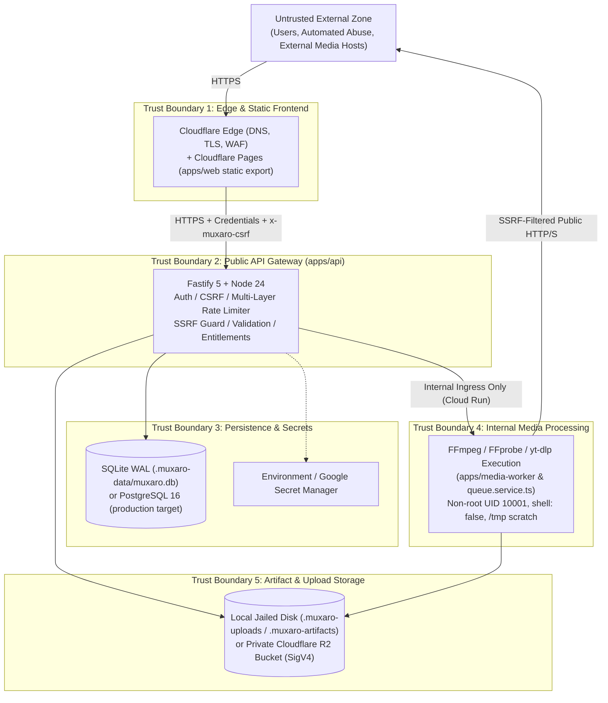

# MUXARO Security Threat Model (STRIDE)

**Scope:** `apps/web`, `apps/api`, `apps/media-worker`, `packages/entitlements`, `packages/source-adapters`, `security/`  
**Methodology:** STRIDE (Spoofing, Tampering, Repudiation, Information Disclosure, Denial of Service, Elevation of Privilege)  
**Compliance Statement:** This document describes MUXARO's implemented engineering security controls and internal verification tests. MUXARO does **not** hold SOC 2, ISO 27001, or external third-party penetration test certifications.

---

## 1. System Trust Boundaries

---

## 2. High-Value Assets

| Asset | Sensitivity | Compromise Impact |
| :--- | :---: | :--- |
| **Cloud Metadata & Host Credentials (`169.254.169.254`, `metadata.google.internal`)** | Critical | IAM token theft, container escape, cloud account compromise |
| **Server Signing & Encryption Keys (`SESSION_SECRET`, `SIGNED_TOKEN_SECRET`, `MFA_ENCRYPTION_KEY`)** | Critical | Forged download URLs, TOTP secret decryption, HMAC bypass |
| **User Credentials, Sessions & MFA Secrets (`users`, `user_sessions`, `user_mfa`)** | High | Account takeover, unauthorized admin access |
| **Media Worker Compute & Disk (`/tmp/muxaro-scratch`, FFmpeg processes)** | High | Remote code execution (RCE), compute exhaustion DoS, billing spikes |
| **User Uploads & Output Artifacts (`uploads/`, `processed/`, `playlists/`)** | High | Cross-tenant data exposure (IDOR), path traversal reads |
| **Quota & Credit Ledger (`quota_reservations`, `credit_ledger`, `reward_sessions`)** | Medium | Free-tier bypass, rewarded ad credit fraud, resource abuse |

---

## 3. STRIDE Threat Matrix & Implemented Controls

### 3.1 Spoofing (S)

| Threat | Attack Vector | Implemented Control | Code Reference |
| :--- | :--- | :--- | :--- |
| **Session & Token Forgery** | Guessing or tampering with session cookies or download tokens | 256-bit CSPRNG session tokens stored only as SHA-256 hashes in `user_sessions`; HMAC-SHA256 signed download tokens verified with `crypto.timingSafeEqual` | `apps/api/src/middleware/auth.middleware.ts`, `apps/api/src/services/token.service.ts` |
| **Account Enumeration** | Probing `/auth/login`, `/auth/register`, `/auth/forgot-password` to discover valid emails | Generic anti-enumeration responses + dummy-hash constant-time verification on missing accounts | `apps/api/src/services/auth.service.ts` |
| **Client IP Spoofing** | Sending fake `X-Forwarded-For` headers to bypass IP rate limits | `extractClientIp()` ignores `X-Forwarded-For` unless `TRUST_PROXY=true` | `apps/api/src/services/ratelimit.service.ts` |
| **Rewarded Ad Spoofing** | Calling API directly claiming an ad was watched (`{ rewarded: true }`) | Client requests never grant credits; only ECDSA-SHA256 signed Google Ad Manager SSV callbacks with HMAC-bound `custom_data` grant credits | `apps/api/src/services/rewards.service.ts` |

### 3.2 Tampering (T)

| Threat | Attack Vector | Implemented Control | Code Reference |
| :--- | :--- | :--- | :--- |
| **FFmpeg Command Injection** | Injecting `;`, `|`, `` ` ``, `$()`, or newlines into filenames or parameters | Strict `shell: false` execution (`spawn`/`execFile`), `SHELL_METACHARS_REGEX` checks, codec/preset/bitrate allowlists, `-protocol_whitelist file,crypto,data`, `-nostdin` | `security/src/ffmpeg-sanitizer.ts`, `apps/media-worker/src/process/sanitizer.ts` |
| **Path Traversal & Symlink Escape** | Supplying `../`, `..\`, or symlinks targeting `/etc/passwd` | `sanitizeFilename()`, `validateSafePath()` (canonicalization + `fs.realpathSync()` jail check), `StorageService.assertSafeObjectKey()` | `security/src/ffmpeg-sanitizer.ts`, `apps/api/src/services/storage.service.ts` |
| **Prototype Pollution & Schema Tampering** | Sending `__proto__`, `constructor`, `prototype`, or >50 playlist items | `hasPrototypePollution()` / `sanitizeObject()` checks, strict bounds (`maxItems <= 50`, `duration <= 14400s`, URL `<= 2048` chars) | `security/src/validation.ts` |
| **Cross-Site Request Forgery (CSRF)** | Triggering state changes from third-party origins using victim cookies | `SameSite=Lax` cookies + `verifyCsrf()` requiring `x-muxaro-csrf` header to match both server session `csrf_token` and `muxaro_csrf` cookie | `apps/api/src/middleware/auth.middleware.ts` |

### 3.3 Repudiation (R)

| Threat | Attack Vector | Implemented Control | Code Reference |
| :--- | :--- | :--- | :--- |
| **Unlogged Admin or Abuse Actions** | Denying account suspension, settings changes, or brute-force attempts | Append-only `admin_audit_logs` (before/after diffs) and redacted `security_events` table; strictly read-only admin audit endpoints | `apps/api/src/services/admin.service.ts`, `apps/api/src/services/ratelimit.service.ts`, `apps/api/src/routes/admin.ts` |
| **Credit Ledger Tampering** | Disputing credit awards, consumption, or expiry | Immutable append-only `credit_ledger` entries (`REWARD_GRANTED`, `CREDIT_RESERVED`, `CREDIT_CONSUMED`, `CREDIT_RELEASED`, `ADMIN_ADJUSTMENT`, `CREDIT_EXPIRED`) | `apps/api/src/services/entitlements.service.ts` |

### 3.4 Information Disclosure (I)

| Threat | Attack Vector | Implemented Control | Code Reference |
| :--- | :--- | :--- | :--- |
| **Cross-Account IDOR** | Guessing job, batch, session, or artifact IDs belonging to another user | Non-sequential Base32 IDs (`MXR-*`, `MXB-*`, `MXJ-*`) + mandatory `isOwnerOrAdmin()` ownership verification on every resource & download endpoint; violations logged as `IDOR_ATTEMPT` | `apps/api/src/services/request-identity.ts`, `apps/api/src/routes/download.ts` |
| **Secret & PII Leakage in Logs / Errors / Analytics** | Stack traces, raw URLs, Bearer tokens, or emails leaking into logs or GA4 | `redactSensitiveData()` scrubs sensitive keys, emails, Bearer tokens, and URL paths; IPs truncated to `/24` (IPv4) or `/48` (IPv6); `app.setErrorHandler` masks 5xx internals; `sanitizeAnalyticsParams()` strips PII before GA4 | `apps/api/src/services/ratelimit.service.ts`, `apps/api/src/app.ts`, `apps/web/lib/analytics.ts` |
| **Server-Side Request Forgery (SSRF)** | Reading internal VPC services or cloud IMDS via external URL inspection | Dual-layer SSRF guard blocking private IPv4/IPv6 CIDRs, obfuscated IPs, restricted ports, metadata hostnames, and DNS rebinding via IP pinning | `security/src/ssrf-guard.ts`, `packages/source-adapters/src/ssrf-filter.ts` |

### 3.5 Denial of Service (D)

| Threat | Attack Vector | Implemented Control | Code Reference |
| :--- | :--- | :--- | :--- |
| **API & Auth Flooding** | High-volume inspection, job creation, login stuffing, or duplicate payload bursts | Multi-layer hybrid sliding-window + token-bucket rate limiter, progressive login backoff (never permanent DoS lockout), duplicate mutation flood detector | `apps/api/src/services/ratelimit.service.ts`, `apps/api/src/app.ts` |
| **Disk / Memory Exhaustion via Uploads** | Uploading >2 GB files or buffering uploads into Node RAM | Streaming `Transform` byte counter (`MAX_UPLOAD_BYTES = 2 GiB`, returns `413 ERR_FILE_TOO_LARGE`), 10 MB JSON `bodyLimit`, 60-minute multipart TTL cleanup, 60-minute artifact auto-delete | `apps/api/src/routes/media.ts`, `apps/api/src/services/queue.service.ts` |
| **Compute Exhaustion & Queue Starvation** | Flooding heavy 4K/8K transcodes or stalling lower-tier users | 6 isolated TurboFlow queue classes with independent concurrency caps, 3-tier weighted fair scheduler with anti-starvation aging, process timeouts (`540s–600s`), Cloud Run `maxScale: 2` | `apps/api/src/services/queue.service.ts`, `infra/cloudrun/*.yaml` |

### 3.6 Elevation of Privilege (E)

| Threat | Attack Vector | Implemented Control | Code Reference |
| :--- | :--- | :--- | :--- |
| **Unauthorized Admin Access** | Regular user or admin without 2FA invoking `/api/v1/admin/*` | `requireAdminMfa` middleware requires `role === 'admin'` AND `user.mfaEnabled && session.mfaVerified` (RFC 6238 TOTP) AND valid CSRF token | `apps/api/src/middleware/auth.middleware.ts`, `apps/api/src/routes/admin.ts` |
| **Container Privilege Escalation** | Compromising FFmpeg process to gain root in container | Dedicated non-root UID/GID `10001:10001` (`muxaro` / `mediaworker`), `/usr/sbin/nologin`, `/usr/bin/tini` PID 1, `muxaro-worker` set to `ingress: internal` | `infra/Dockerfile.api`, `infra/Dockerfile.worker`, `infra/cloudrun/worker-service.yaml` |

---

## 4. Known Residual Risks & Hardening Backlog

1. **PostgreSQL Runtime Driver Migration:** While `infra/migrations/002_account_rewards_analytics.sql` defines PostgreSQL tables, `apps/api/src/db/database.ts` currently executes against Node 24's local `node:sqlite`. Multi-replica Cloud Run deployments require migrating runtime DB calls to a shared PostgreSQL pool (and Redis-backed distributed rate limiting via `REDIS_URL`) before scaling `maxScale > 1` across stateful workloads.
2. **Cross-Subdomain Cookie Domain:** `apps/api/src/middleware/auth.middleware.ts` currently sets cookies without an explicit `Domain` attribute (host-only). Production deployments spanning `muxaro.app` and `api.muxaro.app` must either proxy `/api/v1/*` on the same origin (`muxaro.app`) or add configurable `Domain=.muxaro.app` support.
3. **Production Secret Provisioning:** Default development secrets in `apps/api/src/config.ts` are rejected by `validateProductionConfig()` when `NODE_ENV=production`, requiring operators to inject 32+ byte CSPRNG secrets via Google Secret Manager.
