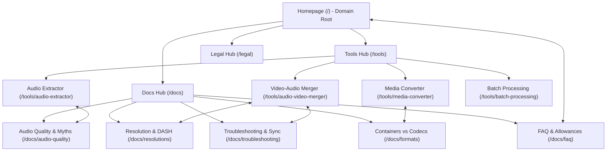

# MUXARO — Internal Linking Topology & PageRank Distribution Map

> **Classification:** Internal Link Equity & Crawl Navigation Architecture  
> **Brand:** MUXARO (`muxaro.com`)  
> **Prepared by:** Chief SEO & Organic Growth Strategist (@seodocs)

---

## 1. Internal Link Equity Graph

Search engine bots follow link paths to understand content hierarchy, semantic relevance, and page importance. MUXARO implements a **Hub-and-Spoke Topology with High-Intent Cross-Linking**:

---

## 2. Bidirectional Link Equity Matrix

| Source Page | Target Page | Primary Anchor Text | Context / Trigger | Link Equity Weight |
| :--- | :--- | :--- | :--- | :--- |
| `/tools/audio-extractor` | `/docs/audio-quality` | `lossless audio extraction guide` | Explaining why stream copy preserves bitstream fidelity | High |
| `/docs/audio-quality` | `/tools/audio-extractor` | `extract audio losslessly online` | Next step: trying direct bitstream demuxing | Very High |
| `/tools/audio-video-merger` | `/docs/resolutions` | `DASH stream separation guide` | Explaining why 1080p+ requires multiplexing | High |
| `/docs/resolutions` | `/tools/audio-video-merger` | `merge video and audio streams` | Actionable fix for disjoint streaming tracks | Very High |
| `/tools/media-converter` | `/docs/formats` | `containers vs codecs documentation` | In-depth breakdown of MP4 vs WebM vs MKV | High |
| `/docs/formats` | `/tools/media-converter` | `convert media formats online` | Interactive conversion widget link | Very High |
| `/docs/troubleshooting` | `/tools/audio-video-merger` | `align and merge out-of-sync streams` | Solution for presentation timestamp drift | High |
| `/docs/troubleshooting` | `/status` | `check real-time service status` | Investigating network timeouts or worker load | Medium |
| `/docs/faq` | `/credits` | `check your rolling 24-hour credits` | Direct link to user quota countdown dashboard | High |

---

## 3. Breadcrumb Hierarchy Standard

Every sub-page declares an explicit breadcrumb hierarchy rendered visually above the `<h1>` and encoded into JSON-LD `BreadcrumbList`:

1. **Tools:** `Home > Tools > [Tool Name]`
   - Example: `https://muxaro.com/` $\to$ `https://muxaro.com/tools` $\to$ `https://muxaro.com/tools/audio-extractor`
2. **Docs:** `Home > Docs > [Topic Name]`
   - Example: `https://muxaro.com/` $\to$ `https://muxaro.com/docs` $\to$ `https://muxaro.com/docs/formats`
3. **Legal:** `Home > Legal > [Policy Name]`
   - Example: `https://muxaro.com/` $\to$ `https://muxaro.com/legal` $\to$ `https://muxaro.com/legal/dmca`

---

## 4. Anchor Text Governance Rules

- **Contextual Relevance:** Every internal link must exist within the body copy surrounded by semantically relevant keywords.
- **No Orphan Pages:** Every page on `muxaro.com` is discoverable within a maximum of **two clicks** from the homepage.
- **Rel Attributes:** All internal links omit `rel="nofollow"` to ensure free circulation of internal PageRank equity throughout the domain.

---

*Authored by Chief SEO & Organic Growth Strategist for MUXARO.*
